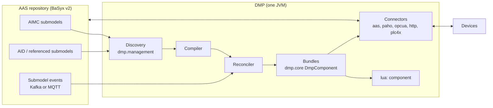

# aas-camel-dmp — Design Specification

> **Status (2026-10-15):** describes the implemented single-process Java DMP.
> Open and deferred work is tracked in [PLAN.md](PLAN.md). Earlier designs
> (Python management node, per-asset containers, file configuration, JSONata,
> BaSyx v1) are retired; see the git history before `8fe9c46` for their text.

## 1. Purpose and scope

The DMP (data-mapping processor) connects asset protocols to Asset
Administration Shells. It:

1. reads AIMC (Asset Interfaces Mapping Configuration 2.0) submodels from an
   AAS v3 repository and the AID (Asset Interfaces Description) and other
   submodels they reference;
2. compiles each mapping into Camel routes that acquire values from sources
   (MQTT, OPC UA, HTTP, Modbus/BACnet via PLC4X, AAS elements), transform them
   with a sandboxed Lua script, and write them to sinks;
3. serves AAS Operation invocations delegated by BaSyx and forwards them to the
   device over HTTP, OPC UA Methods or MQTT 5 request/reply;
4. keeps routes current from repository events.

Out of scope: the AAS server, model authoring and registration (`aas-model`,
`Registration_Service` in the parent workspace), simulators, and the knowledge
graph.

## 2. Terminology

| Term | Meaning |
| --- | --- |
| AID | Submodel describing a device's protocol interfaces: `EndpointMetadata` (base URI, content type, security) and `InteractionMetadata` (properties, actions, events with `forms`). |
| AIMC | Submodel (`https://admin-shell.io/idta/AssetInterfacesMappingConfiguration/2/0/Submodel`) listing `MappingConfigurations`: Sources, Sinks and a Lua `Transformation`. |
| Mapping | One `MappingConfiguration`. Identity is (AIMC id, mapping identity). |
| SourceId / SinkId | Keys of the Lua input table and the Lua result table. |
| Bundle | The set of Camel routes, endpoints and registry bindings owned by one mapping. |
| Ordinary mapping | Data mapping: sources → Lua → sinks. |
| Bridge mapping | Mapping whose single source is an AAS Operation: caller → Lua → device action → reply. |

## 3. Architecture



| Module | Responsibility |
| --- | --- |
| `dmp.management` | Repository client, AIMC/AID wire projection, mapping compiler, fingerprints, reconciliation, Kafka/MQTT event routes, value feed |
| `dmp.core` | Route model, execution-policy route creator, fan-in/fan-out, payload assembly, affordance validation, bundle lifecycle |
| `dmp.camel-lua` | `lua:` component and sandbox |
| `dmp.camel-aas` | AAS element read/write, `aas-event:` source, Operation bridge |
| `dmp.camel-paho`, `-opcua`, `-http`, `-plc4x` | Connectors reachable from AID bindings, including the DMP Camel components (§9) |
| `dmp.component` | Executable, settings, `/health`, `/management/status`, image |

## 4. Discovery and lifecycle

### 4.1 Startup discovery (need-to-know)

1. List AIMCs with `GET /submodels?semanticId=<AIMC>` (paged), or read the IDs
   in `DMP_MANAGED_AIMC_IDS` directly.
2. Collect every Source/Sink ModelReference. Its first key names a submodel; the
   remaining keys are the idShort path.
3. Read each referenced submodel once:
   - an AID whole (recognised by an ID ending in `AssetInterfacesDescription`,
     otherwise by the `$metadata` semanticId);
   - any other submodel as `$metadata` plus the referenced subtrees, or whole
     when referenced at more than eight paths. A missing path is confirmed
     against the whole submodel before the mapping is blocked.
4. Shells are never read. References still containing `{aas_id}` macros block
   their mapping; models are expected to be fully resolved at authoring time.

This is the only full discovery. There is no periodic repair.

### 4.2 Events

- Transport: `DMP_MANAGED_EVENT_TRANSPORT=kafka` (BaSyx `aas-events`/
  `submodel-events` topics, committed offsets) or `mqtt` (BaSyx
  submodel-repository MQTT feature, two persistent QoS 1 subscriptions:
  `sm-repository/<repo>/submodels/+` and `…/submodels/+/submodelElements/#`).
- Parsing is lazy: event identity first; payload and AAS4J parsing only for
  relevant events.
- Relevance filter: events on unreferenced submodels, unreferenced elements and
  value-only updates of referenced Properties are dropped. A relevant event
  re-reads only that submodel and recompiles only the dependent AIMCs. An
  unknown submodel is read once to see whether it is a new AIMC.
- A failed pass retries with backoff (`DMP_MANAGED_RETRY_INTERVAL_MS`, doubling
  up to 16×).
- An MQTT broker that drops the persistent session loses the events of that gap
  until the next restart.

### 4.3 Value feed

AAS Property sources without a `PollingInterval` are event-sourced: each
change event carries the new value. Values come from a separate feed (Kafka:
per-process consumer group at the latest offset, no commits; MQTT: clean
session), started only while such sources exist, so a backlog is never replayed
to devices. Such a source has no value until its first change event.

### 4.4 Compilation and installation

- Each mapping compiles to one plan with a fingerprint over its effective
  inputs. An unchanged fingerprint keeps the installed bundle.
- A changed mapping is staged as an inactive candidate and swapped in under a
  generation fence; in-flight requests on the old bundle drain, and calls during
  the swap receive "unavailable". Device actions are never retried or replayed.
- A mapping that cannot compile is `blocked` with a category; it does not affect
  siblings. `/management/status` reports per-mapping state (`installed`,
  `blocked`, `stale`, `failed`), generation and fingerprints; repository IDs
  appear only as SHA-256 tokens.
- `/health` is 200 once the initial scan completed and the event transport is
  connected (Kafka: assigned on every control topic).
- There is no lease or cluster coordination: run exactly one DMP per set of
  mappings.

## 5. Data model

Accepted template versions: AIMC 2.0 and its bug-fix release 2.1 (same
semantic ID; 2.1 list members carry no idShort, so an unnamed mapping is
identified by its position), and AID 1.1 and 1.2 (1.2 adds the SNMP and CAN
bindings, not yet supported, and optional fields such as
`EndpointMetadata/protocolVersion`, which the DMP ignores). Other versions
block the mappings that reference them.

### 5.1 AIMC

```
AssetInterfacesMappingConfiguration
└── MappingConfigurations[]
    ├── DefaultPollingInterval   (optional, seconds; fallback for Read sources)
    ├── ExecutionSemantics
    │   └── TriggerSourceIds[]   (optional; SourceIds whose updates execute the mapping)
    ├── Transformation           (Blob, Lua)
    ├── Sources[]  : Source (Reference), SourceId, PollingInterval?
    ├── Sinks[]    : Sink (Reference), SinkId
    │   DMP extensions, bridge mappings only (§7):
    ├── ResponseSources[] : Source (Reference), SourceId
    ├── ResponseTransformation   (Blob, Lua)
    └── ResponseSinks[]   : Sink (Reference), SinkId
```

The IDTA template defines `DefaultPollingInterval`, `Transformation`,
`Sources` and `Sinks`. Every DMP extension (Response*,
`ExecutionSemantics`) carries a semantic id
`https://smartproductionlab.aau.dk/aimc/<Name>/1/0`; the DMP checks the
`ExecutionSemantics` id and matches the others by idShort.

Unknown fields, retired declarations (`writeDelegation`, JSONata semantic IDs,
`queryLanguage`, `executionPolicy`) and behaviour-bearing qualifiers are
rejected, not ignored.

### 5.2 AID bindings

The AID is read as IDTA AID 1.2 defines it, plus the extension of
aas-model `docs/aid-extension.md` for what AID leaves EXTERNAL or undefined
(action and event members, the form's `op` and `response`, `readOnly`/
`writeOnly`, `mqv_responseTopic`, the OPC UA event terms). No separate Thing
Description is consulted. Where AID is silent, the W3C WoT protocol bindings
apply.

A reference into AID `InteractionMetadata` selects one affordance with one
form. The form's `href` is resolved against the interface's
`EndpointMetadata.base` as RFC 3986 says (AID 1.2 Annex B): a base path ends
with `/` for relative hrefs to extend it, and an href starting with `/`
replaces it.

**Operations.** A form serves its `op` list (`hctl:hasOperationType`); without
`op` it serves the affordance's WoT TD defaults: a property is readable unless
`writeOnly`, writable unless `readOnly` and observable when `observable`; an
action is invoked; an event is subscribed. A mapping role needs an operation
the form serves:

| Mapping role | Needs | Interaction |
| --- | --- | --- |
| Source on a property | `observeproperty` or `readproperty` | Observe when the property is observable and the connector observes (MQTT, OPC UA monitored item, Modbus polling); else Read (with the effective polling interval; 5 s without one) |
| Source on an event | `subscribeevent` | Observe |
| Sink on a property | `writeproperty` | Write |
| Sink on an action | `invokeaction` | Invoke (bridge mappings only) |

An `op` value outside the WoT operation types, an unrepresented form term
(e.g. `subprotocol`, `htv_headers`, a form `security` selection) or a binding
term of another protocol blocks the mapping.

**HTTP.** The method is `htv_methodName` (mandatory in AID), else the WoT
default: GET to read, PUT to write, POST to invoke. A read is a GET poll; a
write is PUT, POST or PATCH. Bodies are JSON.

**MQTT.** The topic is the resolved `href`'s path without its leading `/`,
percent-decoded: AID writes a topic with a leading `/` as `.//topic` and the
`#` wildcard as `%23`. `mqv_controlPacket` describes the consumer (WoT MQTT
binding): `subscribe` to read and observe, `publish` to write and invoke; a
form whose packet contradicts the mapping role blocks it. An MQTT property is
read by subscription, so a source needs it observable or retained
(`mqv_retain`); a PollingInterval on it is rejected. `mqv_qos` and
`mqv_retain` apply to the subscription and the publication. An action with
`mqv_responseTopic` is an MQTT 5 request/reply (§7.1). Payloads are JSON.

Modbus follows AID 1.2 and the WoT Modbus binding; the compiler translates a
form into a PLC4X tag:

- The resolved `href` is `/{unitID}/{address}?quantity={n}`: AID writes the
  unit ID in the base (`modbus+tcp://host:port/{unitID}/`) and
  `{address}?quantity={n}` in the href; `/{unitID}/{address}` in the href
  against `modbus+tcp://host:port` resolves to the same. The address is the
  protocol address (PLC4X counts from 1, so protocol address 0 is PLC4X
  `coil:1`); with `modv_zeroBasedAddressing` false it counts from 1. PLC4X
  tag syntax in an AID is rejected.
- The memory area is `modv_entity` (Coil, DiscreteInput, HoldingRegister,
  InputRegister), else `modv_function` (readCoil, readHoldingRegisters,
  writeSingleCoil, …), else the binding's default: Coil (readCoil for reads,
  writeSingleCoil for writes). Discrete inputs and input registers are not
  writable.
- `modv_type` (xsd:boolean, short, int, long, their unsigned forms, integer,
  float, double) becomes the PLC4X data type; the quantity counts registers,
  so four registers of `xsd:int` are two values.
- `modv_mostSignificantByte`/`Word` (default true; on the form, or for all
  forms on the interface's `EndpointMetadata`) set the driver's payload
  byte order, `modv_timeout` its request timeout, the unit ID its unit
  identifier. `modv_pollingTime`, the device's maximum polling rate, is a
  source's polling interval when the AIMC gives none and a lower limit for
  the one it gives. Observing a Modbus property polls.
- Forms may declare `application/octet-stream`.

OPC UA follows OPC 10101 (the OPC UA binding for WoT):

- `readproperty`, `writeproperty`, `observeproperty` and `invokeaction` map to
  the UA Read, Write, Monitor and Call services. An observable variable is
  observed (a monitored item); otherwise it is read.
- A form names its node by the NodeId of its `href` (`/?id=<nodeId>`, `#` and
  `&` percent-encoded), else by `uav_browsePath`: an absolute path from the
  Root node (`/Root/Objects/2:Machine/2:Pressure`; qualified names
  `<namespaceIndex>:<name>`, namespace 0 without a prefix) along hierarchical
  references. AID makes `href` mandatory, so such a form carries an href
  without an id (e.g. `/`). `dmp-milo-client:` resolves the path with
  TranslateBrowsePathsToNodeIds once per client session (option
  `browsePath`).
- An observed variable is a monitored item in a subscription of its own; the
  source's `PollingInterval` sets its sampling and publishing interval (the
  IDTA AIMC text calls the interval ignored for asynchronous sources; for OPC
  UA the server samples at it). Its queue keeps short-lived values between
  two publishes.
- An action names its Method's owning Object with `uav_componentOf` on the
  action affordance (a NodeId, or a list holding one), not in the form.
- Forms may declare `application/octet-stream` (the binding's default UA
  serialization); values are decoded from the UA types either way.
- Events (a DMP extension; OPC 10101 v1.00 defines no event vocabulary) are
  event affordances (WoT EventAffordance, `aas-model` `OpcuaEvent`), consumed
  like MQTT events: the form `href` (or `uav_browsePath`) names the event
  notifier (e.g. the Server object `i=2253`), the form serves `subscribeevent` (the default). Each
  property of the event's `data` schema (an object) is one selected field:
  its `uav_eventField` browse path relative to the event (`0:ToState/0:Id`,
  `/`-separated qualified names, namespace 0 without a prefix), or its own
  name as a namespace-0 BrowseName (`Message`, `Severity`, `Time`, …). The
  affordance-level `uav_eventType` (an EventType NodeId) is the where clause,
  `OfType`, so subtypes pass. Both terms carry DMP semantic ids
  (`…/aid/OpcuaEventType/1/0`, `…/aid/OpcuaEventField/1/0`). The DMP
  subscribes with an event monitored item (select clauses relative to
  BaseEventType); each event arrives as an object of its fields (UA built-in
  values as JSON: LocalizedText → text, NodeId → string, DateTime → ISO-8601)
  and a field the event lacks is `null`. `PollingInterval` sets the
  publishing interval.

Event affordances of every binding carry the WoT EventAffordance terms
(`subscription`, `data`, `dataResponse`, `cancellation`); the DMP consumes
`data` and rejects the other three, since MQTT and OPC UA subscriptions carry
no such payloads.

### 5.3 AAS element bindings

| Reference target | Interaction |
| --- | --- |
| Operation as Source | Accept invocation (bridge mapping) |
| Property Source with `PollingInterval` | Read (`GET …/$value`) |
| Property Source without one | Observe through the value feed (§4.3) |
| Collection/list Source | Read; requires an explicit interval |
| Property/collection Sink | Write (`PATCH …/$value`) |
| Operation as Sink | Rejected (no chained actions) |

The Property `valueType` (or list `valueTypeListElement`) types the values Lua
receives and returns. Property values are never part of the configuration.

### 5.4 Granularity (`valuePath`)

A reference may end at a whole affordance (coarse: Lua receives the whole
decoded payload) or continue into its payload schema (fine: the compiler pins a
JSON Pointer, RFC 6901, and the route extracts that member before Lua). On
sinks, a pointer places the SinkId value into the outgoing payload. Sinks that
address members of the same affordance are assembled into one payload and one
send; distinct affordances stay separate sends; AAS children are separate
writes. Per-element fan-out over arrays is not supported.

## 6. Ordinary mappings

```
Sources[] ──► latest-value cache ──► aimc_main(sources) ──► per-SinkId dispatch ──► Sinks[]
```

- Each source has its own consumer (Observe) or poller (Read) and contributes
  its decoded, `valuePath`-extracted value to a per-mapping latest-value cache.
- The mapping evaluates when a triggering source updates **and every source has
  delivered at least once**. Without `TriggerSourceIds` every source triggers;
  with it, only the listed ones do and the rest refresh the cache only.
- Lua runs once per evaluation against an immutable snapshot of the cache.
- Sinks are dispatched sequentially in authored order; each starts from restored
  headers and body. A SinkId missing from the Lua result is an error for that
  sink; it is not silently skipped.
- `DMP_AFFORDANCE_VALIDATION=ON` validates inbound values and outbound payloads
  against the AID schemas (invalid inbound values are dropped, invalid outbound
  payloads are not sent); `REPORT` only logs; `OFF` (default) skips validation.
- No timeout, partial evaluation or debounce exists; the only timing knob is the
  authored polling interval.

## 7. Bridge mappings (Operation delegation)

1. BaSyx delegates an Operation to the URL in its `invocationDelegation`
   qualifier. The DMP serves `POST` on that URL's path (by convention
   `/operations/{aasIdShort}/{skill}`). An Operation without exactly one
   absolute delegation URL blocks its mapping.
2. The mapping's sources are the Operation and, optionally, further AAS
   elements (fan-in, §7.1). Its sinks bind the Operation 1:1 to one affordance
   of the device's AID: the action of the same skill, or one whole property
   (§7.1). Operation input, output and InOut
   variables have unique idShorts and are one of:
   - a **Property** with a supported `valueType` → a typed scalar;
   - a **SubmodelElementCollection** of such variables (members uniquely
     named) → an object keyed by member idShort;
   - a **SubmodelElementList** → an array. Every member must have the list's
     `typeValueListElement` (and, for Properties, `valueTypeListElement`).
     The first authored member defines the member shape; an empty list is
     only allowed for Properties with a `valueTypeListElement`.
   Nesting is unrestricted. Other element types (Range, File, Blob, …) block
   the mapping. Lua receives inputs and InOut values typed by their declared
   `valueType`s. The reply is rebuilt from the declared variables: list
   members get no idShort (AASd-120), list metadata and semantic IDs are
   copied, members the declaration lacks are dropped, and a value whose shape
   contradicts the declaration fails with `DMP_RESPONSE_MAPPING_FAILED`.
3. The request Lua is mandatory and turns the caller's input variables (and
   the fanned-in AAS values, keyed by their SourceIds) into the device command
   or the value to write.
4. The command leg is synchronous per protocol:
   - **HTTP**: the HTTP response is the reply;
   - **OPC UA**: Method call; arguments are matched by name to the server's
     `InputArguments`/`OutputArguments`, outputs must match the declared basic
     type and rank;
   - **MQTT 5**: `paho-mqtt5-inout:` publishes with ResponseTopic and
     CorrelationData; the first reply on the declared reply topic that carries
     the request's correlation data is the terminal reply, whatever its
     payload. A device publishes progress or other messages without that
     correlation data. Timeout 30 s.
   - **PLC4X (Modbus, BACnet)**: no actions; a tag write reports no result.
5. The reply is validated, optionally transformed by `ResponseTransformation`,
   and returned to the caller as its output variables. Without response Lua a
   native normalized reply passes through.
6. `ResponseSinks` that address AAS elements receive their SinkId value
   asynchronously through a bounded Wire Tap (2 workers, 128 queued jobs, abort
   on overflow). These writes are best effort and never change the caller's
   reply.
7. Failures return structured errors: `DMP_DEVICE_TIMEOUT` (504),
   `DMP_DEVICE_ERROR`/`DMP_DEVICE_TRANSPORT_ERROR` (502),
   `DMP_COMMAND_VALIDATION_FAILED`, `DMP_RESPONSE_VALIDATION_FAILED`,
   `DMP_RESPONSE_MAPPING_FAILED`, `DMP_OPERATION_VALIDATION_FAILED`,
   `DMP_CONNECTOR_CONFIGURATION_ERROR` (500). Nothing is retried.

### 7.1 Scope: one affordance, one terminal answer

A bridge mapping binds the Operation 1:1 to one affordance:

- an **action**, whose terminal reply is its result: an OPC UA Method, an
  MQTT 5 request/reply, an HTTP request;
- a **property**, which the call writes. The call returns once the connector
  acknowledges the write: the PLC4X write response, the OPC UA Write status
  (`dmp-milo-client:` waits for it and converts a scalar to the variable's
  DataType), the HTTP response; MQTT only confirms that the broker accepted
  the publish (QoS 1/2). The reply is the written value: ResponseSources
  select it (or members of it). Without a ResponseTransformation the call
  answers with no outputs. A rejected write answers 502
  `DMP_DEVICE_ERROR`; nothing is fanned out.

On the AAS side the mapping fans in and out:

- **Fan-in.** Further Sources that address AAS elements are read once per
  invocation, before the request Lua, and passed to it under their SourceIds
  next to the Operation's variables. A failed read answers
  `DMP_DEVICE_TRANSPORT_ERROR`. A read returns the element as the repository
  serves it (a Property's value as lexical text).
- **Fan-out.** ResponseSinks receive the response Lua's values for their
  SinkIds (§7 item 6).

The DMP
does not model multi-step device sequences (write parameters, trigger, poll a
status, read a result, reset, e.g. Modbus coils or OPC UA Programs); the
higher-level control orchestrates them through ordinary mappings.

- **Concurrency.** Each invocation is correlated by its protocol (an OPC UA
  Call, MQTT 5 correlation data, an HTTP exchange), so invocations of the
  same action run concurrently; there is no busy guard.
- **Timeouts.** A call waits for its terminal reply up to the connector's
  timeout (30 s for MQTT, OPC UA and HTTP). BaSyx delegation is
  synchronous and has no timeout of its own, so the invoking client's HTTP
  timeout must exceed the connector's.
- **Late replies.** When the timeout expires the call fails, but the device
  may still carry out the action; a later reply is dropped. Idempotency and
  compensation are the higher-level control's concern.

**Route.** Content Enrichers make the fan-in reads; a Content Enricher sends
the command through a command route that clears the caller's headers and runs
the connector's invocation steps (`SynchronousInvocationAdapter.configureInvoke`)
or the property write; a Wire Tap makes the AAS response writes.

## 8. Lua contract

```lua
function aimc_main(sources)          -- sources keyed by SourceId
    return { sink1 = sources.a + sources.b }   -- result keyed by SinkId
end
```

- Lua arrives only as AIMC Blobs and is compiled once per mapping in memory
  (`LuaCompiledSource`); identical sources share one compiled prototype.
- Each invocation gets fresh, isolated globals. Inputs are converted from
  decoded Java values (maps, lists, scalars, null markers, bytes) to native Lua
  values; results are converted back. No JSON text crosses the boundary; Lua
  may call `json.encode`/`json.decode` explicitly.
- Integral numbers stay integral (a Lua double with an exact integral value
  becomes a `Long`, up to 2^53−1).
- Sandbox: base functions, `math`, `table`, `string`, `json`, `os.clock`. No
  `io`, other `os`, `require`/`load*`/`dofile`, `debug`, `luajava`, `package`,
  `coroutine`.
- Guards: CPU budget per invocation via instruction-count hook (default 2 s), a
  maximum script size, and the contract checks (`aimc_main` exists, result is a
  table). There is no per-script memory cap; the JVM heap (`-Xmx`, default
  512 MB in the image) is shared by all mappings.

## 9. Connector capabilities

| Binding | Implemented | Not implemented |
| --- | --- | --- |
| AAS | Read, Observe (events), Write, Accept invocation | Operation sinks |
| OPC UA (Milo) | Read (Read service), Observe (monitored items), Events (event monitored items, DMP extension), Write, Invoke (Method) | Custom/structured datatypes, condition refresh and acknowledgement |
| MQTT 5 | Observe (subscribe), Write (publish), Invoke (request/reply) | Read; MQTT 3.1.1 |
| HTTP | Read (poll), Write, Invoke | Observe, inbound requests other than Operations |
| PLC4X (Modbus, BACnet) | Read, acknowledged Write of one tag per affordance | Invoke (a tag write reports no result) |

Data-plane MQTT clients are one per endpoint; their credentials are bound in
the Camel registry per bundle and referenced by name in URIs.

Where an upstream Camel component lacks a behaviour the DMP needs, the DMP
ships a component that extends it under its own scheme (registered through
`META-INF/services/org/apache/camel/component/<scheme>`); routes use it like
any component, and the upstream component stays usable unchanged:

| Scheme | Extends | Adds |
| --- | --- | --- |
| `dmp-plc4x:` | camel-plc4x | acknowledged writes and checked reads (failures raise instead of being logged or read as `{}`); the body is the tag value |
| `dmp-milo-client:` | camel-milo client | a Method producer that answers with the Call's result (camel-milo 4.22 drops it); a consumer whose monitored item has its own subscription and a sample queue (camel-milo shares one subscription per server, created with the first endpoint's publishing interval, and keeps only the latest sample); event monitored items with an EventFilter (options `eventFields`, `eventType`; camel-milo has only data-change filters); a Write producer that waits for the server, fails on a Bad status and writes scalars as the variable's DataType (camel-milo ignores the status) |
| `paho-mqtt5-inout:` | camel-paho-mqtt5 | MQTT 5 request/reply with correlation; owns its reply consumer and publish producer |

Connector invocation steps (`SynchronousInvocationAdapter.configureInvoke`)
remain for argument and reply mapping (HTTP, OPC UA, MQTT); a PLC4X action
trigger is the `dmp-plc4x:` producer itself.

## 10. AAS interaction log

Optional (`DMP_AUDIT_INFLUX_URL`). Every AAS-side interaction becomes one
InfluxDB point:

| Measurement | Recorded when | Tags | Notable fields |
| --- | --- | --- | --- |
| `aas_read` | AAS element poll | `submodel`, `path`, `outcome` | value, `durationMs`, `error` |
| `aas_event` | Change event used as a source value | `submodel`, `path`, `eventType` | value, `eventId`, `eventTime` |
| `aas_write` | AAS element write (including response sinks) | `submodel`, `path`, `outcome` | value, `durationMs`, `error` |
| `aas_invoke` | Operation call accepted | `submodel`, `path`, `skill`, `restPath`, `aas`, `caller` | input values, `invocation` |
| `aas_reply` | Operation answered or failed | as `aas_invoke`, plus `outcome` | `invocation`, `httpStatus`, `errorCode`, `durationMs` |
| `dmp_mapping` | Mapping state, fingerprint or category changed | `aimc`, `mapping`, `state` | `generation`, fingerprints, `category` |

- Values use one field per type (`value_num` as float, `value_bool`,
  `value_str`, `value_json` for objects and arrays, `value_null`), because
  InfluxDB fixes a field's type per measurement.
- Recording never blocks or fails the data flow: points go to a bounded
  in-memory queue; a full queue drops the point. One writer thread sends
  batches in line protocol; unreachable/5xx/408/429 are retried with backoff,
  other 4xx batches are dropped as rejected. Counters (`queued`, `written`,
  `dropped`, `rejected`, `lastSuccess`, `lastError`) appear under `audit` in
  `/management/status`. On shutdown the queue is flushed for up to 3 s.
- The log is the DMP's own view: AAS changes made by other clients are not in
  it. Lost points are counted, not marked in the series.
- Points carry write-time timestamps (ns); two points of the same series with
  the same timestamp would overwrite each other in InfluxDB.

## 11. Security

- Lua blobs are untrusted: sandbox, CPU budget, size limit.
- Secrets (repository authorization, Kafka SASL, MQTT credentials) come from
  environment variables and are never logged or exposed in status.
- Repository access is read-only (GET); the DMP never writes models.

## 12. Decisions

| ID | Decision |
| --- | --- |
| ADR-001 | Lua engine is LuaJ 3.0.1 (pure Java). |
| ADR-002 | Plain Apache Camel JVM process in Docker, not Camel K. |
| ADR-003/004 | Lua input/output are tables keyed by SourceId/SinkId of decoded values; JSON encoding belongs to connectors. |
| ADR-005 | Sandbox, CPU budget and JVM heap bound; no per-script memory cap. |
| ADR-007 | Normalize at the protocol boundary; Lua is protocol-agnostic. |
| ADR-009/026 | Camel 4.22, Java 21. |
| ADR-011 | Lua comes only from AIMC Blobs. |
| ADR-014 | Coarse/fine references via `valuePath`, symmetric on sources and sinks. |
| ADR-017 | Mapping-scoped entity identities; raw SourceId/SinkId reach Lua. |
| ADR-019 | References are anchored at the submodel they name; no fallback to another AID. |
| ADR-020 | One fixed execution rule per mapping (§6); no authorable execution policy. |
| ADR-022 | Operation delegation: the Operation is the source, an AID action is the sink. |
| ADR-023 | Variables/Parameters are plain Properties; references address the element itself. |
| ADR-024 | Optional `TriggerSourceIds`; acquisition mode comes from declared capability. |
| ADR-025 | Connector capabilities are explicit per interaction (§9). |
| ADR-027 | Single Java process; Python management node, per-asset containers and file configuration removed (2026-10-15). |
| ADR-028 | Need-to-know discovery and event-only lifecycle; no periodic repair (2026-10-15). |
| ADR-029 | REST path comes from the Operation's `invocationDelegation` URL; shells and `{aas_id}` expansion are not used. |

Retired: ADR-006 (file-loaded scripts), ADR-008/012 (one DMP per asset),
ADR-010 (Kafka-only eventing), ADR-013 (Python management node), ADR-015
(JSONata), ADR-018 (timer/event fan-in split), ADR-021 (instance attribution and
local-AID pins).

## 13. Provenance and licensing

- Fork of [eclipse-basyx/basyx-databridge](https://github.com/eclipse-basyx/basyx-databridge)
  (MIT). Derived files keep their MIT headers; the project stays MIT.
- AIMC/AID semantics: IDTA submodel templates (CC BY 4.0) — attribute and
  indicate modifications.
- This is a derivative work, not an official Eclipse BaSyx component.
