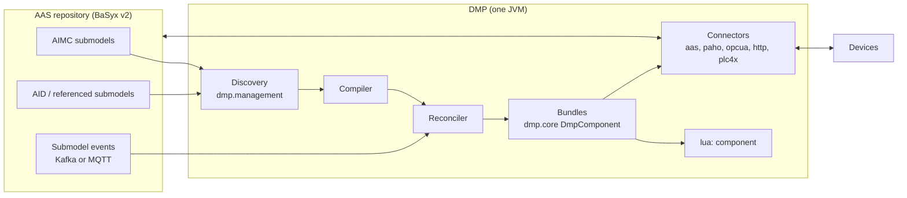

# aas-camel-dmp — Design Specification

> **Status (2026-10-15):** describes the implemented single-process Java DMP.
> Open and deferred work is tracked in [PLAN.md](PLAN.md). Earlier designs
> (Python management node, per-asset containers, file configuration, JSONata,
> BaSyx v1) are retired; see the git history before `8fe9c46` for their text.

## 1. Purpose and scope

The DMP (data-mapping processor) connects asset protocols to Asset
Administration Shells. It:

1. reads AIMC (Asset Interfaces Mapping Configuration 2.0) submodels from an
   AAS v3 repository and the AID (Asset Interfaces Description) and other
   submodels they reference;
2. compiles each mapping into Camel routes that acquire values from sources
   (MQTT, OPC UA, HTTP, Modbus/BACnet via PLC4X, AAS elements), transform them
   with a sandboxed Lua script, and write them to sinks;
3. serves AAS Operation invocations delegated by BaSyx and forwards them to the
   device over HTTP, OPC UA Methods or MQTT 5 request/reply;
4. keeps routes current from repository events.

Out of scope: the AAS server, model authoring and registration (`aas-model`,
`Registration_Service` in the parent workspace), simulators, and the knowledge
graph.

## 2. Terminology

| Term | Meaning |
| --- | --- |
| AID | Submodel describing a device's protocol interfaces: `EndpointMetadata` (base URI, content type, security) and `InteractionMetadata` (properties, actions, events with `forms`). |
| AIMC | Submodel (`https://admin-shell.io/idta/AssetInterfacesMappingConfiguration/2/0/Submodel`) listing `MappingConfigurations`: Sources, Sinks and a Lua `Transformation`. |
| Mapping | One `MappingConfiguration`. Identity is (AIMC id, mapping identity). |
| SourceId / SinkId | Keys of the Lua input table and the Lua result table. |
| Bundle | The set of Camel routes, endpoints and registry bindings owned by one mapping. |
| Ordinary mapping | Data mapping: sources → Lua → sinks. |
| Bridge mapping | Mapping whose single source is an AAS Operation: caller → Lua → device action → reply. |

## 3. Architecture



| Module | Responsibility |
| --- | --- |
| `dmp.management` | Repository client, AIMC/AID wire projection, mapping compiler, fingerprints, reconciliation, Kafka/MQTT event routes, value feed |
| `dmp.core` | Route model, execution-policy route creator, fan-in/fan-out, payload assembly, affordance validation, bundle lifecycle |
| `dmp.camel-lua` | `lua:` component and sandbox |
| `dmp.camel-aas` | AAS element read/write, `aas-event:` source, Operation bridge |
| `dmp.camel-paho`, `-opcua`, `-httppolling`, `-plc4x` | Connectors reachable from AID bindings |
| `dmp.camel-kafka`, `-activemq`, `-hono`, `-sql`, `-jsonjackson` | Connector components without an AID binding (kept, unreachable from the compiler) |
| `dmp.component` | Executable, settings, `/health`, `/management/status`, image |

## 4. Discovery and lifecycle

### 4.1 Startup discovery (need-to-know)

1. List AIMCs with `GET /submodels?semanticId=<AIMC>` (paged), or read the IDs
   in `DMP_MANAGED_AIMC_IDS` directly.
2. Collect every Source/Sink ModelReference. Its first key names a submodel; the
   remaining keys are the idShort path.
3. Read each referenced submodel once:
   - an AID whole (recognised by an ID ending in `AssetInterfacesDescription`,
     otherwise by the `$metadata` semanticId);
   - any other submodel as `$metadata` plus the referenced subtrees, or whole
     when referenced at more than eight paths. A missing path is confirmed
     against the whole submodel before the mapping is blocked.
4. Shells are never read. References still containing `{aas_id}` macros block
   their mapping; models are expected to be fully resolved at authoring time.

This is the only full discovery. There is no periodic repair.

### 4.2 Events

- Transport: `DMP_MANAGED_EVENT_TRANSPORT=kafka` (BaSyx `aas-events`/
  `submodel-events` topics, committed offsets) or `mqtt` (BaSyx
  submodel-repository MQTT feature, two persistent QoS 1 subscriptions:
  `sm-repository/<repo>/submodels/+` and `…/submodels/+/submodelElements/#`).
- Parsing is lazy: event identity first; payload and AAS4J parsing only for
  relevant events.
- Relevance filter: events on unreferenced submodels, unreferenced elements and
  value-only updates of referenced Properties are dropped. A relevant event
  re-reads only that submodel and recompiles only the dependent AIMCs. An
  unknown submodel is read once to see whether it is a new AIMC.
- A failed pass retries with backoff (`DMP_MANAGED_RETRY_INTERVAL_MS`, doubling
  up to 16×).
- An MQTT broker that drops the persistent session loses the events of that gap
  until the next restart.

### 4.3 Value feed

AAS Property sources without a `PollingInterval` are event-sourced: each
change event carries the new value. Values come from a separate feed (Kafka:
per-process consumer group at the latest offset, no commits; MQTT: clean
session), started only while such sources exist, so a backlog is never replayed
to devices. Such a source has no value until its first change event.

### 4.4 Compilation and installation

- Each mapping compiles to one plan with a fingerprint over its effective
  inputs. An unchanged fingerprint keeps the installed bundle.
- A changed mapping is staged as an inactive candidate and swapped in under a
  generation fence; in-flight requests on the old bundle drain, and calls during
  the swap receive "unavailable". Device actions are never retried or replayed.
- A mapping that cannot compile is `blocked` with a category; it does not affect
  siblings. `/management/status` reports per-mapping state (`installed`,
  `blocked`, `stale`, `failed`), generation and fingerprints; repository IDs
  appear only as SHA-256 tokens.
- `/health` is 200 once the initial scan completed and the event transport is
  connected (Kafka: assigned on every control topic).
- There is no lease or cluster coordination: run exactly one DMP per set of
  mappings.

## 5. Data model

### 5.1 AIMC

```
AssetInterfacesMappingConfiguration
└── MappingConfigurations[]
    ├── DefaultPollingInterval   (optional, seconds; fallback for Read sources)
    ├── ExecutionSemantics
    │   └── TriggerSourceIds[]   (optional; SourceIds whose updates execute the mapping)
    ├── Transformation           (Blob, Lua)
    ├── ResponseTransformation   (Blob, Lua; bridge mappings only)
    ├── Sources[]  : Source (Reference), SourceId, PollingInterval?
    ├── Sinks[]    : Sink (Reference), SinkId
    ├── ResponseSources[] / ResponseSinks[]   (bridge mappings only)
```

Unknown fields, retired declarations (`writeDelegation`, JSONata semantic IDs,
`queryLanguage`, `executionPolicy`) and behaviour-bearing qualifiers are
rejected, not ignored.

### 5.2 AID bindings

A reference into AID `InteractionMetadata` selects one affordance. Its form
(`href`, `op`, protocol terms such as `mqv_qos`, `mqv_retain`,
`mqv_control_packet`, `mqv_request_reply`, `mqv_response_topic`,
`mqv_reply_timeout`) and the interface's `EndpointMetadata.base` determine the
Camel endpoint. Acquisition mode follows the declared capability:

| Declaration | Interaction |
| --- | --- |
| `op=readproperty` (plus effective polling interval) | Read |
| `op=observeproperty` / event affordance / MQTT subscription | Observe |
| `op=writeproperty` | Write |
| `op=invokeaction` | Invoke (bridge mappings only) |

An MQTT subscription is never a Read; a polling declaration on it is rejected.
A Read source without an interval polls every 5 s.

### 5.3 AAS element bindings

| Reference target | Interaction |
| --- | --- |
| Operation as Source | Accept invocation (bridge mapping) |
| Property Source with `PollingInterval` | Read (`GET …/$value`) |
| Property Source without one | Observe through the value feed (§4.3) |
| Collection/list Source | Read; requires an explicit interval |
| Property/collection Sink | Write (`PATCH …/$value`) |
| Operation as Sink | Rejected (no chained actions) |

The Property `valueType` (or list `valueTypeListElement`) types the values Lua
receives and returns. Property values are never part of the configuration.

### 5.4 Granularity (`valuePath`)

A reference may end at a whole affordance (coarse: Lua receives the whole
decoded payload) or continue into its payload schema (fine: the compiler pins a
JSON Pointer, RFC 6901, and the route extracts that member before Lua). On
sinks, a pointer places the SinkId value into the outgoing payload. Sinks that
address members of the same affordance are assembled into one payload and one
send; distinct affordances stay separate sends; AAS children are separate
writes. Per-element fan-out over arrays is not supported.

## 6. Ordinary mappings

```
Sources[] ──► latest-value cache ──► aimc_main(sources) ──► per-SinkId dispatch ──► Sinks[]
```

- Each source has its own consumer (Observe) or poller (Read) and contributes
  its decoded, `valuePath`-extracted value to a per-mapping latest-value cache.
- The mapping evaluates when a triggering source updates **and every source has
  delivered at least once**. Without `TriggerSourceIds` every source triggers;
  with it, only the listed ones do and the rest refresh the cache only.
- Lua runs once per evaluation against an immutable snapshot of the cache.
- Sinks are dispatched sequentially in authored order; each starts from restored
  headers and body. A SinkId missing from the Lua result is an error for that
  sink; it is not silently skipped.
- `DMP_AFFORDANCE_VALIDATION=ON` validates inbound values and outbound payloads
  against the AID schemas (invalid inbound values are dropped, invalid outbound
  payloads are not sent); `REPORT` only logs; `OFF` (default) skips validation.
- No timeout, partial evaluation or debounce exists; the only timing knob is the
  authored polling interval.

## 7. Bridge mappings (Operation delegation)

1. BaSyx delegates an Operation to the URL in its `invocationDelegation`
   qualifier. The DMP serves `POST` on that URL's path (by convention
   `/operations/{aasIdShort}/{skill}`). An Operation without exactly one
   absolute delegation URL blocks its mapping.
2. The mapping has exactly one source (the Operation) and one sink: an AID
   action affordance of the same skill. Operation input, output and InOut
   variables have unique idShorts and are one of:
   - a **Property** with a supported `valueType` → a typed scalar;
   - a **SubmodelElementCollection** of such variables (members uniquely
     named) → an object keyed by member idShort;
   - a **SubmodelElementList** → an array. Every member must have the list's
     `typeValueListElement` (and, for Properties, `valueTypeListElement`).
     The first authored member defines the member shape; an empty list is
     only allowed for Properties with a `valueTypeListElement`.
   Nesting is unrestricted. Other element types (Range, File, Blob, …) block
   the mapping. Lua receives inputs and InOut values typed by their declared
   `valueType`s. The reply is rebuilt from the declared variables: list
   members get no idShort (AASd-120), list metadata and semantic IDs are
   copied, members the declaration lacks are dropped, and a value whose shape
   contradicts the declaration fails with `DMP_RESPONSE_MAPPING_FAILED`.
3. The request Lua is mandatory and turns the caller's input variables into the
   device command.
4. The command leg is synchronous per protocol:
   - **HTTP**: the HTTP response is the reply;
   - **OPC UA**: Method call; arguments are matched by name to the server's
     `InputArguments`/`OutputArguments`, outputs must match the declared basic
     type and rank;
   - **MQTT 5**: `paho-mqtt5-inout:` publishes with ResponseTopic and
     CorrelationData and completes on the first terminal reply on the declared
     reply topic; default timeout 30 s (`mqv_reply_timeout`).
   PLC4X tag writes are not actions; Modbus/PLC4X command invocation is rejected.
5. The reply is validated, optionally transformed by `ResponseTransformation`,
   and returned to the caller as its output variables. Without response Lua a
   native normalized reply passes through.
6. `ResponseSinks` other than the caller receive their SinkId value
   asynchronously through a bounded Wire Tap (2 workers, 128 queued jobs, abort
   on overflow). These writes are best effort and never change the caller's
   reply.
7. Failures return structured errors: `DMP_DEVICE_TIMEOUT` (504),
   `DMP_DEVICE_ERROR`/`DMP_DEVICE_TRANSPORT_ERROR` (502),
   `DMP_COMMAND_VALIDATION_FAILED`, `DMP_RESPONSE_VALIDATION_FAILED`,
   `DMP_RESPONSE_MAPPING_FAILED`, `DMP_OPERATION_VALIDATION_FAILED`,
   `DMP_CONNECTOR_CONFIGURATION_ERROR` (500). Nothing is retried.

## 8. Lua contract

```lua
function aimc_main(sources)          -- sources keyed by SourceId
    return { sink1 = sources.a + sources.b }   -- result keyed by SinkId
end
```

- Lua arrives only as AIMC Blobs and is compiled once per mapping in memory
  (`LuaCompiledSource`); identical sources share one compiled prototype.
- Each invocation gets fresh, isolated globals. Inputs are converted from
  decoded Java values (maps, lists, scalars, null markers, bytes) to native Lua
  values; results are converted back. No JSON text crosses the boundary; Lua
  may call `json.encode`/`json.decode` explicitly.
- Integral numbers stay integral (a Lua double with an exact integral value
  becomes a `Long`, up to 2^53−1).
- Sandbox: base functions, `math`, `table`, `string`, `json`, `os.clock`. No
  `io`, other `os`, `require`/`load*`/`dofile`, `debug`, `luajava`, `package`,
  `coroutine`.
- Guards: CPU budget per invocation via instruction-count hook (default 2 s), a
  maximum script size, and the contract checks (`aimc_main` exists, result is a
  table). There is no per-script memory cap; the JVM heap (`-Xmx`, default
  512 MB in the image) is shared by all mappings.

## 9. Connector capabilities

| Binding | Implemented | Not implemented |
| --- | --- | --- |
| AAS | Read, Observe (events), Write, Accept invocation | Operation sinks |
| OPC UA (Milo) | Read (Read service), Observe (monitored items), Write, Invoke (Method) | Events, custom/structured datatypes |
| MQTT 5 | Observe (subscribe), Write (publish), Invoke (request/reply) | Read; MQTT 3.1.1 |
| HTTP | Read (poll), Write, Invoke | Observe, inbound requests other than Operations |
| PLC4X (Modbus, BACnet) | Read, Write of tags | Invoke |
| Kafka, ActiveMQ, SQL, Hono, JsonJackson | Camel components only | No AID binding; Hono consumer is an incomplete prototype |

Data-plane MQTT clients are one per endpoint; their credentials are bound in
the Camel registry per bundle and referenced by name in URIs.

## 10. Security

- Lua blobs are untrusted: sandbox, CPU budget, size limit.
- Secrets (repository authorization, Kafka SASL, MQTT credentials) come from
  environment variables and are never logged or exposed in status.
- Repository access is read-only (GET); the DMP never writes models.

## 11. Decisions

| ID | Decision |
| --- | --- |
| ADR-001 | Lua engine is LuaJ 3.0.1 (pure Java). |
| ADR-002 | Plain Apache Camel JVM process in Docker, not Camel K. |
| ADR-003/004 | Lua input/output are tables keyed by SourceId/SinkId of decoded values; JSON encoding belongs to connectors. |
| ADR-005 | Sandbox, CPU budget and JVM heap bound; no per-script memory cap. |
| ADR-007 | Normalize at the protocol boundary; Lua is protocol-agnostic. |
| ADR-009/026 | Camel 4.22, Java 21. |
| ADR-011 | Lua comes only from AIMC Blobs. |
| ADR-014 | Coarse/fine references via `valuePath`, symmetric on sources and sinks. |
| ADR-017 | Mapping-scoped entity identities; raw SourceId/SinkId reach Lua. |
| ADR-019 | References are anchored at the submodel they name; no fallback to another AID. |
| ADR-020 | One fixed execution rule per mapping (§6); no authorable execution policy. |
| ADR-022 | Operation delegation: the Operation is the source, an AID action is the sink. |
| ADR-023 | Variables/Parameters are plain Properties; references address the element itself. |
| ADR-024 | Optional `TriggerSourceIds`; acquisition mode comes from declared capability. |
| ADR-025 | Connector capabilities are explicit per interaction (§9). |
| ADR-027 | Single Java process; Python management node, per-asset containers and file configuration removed (2026-10-15). |
| ADR-028 | Need-to-know discovery and event-only lifecycle; no periodic repair (2026-10-15). |
| ADR-029 | REST path comes from the Operation's `invocationDelegation` URL; shells and `{aas_id}` expansion are not used. |

Retired: ADR-006 (file-loaded scripts), ADR-008/012 (one DMP per asset),
ADR-010 (Kafka-only eventing), ADR-013 (Python management node), ADR-015
(JSONata), ADR-018 (timer/event fan-in split), ADR-021 (instance attribution and
local-AID pins).

## 12. Provenance and licensing

- Fork of [eclipse-basyx/basyx-databridge](https://github.com/eclipse-basyx/basyx-databridge)
  (MIT). Derived files keep their MIT headers; the project stays MIT.
- AIMC/AID semantics: IDTA submodel templates (CC BY 4.0) — attribute and
  indicate modifications.
- This is a derivative work, not an official Eclipse BaSyx component.
