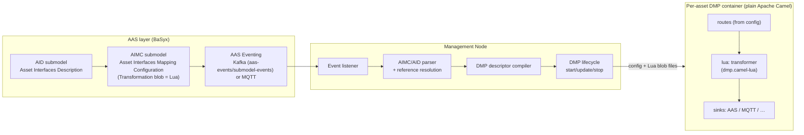
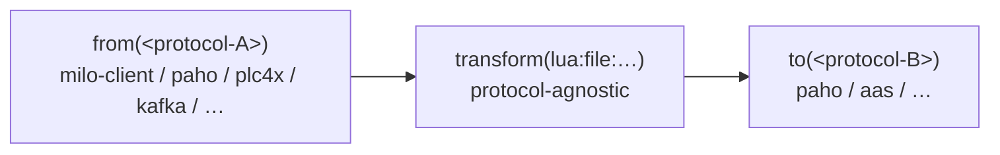
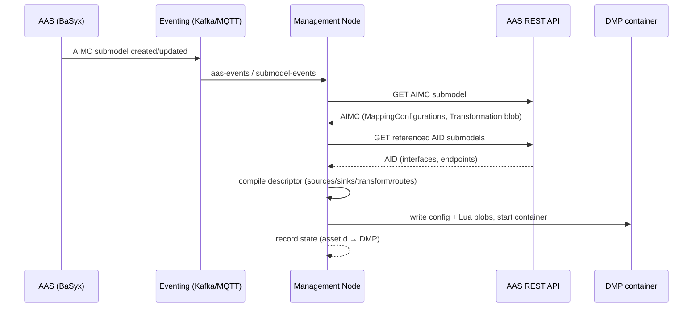

# aas-camel-dmp — Design Specification

> **Status:** The implementation spans W0–W5, but a 2026-10-11 source review reopened correctness and acceptance gaps. Local test/package/image successes do not establish completion of every workstream. W6 live staging, external asset/model prerequisites and the follow-ups recorded in `PLAN.md` remain open. **ADR-020 amendment (2026-09-15)** removed the broad execution-policy vocabulary. **ADR-024 (2026-10-06)** adds only optional trigger SourceId selection. **ADR-025 (2026-10-07)** records interaction-specific connector capability boundaries. **W4a (2026-10-09)** makes Lua the only transform engine and decoded Java values the only internal transform boundary; JSONata and Lua input/output mode selection are retired.
>
> **DMP v3 amendment (2026-09-16, in progress): operation delegation = one-MC authoring on the Operation element.** A mapping whose SOURCE reference targets an **Operation SubmodelElement** (own or cross-AAS) IS an operation delegation: sink = the native command affordance, Transformation = the request blob (replies pass through — response blob optional). The caller-facing REST surface is **derived by convention** (`POST /operations/{aas_id_short}/{action}`, the action = the owning skill's idShort, `{aas_id_short}` resolved at descriptor compile time) and carried in the bridge route's `triggerData` (`restPath`/`restMethod`) — the **two-MC request/response pairing, `interface_rest` REST-caller affordances, the `restsources.json` emission and the `RestCallerProtocols` machinery are retired**; the AID models only the device's own communication
>
> **Action-route amendment (2026-10-06):** only an Operation triggers an ACTION affordance in this scope; one Operation and one distinct ACTION affordance per route. Additional AAS sources may enrich the request only after invocation-time sampling is implemented; updates to those values never invoke the action. Request/response Lua uses the authored `SourceId`/`SinkId` keys. `ResponseSources`/`ResponseSinks` optionally map a validated device reply through one response Lua evaluation; each sink receives its own returned value on an independent asynchronous branch, while the Operation caller receives its own SinkId value. No chained ACTION response sinks. OPC UA positional Method arguments are matched by the names in server `InputArguments`/`OutputArguments`, not JSON property order or Lua indices. Property write-delegation is retired; BaSyx property changes use eventing/polling. With validation `ON`, invalid action commands are not sent and invalid correlated replies return structured DMP errors to their invoker.
>
> **Connector/trigger amendment (2026-10-06):** the core routes normalized connector capabilities and is protocol agnostic. `dmp.camel-aas` owns AAS Operation acceptance/reply conversion and AAS Property reads, event observation, writes and Operation-specific REST errors. `dmp.camel-opcua` owns Milo Method metadata, argument Variant encoding, result naming and UA status conversion. AAS binding convention: Operation Source = Accept Invocation; Property Source with a positive effective interval = Read, otherwise Observe through BaSyx events; writable Property Sink = Write; the original Operation result completes the same invocation. No AAS `op` field is added. Optional AIMC `ExecutionSemantics.TriggerSourceIds` selects which request SourceIds execute a mapping; it does not set acquisition mode. Absent semantics retains legacy any-valid-source triggering for ordinary data mappings; action routes remain Operation-triggered. Unselected source updates refresh enrichment only. Property observation requires a usable event stream; collection/list/submodel reads require an explicit positive effective interval unless their observation capability is independently declared.
> **Date:** 2026-08-19 · **Last updated:** 2026-10-11
> **Applies to:** this repository, checked out as **`aas-camel-dmp`** (renamed from `aas-camel-k-dmp`, M0)
> **Companion artifacts:** `dmp.camel-lua/` (sole Lua component + harness), `dmp.core/` (protocol-neutral fan-in/fan-out), `dmp.camel-aas/` (BaSyx binding), `dmp.camel-opcua/` (UA binding), `dmp.management/` (Java discovery/compiler/reconciliation), `management-node/` (retained legacy Python orchestrator), standalone per-protocol config catalog (`mqttdatasource.json`, `mqttdatasink.json`, `aasdatasink.json`, …)
>
> **Shared Java stack amendment (2026-10-14, clarified 2026-10-15):** parent main/E2E definitions select one managed Java `dmp` service. Startup discovers existing repository AIMCs, constructs routes in memory and repairs them from both literal `aas-events,submodel-events` control topics and periodic scans. Resource formats, Python authoring/registration and simulations are retained. Model-authored Operation qualifiers target `http://dmp:8080/operations/{aasIdShort}/{skill}` with exact case/segment encoding; registration validates, not rewrites, the URL. CCI Operation InOut variables are supported when each is a uniquely named scalar Property with a supported `valueType` (they are caller inputs and caller outputs); collection and other non-scalar InOut forms remain fail-closed. E2E skill Operations use only UA on canonical paths; MQTT timers and the four legacy synchronous Property PUT/same-Property-writeback mappings are retired by explicit user choice. Generic native MQTT/UA parameter writing, writable AID forms and Parameter variables remain. Different-Property response writeback is future design requiring explicit correlated AIMC `ResponseSources`/`ResponseSinks`, not permission to enable arbitrary ordinary response extensions. No live cutover is implied. Historical per-asset/descriptor-generation sections below describe the retained standalone/legacy architecture, not the selected managed startup.
>
> **Single Java unit amendment (2026-10-15, supersedes conflicting text below):** the DMP is deployed only as one Java process. The Python management node, per-asset DMP containers, generated descriptors, standalone file configuration (`routes.json`, `*datasource.json`, `luatransformer.json`, Lua blob files, environment-variable descriptors), the `--compare` mode and the file-configured examples are removed. Every route is built at runtime from the AAS repository and maintained from AAS/submodel events; Lua arrives only as AIMC Blobs compiled in memory. AAS endpoints speak only the AAS Part 2 API v3 (BaSyx v1/VAB removed). CCI Operation InOut variables are supported as uniquely named scalar Properties. Sections describing the Python node, descriptor generation, per-asset deployment or file-based Lua are historical.

> **Need-to-know discovery amendment (2026-10-15, supersedes conflicting text below):** shells are never read; ownership, `{aas_id}`/`{aas_id_short}` expansion, owner scopes and local-AID pins/majority discovery are removed. Published models are resolved by aas-model, so a reference still containing `{aas_id}` blocks its mapping. The Operation's REST path is the path of its BaSyx `invocationDelegation` qualifier URL; an Operation without exactly one absolute delegation URL blocks its mapping. The one full discovery lists AIMCs by semanticId and reads each referenced submodel once: an AID whole (recognised by the fixed `AssetInterfacesDescription` idShort ending its ID, else by `$metadata` semanticId), any other submodel as `$metadata` plus the referenced subtrees (whole beyond eight paths; a missing path is confirmed against the whole submodel). Retired-declaration validation covers the consumed subtree only. Afterwards only events change desired state: events are filtered against the referenced paths (value-only Property updates and unreferenced elements are ignored), a relevant event re-reads only its submodel and the dependent AIMCs, and unknown submodels are read once to detect new AIMCs. There is no periodic repair; failed passes retry with backoff. Events arrive over Kafka or the BaSyx submodel-repository MQTT feature (`DMP_MANAGED_EVENT_TRANSPORT`); both use Camel components, MQTT with two fixed persistent subscriptions (submodel events and all element events), filtered in the DMP like Kafka. Event parsing is lazy: identity first, payload and AAS4J parsing only for relevant or listened-to events. Event-sourced AAS Property values come from a separate value feed (Kafka: per-process group at the latest offset, no commits; MQTT: clean session), started only while such routes exist, so no backlog is replayed to devices; the control consumers no longer feed them. All data-plane MQTT uses `paho-mqtt5`; MQTT credentials are bound in the Camel registry per bundle and referenced by name in endpoint URIs. AAS Property sources without a PollingInterval are event-sourced through the control consumer (`aas-event:`). Mapping identity is (AIMC ID, mapping identity).

---

## 1. Purpose & Scope

This document is the implementation guideline for reworking the current Eclipse BaSyx DMP fork into the **aas-camel-dmp**: a per-asset, deployable **DMP** (DMP MQTT Platform) container that

1. consumes data from industrial protocols (OPC UA, PLC, MQTT, Kafka, HTTP, …),
2. transforms incoming data with **Lua only** in compliance with the **AIMC** transformation contract, and
3. writes transformed data to sinks (AAS submodel elements, MQTT topics, other protocols).

The DMP instances are **instantiated by a management node** that is triggered by **AAS eventing (Kafka or MQTT)** and parses the asset's **AID** and **AIMC** submodels to derive the DMP configuration, including the Lua transformation blobs.

Out of scope: the AAS server itself, the AAS registration service, ontology generation, and the knowledge graph — except where the management node interacts with them.

---

## 2. Terminology

| Term | Meaning |
|---|---|
| **AAS** | Asset Administration Shell (IEC 63278 / IDTA). |
| **AID** | **Asset Interfaces Description** submodel — describes each protocol interface of an asset (MQTT endpoints, OPC UA nodes, …) with `EndpointMetadata` and `InteractionMetadata`. |
| **AIMC** | **Asset Interfaces Mapping Configuration** submodel (IDTA `.../AssetInterfacesMappingConfiguration/2/0`) — describes how data is mapped asset→AAS or AAS→AAS: sources, sinks, and the Lua transformation. A `Source`/`Sink` reference may resolve at coarse (whole data point) or fine (one nested property) granularity — see §6.5. |
| **Coarse source** | A source resolved to the **whole AID data point** (one MQTT topic / OPC UA node). The decoded value is delivered under the `SourceId`; any nested structure is navigated inside Lua (`sources.X.Y`). |
| **Fine source** | A source resolved to **one nested property** of an AID data point. The management node pins a JSON Pointer (e.g. `$.State`) that extracts that typed value into `sources[SourceId]` at the DMP boundary. §6.5. |
| **Transformation Blob** | The Lua script stored in an AIMC `MappingConfiguration.Transformation`. Must expose `function aimc_main(sources)`. |
| **Delivery style** | How a *source* hands data to the DMP, classified **per data point from the AID** and **protocol-agnostic** (§6.1): **async** = push/event (MQTT, Kafka, observable/monitored OPC UA, `InteractionMetadata.events`), **sync** = request/response / polled (HTTP, Modbus/PLC, OPC UA reads, AAS-element). The DMP route trigger and fan-in strategy key on this, not on the protocol string. |
| **DMP** | DMP MQTT Platform — the per-asset integration container (this project). |
| **Management node** | Orchestrator that reacts to AAS events, parses AID/AIMC, and instantiates/updates/removes DMPs. |

---

## 3. Background & Current State

- This repository is a fork of the **Eclipse BaSyx DMP**, running as a
  **plain Apache Camel 4.x JVM application** (`DMPExecutable` →
  `DefaultCamelContext` → `DMPRouteBuilder`), **not** on Camel K (M5,
  ADR-002). Renamed `aas-camel-k-dmp` → **`aas-camel-dmp`** (M0); baseline
  upgraded to **Camel 4.22.x / Java 17** (M0.5, ADR-009).
- Routes are built at startup from JSON configs (`routes.json` + per-category
  config files, e.g. `luatransformer.json`, `mqttdatasource.json`).
- The sole transformation is a sandboxed **Lua** script with an
  `aimc_main(sources)` entry point (`dmp.camel-lua` → `lua:file:<path>`, §7),
  harness-verified (§8.4). JSONata runtime support and semantic-id dispatch are
  removed (W4a); existing JSONata mappings must be migrated, not interpreted as Lua.
- Java Maps/Lists/scalars are converted to isolated native Lua values and the
  returned Lua table/scalar is converted back to Java values. JSON text is used
  only at connector wire boundaries that require it; there are no Lua
  `inputType`/`outputType` settings.
- **Reference granularity (M8, ADR-014)** implements coarse/fine on source AND
  sink: a `valuePath` (JSON Pointer) disassembles the payload pre-transform and
  assembles the outgoing payload post-transform (§6.5). **Fan-in
  aggregation is native (§6.4)** — a route may aggregate several sources into
  one `sources{}` map before the transform.
- **Use-case 2 (AAS→AAS) is supported (R1–R4).** A non-interface source (any
  submodel element) becomes an **AAS polling consumer**
  (`aaspollingdatasource.json`) whose sync payloads are read at their declared
  `PollingInterval` (AIMC `DefaultPollingInterval` fallback); every poll tick
  that completes the sources set evaluates the mapping;
  AAS sinks may target **any**
  submodel (not just the asset's Variables); a mapping with **no
  Transformation** emits a passthrough identity Lua blob (SourceId↔SinkId
  linking per the AIMC template); OPC UA, Modbus/PLC and synchronous HTTP
  interfaces emit `opcuadatasource.json` / `plc4xdatasource.json` /
  `httpdatasource.json` respectively.
- The repo ships a Kafka-based AAS eventing backbone (BaSyx
  `BASYX_FEATURE_KAFKA_ENABLED`, topics `aas-events` / `submodel-events`) that
  the **management node** (`management-node/`, Python, M3) consumes (ADR-010):
  it parses AID + AIMC, pins `valuePath` per fine source/sink, selects the
  engine from the blob semantic id, and compiles the DMP descriptor (routes,
  `mqttdatasource.json`, `mqttdatasink.json`, `aasdatasink.json`,
  Lua transformer blobs).

---

## 4. Goals / Non-Goals

### Goals
- G1. The sole transformation is a **Lua** script conforming to the AIMC contract (`aimc_main`), using decoded value boundaries.
- G2. One deployable DMP container per asset, configured from AID + AIMC submodels.
- G3. A management node that reacts to AAS events and instantiates/updates/removes DMPs.
- G4. Runtime-loaded Lua scripts (blobs arrive at runtime via the AIMC submodel, not at build time).
- G5. Protocol bridging ("interface transforms") so a resource with only OPC UA can be decorated with an MQTT interface (and vice versa / any protocol pair).
- G6. A hardened Lua sandbox: module whitelist, CPU timeout, bounded memory.
- G7. A local harness + contract tests so blobs are verifiable before deployment.
- G8. Reference granularity (**coarse** vs **fine**), symmetric on **source and sink**: let an author point at an AID data point and resolve nested structure in the transform (**coarse**), or point at a specific nested property and have that resolution performed **automatically** (**fine**, via a JSON Pointer `valuePath`) — disassembly pre-transform, assembly post-transform (§6.5) — while the DMP stays a declarative, minimally-configured router (ADR-014).

### Non-goals
- NG1. Running the DMP on Camel K / Kubernetes (see ADR-002; **resolved at M5**: plain Apache Camel in Docker containers — no cluster fleet in scope).
- NG2. Replacing the AAS server or registration service.
- NG3. Guaranteeing hard per-script memory isolation inside the JVM (see §14.4).

---

## 5. High-Level Architecture



**Data flow:** A resource's AAS is described by an AID submodel (interfaces) and an AIMC submodel (mappings + Lua blob). An AAS event (new/updated AIMC) triggers the management node, which parses both submodels, compiles a DMP descriptor, and deploys a per-asset DMP container. The DMP consumes protocol data, transforms it with the Lua blob, and writes to sinks.

---

## 6. Driving Data Model: AID + AIMC

### 6.1 AID — Asset Interfaces Description

Defined by `aas_pydantic/submodel_templates/asset_interfaces_description.py`; instantiated in `AASDescriptions/Resource/configs/*.json` (e.g. `syntegonStoppering.json`).

Per interface (e.g. `interface_mqtt`):

- **`EndpointMetadata`**
  - `base` — protocol endpoint, e.g. `mqtt://192.168.0.104:1883/NN/Nybrovej/InnoLab/Stoppering`
  - `contentType` — e.g. `application/json`
  - `securityDefinitions`
- **`InteractionMetadata`** — describes data/actions on the interface:
  - `actions.<name>` with
    - `key`
    - `synchronous` (bool)
    - `forms[]` with `href`, `op`, and protocol-specific fields, e.g. MQTT: `mqv_retain`, `mqv_control_packet` (`subscribe`/`publish`), `mqv_qos`.
  - `properties.<name>` with `observable`, `forms[]` (`href`, `op`, `subprotocol`, protocol-specific fields)
  - `events.<name>` (WoT EventAffordance) — transient **push** sources, always async.

**Delivery style (async vs sync) — protocol-agnostic classification.** How a
source delivers is declared **per data point/affordance in the AID**, not by the
protocol string (this replaces any `SYNC_PROTOCOLS`-style protocol lookup; §6.4):

| Indicator (in AID) | Meaning |
|---|---|
| `InteractionMetadata.events` entry | **async** by definition (push) |
| `forms[].op` ∈ {`observeproperty`, `subscribeevent`, …observe/subscribe…} | **async** (subscription) |
| `forms[].subprotocol` ∈ {`sse`, `websub`, `longpoll`, monitored-item, …} | **async** mechanism |
| `property_name.observable = true` | observation **capability** (e.g. OPC UA monitorable) |
| `forms[].op = observeproperty` / `subscribeevent` | **Observe/Subscribe** if the connector implements it |
| source form `op = readproperty` | **Read**; use source `PollingInterval`, then mapping `DefaultPollingInterval`, then the existing device-connector default when applicable |
| sink form `op = writeproperty` / action sink `op = invokeaction` | **Write** / **Invoke** (direction and route role determine which) |
| protocol default | MQTT/Kafka → async; HTTP/Modbus/PLC/AAS → sync |

An MQTT property binding is subscription-based Observe; an explicit
`readproperty` or polling interval on it is rejected because the DMP has no
fresh MQTT Read operation. Retained messages do not change that contract.

The resolver (`resolver.py::ResolvedSource.delivery`) derives each source's
acquisition mode. A connector's `op` and protocol binding establish endpoint
capability; `PollingInterval` controls acquisition cadence. Separately, the
optional AIMC `ExecutionSemantics.TriggerSourceIds` selects which request
SourceId contributions execute a mapping. All valid contributions refresh a
per-route latest-value cache; only selected updates trigger evaluation, and
evaluation waits until all required sources have delivered. Unselected updates
refresh enrichment without executing Lua. If the SMC is absent, an ordinary
data mapping retains legacy any-valid-source triggering; a delegated action
continues to be triggered only by its Operation invocation. This adds no
`TriggerKind` enum and does not make polling interval itself the route trigger.

For AAS references the connector binding convention (not a modification to the
AAS metamodel) is: Operation Source = Accept Invocation; Property Source with
a positive effective interval = Read; Property Source without one = Observe
the exact Property through BaSyx events; writable Property Sink = Write; the
original Operation caller response completes that same invocation. AAS
collection/list/submodel reads require an explicit effective interval unless
their observation capability is independently defined. An unavailable AAS
Property event stream is a binding error, not a silent polling fallback. Caller
feedback is available for Operation triggers only; asynchronous event/poll
routes reject/log without manufacturing a REST response.

**Interpretation rule for the DMP:** every `InteractionMetadata` form that is addressable as a data point becomes a candidate **source** or **sink** endpoint. Protocol and addressing are fully derived from the AID; the DMP maps `href`/`base` + `mqv_*`/OPC-UA node identifiers onto Camel endpoint URIs (see §10).

**Reference granularity (coarse vs fine):** a `Source`/`Sink` reference may point at either an entire AID data point (`properties`/`actions` entry → its topic/node) **or** at a specific nested property within it. *Coarse* resolution delivers the whole data-point payload under the `SourceId` and leaves nested structure to the Lua blob (`sources.X.Y`); *fine* resolution additionally pins a JSON Pointer (`valuePath`, e.g. `$.State`) that auto-extracts the nested property into `sources[SourceId]` at the DMP boundary. Both modes share the same AID endpoint/topic resolution (interface → base → form `href`); they differ only in how much of the payload is delivered and who does the drill-down (see §6.5, ADR-014).

### 6.2 AIMC — Asset Interfaces Mapping Configuration (v2.0)

Defined by `aas_pydantic/submodel_templates/asset_interfaces_mapping_configuration.py`.
Submodel semantic id: `https://admin-shell.io/idta/AssetInterfacesMappingConfiguration/2/0/Submodel`.

Structure:

```
AssetInterfacesMappingConfiguration
└── MappingConfigurations[] : MappingConfiguration
    ├── DefaultPollingInterval  (optional, xs:double, seconds; fallback for synchronous/read sources)
    ├── ExecutionSemantics      (optional SMC; selects trigger SourceIds, not read/observe mode)
    ├── Transformation          (Blob, content_type text/plain)  ← THE LUA SCRIPT
    ├── Sources[] : Source
    │   ├── Source              (Reference → SubmodelElement, incl. AID InteractionMetadata)
    │   ├── SourceId            (xs:string; key used inside the Lua `sources` table)
    │   └── PollingInterval     (optional; overrides DefaultPollingInterval)
    ├── ExecutionSemantics.TriggerSourceIds[] (optional strings → request SourceIds)
    └── Sinks[] : Sink
        ├── Sink                (Reference → SubmodelElement, e.g. AAS submodel element)
        └── SinkId              (xs:string; key used in the Lua return table)
```

**Semantics (from the IDTA template):**

- *"The transformation allows for transforming incoming data before writing it to the sinks. The transformation must contain an `aimc_main(sources)` entrypoint function in Lua."*
- `SourceId` — *"unique and non-empty identifier that facilitates data access in the Lua transformation … unique with respect to the Sources-list."* → **`sources[SourceId]`**
- `SinkId` — *"unique and non-empty identifier that facilitates data writing in the Lua transformation"* → **return table keyed by `SinkId`**
- Sources/Sinks reference SubmodelElements, *"including those defined in the InteractionMetadata of AID Submodels for fetching live-data from assets."*
- *"The AIMC 2.0 is used to describe how data is mapped from asset to AAS or from AAS to AAS."*
- **Versioning (Q3):** always track the **latest AIMC** (currently **2.0**); refactor when a new version is released.

**This resolves the `sources` shape question:** `sources` is a **map keyed by `SourceId`**, and the return value is a **map keyed by `SinkId`** (JSON object both ways).

### 6.3 AIMC → DMP descriptor compilation

The management node compiles each `MappingConfiguration` into DMP config:

| AIMC element | DMP artifact |
|---|---|
| `MappingConfiguration` (one per logical mapping) | one entry in `routes.json` (or one route) |
| `Sources[].Source` + AID resolution | `datasource` endpoint (MQTT topic / OPC UA node / polling source) |
| `Sources[].Source` **nested target** (fine mode, §6.5) | a `valuePath` (JSON Pointer, e.g. `$.State`) on the datasource that auto-extracts the nested property into `sources[SourceId]` at the DMP boundary |
| `Sources[].SourceId` | the key under which the payload is placed in `sources` |
| `Transformation` (blob content — **only source**, Q2) | extracted by the management node from the AIMC submodel → written as a `.lua` file in the DMP's `queries/` (or mounted path) |
| `Sinks[].Sink` + AID resolution | `datasink` endpoint (AAS element write / MQTT publish / …) |
| `Sinks[].Sink` **nested target** (fine mode, §6.5) | a `valuePath` (JSON Pointer) on the datasink that places/reads the `SinkId` value at the target field of the outgoing payload (assembly) |
| `Sinks[].SinkId` | key in the returned object mapped to the sink |
| AID payload schema at a device source/sink | inline `schema` for the addressed value; sinks also carry `payloadSchema` for the whole affordance and an anchored `payloadGroup` identity |
| `DefaultPollingInterval` / `Source.PollingInterval` | the poll cadence of sync sources — the evaluation driver (emitted as `pollingIntervalMs` on the consumer entry) |
| source `delivery` (async/sync, from AID §6.1) | the contribution mode (ADR-020 amendment): async feeds the cache on arrival, sync is polled at its interval — both feed the same latest-value cache |

Each device affordance declares one wire payload. Sinks addressing different
members of one object payload are assembled recursively into **one** request
per affordance, after their individual transformations; distinct affordances
remain separate requests. AAS child properties remain separate writes. The
whole-affordance path remains available: Lua may copy fields or marshal the
complete payload, which is then sent as authored. Pointers and grouping do not
replace Lua transformations. The management node derives the inline JSON
Schemas from the AID mirror (including object `required` qualifiers); the DMP
does not fetch the AID at runtime.
`DMP_AFFORDANCE_VALIDATION=ON` rejects non-compliant outbound payloads and
drops non-compliant inbound values before transformation, logging violations;
`OFF` skips validation and the rollout-only `REPORT` logs without blocking.

**Per-asset, per-protocol config selection.** The descriptor emits **exactly
the datasource/datasink config files for the protocols an asset's interfaces
declare**, each from the fixed catalog:

| Protocol/kind | Config file |
|---|---|
| MQTT source | `mqttdatasource.json` |
| OPC UA source | `opcuadatasource.json` |
| PLC / SQL / HTTP / Kafka | `plc4x.json` / `sqldatasource.json` / `httpdatasink.json` / `kafkadatasource.json` |
| AAS sink | `aasdatasink.json` |
| MQTT datasink | `mqttdatasink.json` |

Operation delegations carry their REST surface in the route's
`triggerData` (`restPath`/`restMethod`, DMP v3) — no REST datasource file
exists; the bridge emits the camel-rest consumer from the derived path.

> **Operation-invocation amendment (implemented 2026-09-24): the legs are the
> Camel RequestReply EIP, hybrid on the upstream transport.** An interaction
> whose command affordance declares the MQTT 5 correlation terms
> (`mqv_request_reply` + `mqv_response_topic`) rides the **`paho-mqtt5-inout:`
> component** (in `dmp.camel-paho`). Upstream `camel-paho-mqtt5` is
> plain pub/sub — its producer is fire-and-forget (an InOut exchange completes
> immediately with a null reply) and has no reply/correlation options — so the
> component adds ONLY the InOut semantics: the producer mints a correlation,
> publishes THROUGH the upstream `paho-mqtt5:` producer derived from the
> shared transport options (the v5 ResponseTopic + CorrelationData PUBLISH
> properties ride the `CamelPahoMqtt5MsgProperties` header), registers the
> reply subscription as its own lazily-added upstream `paho-mqtt5:` CONSUMER
> route on the DECLARED reply topic (camel-jms ReplyManager style; upstream
> owns connections/reconnects/persistence), and completes the exchange on the
> first terminal reply (the PackML `State: RUNNING` progress ack is filtered
> like camel-jms intermediate replies); timeout → HTTP 504. The bridge route
> is declarative: flatten → request Lua using authored `SourceId`s → command
> prep (typed coercion + deterministic correlation stringification) →
> `to(paho-mqtt5-inout:…)` → validate reply → optional response projection/Lua
> → return the caller `SinkId` and asynchronously dispatch each other
> `ResponseSink.SinkId` value independently. Property writes do not use
> operation delegation; property updates use eventing/polling. An action
> without declared MQTT request/reply terms is not exposed. The old payload-`Uuid`
> pending bridge, reply datasource routes, and their processors are removed.
> The HTTP leg shares the declarative chain (the camel-http response IS the
> reply). On OPC UA, the DMP reads and caches the configured Method's
> server-declared `InputArguments`/`OutputArguments`; named Lua/AID values are
> reordered to the server input signature at the transport edge and returned
> values are named from the server output signature. CCI `outputVariables`
> order is used only for the caller's `OperationVariable[]` envelope. Existing
> one-String JSON Methods keep that wire contract. A missing or mismatched
> multi-argument signature fails rather than guessing from JSON insertion order.

The implementation builds fixed request and response transformer chains as
sequential Camel `to` steps; heterogeneous per-SinkId chains are compiled as
small direct routes. Device invocation still runs through adapter/template
dispatch in a Processor; removing that residual orchestration remains a W3
follow-up. A validated response is projected/transformed once, then
additional response destinations are assembled into jobs and sent
through a finite Split/Wire Tap path. Wire Tap uses a Camel-managed bounded
executor (2 workers, 128 queued jobs, Abort rejection); only enqueueing occurs
before caller completion. Extra writes are volatile and best-effort:
rejections and sink failures are logged and never change the caller's valid
reply. Deep-copy isolation of shared nested response values remains an acceptance
follow-up in `PLAN.md`. There is no durable outbox or automatic action retry. Ordinary data
fan-out remains sequential to preserve configured dispatch order; each sink
starts with restored message headers, body and exchange properties, while
payload-group assembly/completeness remains explicit domain logic. After those
branches prepare immutable dispatch jobs, a sequential Camel Split sends them
through statically compiled endpoint choices and a small outcome
AggregationStrategy. Its `onPrepare` restores nested headers/properties because
Split exchange copies are shallow. The Split does not perform payload assembly
or group completeness; those domain operations remain before dispatch.

Core response dispatch carries each selected decoded value without constructing
protocol envelopes. For an AAS response destination, the AAS bridge's connector
route wraps that value under its authored `SinkId` immediately before the AAS
endpoint, whose `valuePath` extracts the target element. Each AAS child remains
an independent write.

So an asset with only an MQTT interface ships only `mqttdatasource.json`; an
asset with an OPC UA interface ships an `opcuadatasource.json`; an asset involved
in a PLC4X→MQTT remap ships both `plc4x.json` and `mqttdatasink.json`. The DMP
reads whatever datasource/sink config files are present and builds the
corresponding Camel endpoints — the presence/absence of a per-protocol file is
the *only* protocol signal the DMP needs. "Protocol-agnostic" refers to the
transform and route model (canonical JSON, §10), **not** to the endpoint
configs, which are inherently per-protocol.

### 6.4 Symmetric route model: fan-in → transform → fan-out

The AIMC 2.0 model defines `Sources[]` and `Sinks[]` as **lists**, and the Lua
contract is already fan-in-shaped (`aimc_main(sources)` where `sources` is keyed
by `SourceId`) and fan-out-shaped (return table keyed by `SinkId`). The DMP route
model must therefore be **symmetric**: many sources may feed one transform, and
one transform may feed many sinks.

```
Sources[] ──► (aggregate by SourceId) ──► aimc_main(sources) ──► (multicast by SinkId) ──► Sinks[]
```

**Current state (implemented, M8 + delivery + gap-closure 2026-08-26):** fan-out is native and fan-in is
**implemented** — a route has a `List<String> datasinks` and the ONE
aggregation creator multicasts (or pipelines per `datasinkMappingConfiguration`),
and `RouteConfiguration.datasources` is a single `List<String>` (the legacy
singular `"datasource"` key is rejected — plural only). Every source gets its
own `from()` route, is disassembled per-source (fine `valuePath`, §6.5) and
contributes to a shared latest-per-source cache; **the fixed execution semantic
(ADR-020 amendment 2026-09-15) evaluates the mapping on any source update —
async arrival or the sync source's declared poll tick — once every SourceId has
delivered**; route-level transforms run exactly once before the multicast, and
each sink's assembly reads the shared return object (never a previous sink's
mutated body). Entity ids are scoped `{asset}_{mapping}_{id}` with raw AIMC
`sourceId`/`sinkId` pinned on each config entry (ADR-017); cross-AAS references
resolve via other assets' AIDs (ADR-019). See §8.4 #9.

**Delivery keys the contribution mode, not the protocol.** Every source is
classified `async` (push) or `sync` (polled) from the AID (§6.1): async sources
contribute on arrival, sync sources are polled at their declared interval —
both feed the same cache behind one all-sources gate.

**Extension (this section):**

1. **`RouteConfiguration.datasources` is a single `List<String>`.** The
   redundant singular `datasource` field is removed — a route declares
   multiple sources, plural only.
2. **Fan-in aggregation:** every source runs its own `from()` route that
   disassembles the payload (fine `valuePath`, §6.5) and places the latest
   value under its `SourceId` in a shared per-route cache; an update of any
   source evaluates the mapping only when **every** source has delivered at
   least once. Sync sources contribute via a dedicated poller at their
   declared interval instead of a consumer route.
3. **Symmetric AIMC selectors:** the base config classes carry the AIMC key
   each side maps to/from, mirroring each other:

   | Side | Selector | Meaning |
   |---|---|---|
   | Source | `DataSourceConfiguration.sourceId` | key under which this source's payload lands in `sources` |
   | Sink | `DataSinkConfiguration.sinkId` | key (`SinkId`) whose value this sink writes out of the return object (concrete sinks, e.g. AAS, expose it as `valuePath`) |

4. **No Lua changes required:** `aimc_main(sources)` already consumes a
   `SourceId`-keyed map and returns a `SinkId`-keyed map. The extension is
   confined to the route assembly layer (config model + route creator +
   aggregation strategy).

**Example — combine two sources in one math transform:**

```json
{
  "routeId": "combine",
  "datasources": ["station_state", "station_mode"],
  "transformers": ["combine_lua"],
  "datasinks": ["packml_state", "packml_mode"]
}
```

```lua
function aimc_main(sources)
    local state = sources["station_state"]
    local mode  = sources["station_mode"]
    return {
        ["packml_state"] = state,
        ["packml_mode"]  = mode
    }
end
```

**Aggregation semantics (implemented):** each source's latest payload is
retained per `SourceId`; the transform fires only when **every** source has
delivered at least once. Subsequent updates from any source re-evaluate the
mapping against the latest complete set; there is no timeout-based partial
emission or separate single-source creator (ADR-020). This matches the AIMC intent that a mapping may read from any
SubmodelElement in any Asset, combine the values, and write the result to any
sink.
Each valid contribution is accepted together with its immutable latest-value
trigger snapshot; Lua executes against that snapshot outside the cache lock, so
a concurrent later update cannot change an already accepted trigger's inputs.

**Unified fan-in across protocols (implemented; ADR-018 superseded by ADR-020).**
Multiple synchronous sources and sync+async mappings compile to the same route
model as async-only mappings; they are not skipped. Async sources contribute on
arrival, while each sync source is polled at its declared interval
(`pollingIntervalMs`). The shared latest-value cache gates evaluation until
every source has delivered at least once; any later update triggers evaluation
with the latest complete set. There is no timer-vs-event creator split, per-event
read of all sync sources, or bounded-barrier timeout (§6.1).
Synchronous OPC UA reads use a Camel timer followed by a native Milo producer
step; the connector adapter prepares the Read headers and normalizes the awaited
Milo result.

---

### 6.5 Source / Sink reference resolution: coarse vs fine

A `MappingConfiguration` `Source`/`Sink` is an AAS `ModelReference` — a key
path into an AID interface. Its resolution is therefore **two independent
steps that may target different granularities**:

1. **Endpoint resolution (always coarse):** the reference names an AID
   interface (`interface_*`) and a data point (a `properties`/`actions`
   entry) → the interface's `base` plus that data point's form `href` yield
   the **protocol endpoint** (MQTT topic / OPC UA node / polling source).
2. **Payload granularity (coarse *or* fine):** how much of that data point's
   incoming payload is delivered under the `SourceId`, and **who does the
   drill-down** into the nested structure.

> **The user goal.** The DMP author wants *either* mode to work with no extra
> mental model: point at the interface/data point and resolve the nesting
> inside the Lua blob (coarse), **or** point at one specific property within
> the AID interface and have that resolution done **automatically** (fine) —
> without hand-writing the traversal and without hard-coding topics in the
> DMP.

| Mode | AIMC reference | Payload delivered under `SourceId` | Drill-down done by | Blob sees |
|---|---|---|---|---|
| **Coarse** (default) | interface + data point, with no trailing schema member | whole JSON payload of that data point/topic | the Lua blob (`sources.X.Y`) | the full object |
| **Fine** | … + **nested property** (extends the reference to a JSON Pointer like `$.State`) | **only** the extracted nested property | the management node (pins `valuePath`) | the leaf value |

Both modes share the same endpoint/topic resolution; they differ only in what
is placed under the `SourceId` and who navigates the nesting. `SourceId`,
`sources` shape and the `aimc_main(sources)` / return-table contract are
identical in both modes (§7.1).

#### 6.5.1 JSON Pointer as the fine-resolution unit (source & sink)

A fine reference extends the AIMC `Source`/`Sink` reference with a
**JSON Pointer** (RFC 6901), e.g. `$.State` or `$.ProcessQueue.mode`:

```
Source  -> [ AID submodel, interface_mqtt, InteractionMetadata,
             properties, StationState ]        # coarse: topic/endpoint + whole payload
           + valuePath = "$.State"             # fine: auto-extract sources.StationState = payload.State

Sink    -> [ AID submodel, interface_rest, InteractionMetadata, ... ]
            + valuePath = "$.SetPoint"          # fine: place the SinkId value under $.SetPoint of the
                                                # constructed outgoing JSON (or extract it outright)

Action  -> [ AID submodel, interface_mqtt, InteractionMetadata,
             actions, Stoppering, input, Uuid ]  # action input is transparent: valuePath = "$.Uuid"
```

- **Public representation:** `valuePath` on the datasource entry **and** on the
  datasink entry of the DMP descriptor, applied at the per-source route boundary
  before the transform and at the sink boundary afterward. The optional Lua
  `valuePath` URI option (§8.3) remains for standalone single-source use; the
  management node does not emit it on transformer entries. This **mirrors the
  existing AAS sink `valuePath`** already used for AAS variable writes
  (§6.3/§16.7; `AASEndpoint` extracts `node.get(valuePath)`).
- **Symmetric on both sides:** a source `valuePath` performs **disassembly**
  (select the leaf out of the incoming payload *before* the transform); a sink
  `valuePath` performs **assembly** (place/write the `SinkId` value at the
  path in the outgoing payload *after* the transform). Together they form the
  JSON dis/assembly pipeline of §6.5.4.
- **Affordance identity:** two sink pointers into the same device affordance
  contribute to one object payload and one send, even when they carry distinct
  `SinkId`s. The shared `payloadGroup` comes from the anchored AID reference,
  not from coincidentally equal transport URLs.
- **Syntax (JSON Pointer, RFC 6901):** object keys (`$.State`) and **0-based
  array indices** (`$.WorkOrders[0].id`) are supported. **Non-goal:** "apply
  the transform to *every* element of an array" (per-element fan-out) is **not**
  expressed by `valuePath` and is deferred until the AID template your
  registration service emits models array payloads as a first-class type.
- **Handling convention (three sub-cases):**
  - *No `valuePath`* ⇒ coarse. Deliver the whole payload keyed by `SourceId`
    (source) / write the whole `SinkId` value (sink) — the blob drills down /
    the sink writes as-is. Current implementation.
  - *Fine source but **no** data-point anchor* ⇒ the payload is treated as
    **self-describing** (this is the OPC UA canonical form, §10.6: the whole
    body already is `{ value, status, timestamp, nodeId }`). The DMP delivers
    the payload unchanged as `sources[SourceId]` and the blob reads
    `sources.X.value` — no artificial pointer needed.
  - *Fine sink but **no** target anchor* ⇒ the sink payload is treated as
    **self-describing** — the `SinkId` value *is* the outgoing payload, so the
    sink publishes/writes it unchanged (extract-only).

#### 6.5.2 Where each part lives: management node vs DMP

The **management node** owns all AID/AIMC intelligence; the **DMP** stays a
*dumb, declaratively-configured router* (this split keeps the per-asset DMP
config minimal — the management node's whole job is to compile a simple,
self-contained config from the rich AID/AIMC submodels).

| Concern | Owner | Responsibility |
|---|---|---|
| Parse AID + AIMC | **Management node** | AID/AIMC parsers + resolver (existing). |
| Resolve reference → interface / data point / endpoint | **Management node** | Protocol, `base`, form `href` → MQTT topic / OPC UA node (existing `resolver.py`). |
| Fine-resolution **detection** (source & sink) | **Management node** | Decide coarse vs fine from the reference shape (nested key vs data-point key) and/or the AID datatype. |
| Fine-resolution **unit** (JSON Pointer) | **Management node** | Pin `valuePath` per fine source and per fine sink. **The DMP never computes this.** |
| **Disassemble** incoming payload (source `valuePath`) | **DMP** (datasource/route boundary) | If the datasource has `valuePath`, apply the pointer to the canonical payload and place the **leaf** under `SourceId`; else place the whole payload. No routing decisions. |
| **Assemble** outgoing payload (sink `valuePath`) | **DMP** (datasink/adapter) | Place/write the `SinkId` value at the sink's `valuePath` when set (AAS does this via `AASEndpoint.node.get(valuePath)`), else write it as-is. No routing decisions. |
| Navigate nested structure (coarse) | **DMP transformation blob** | `sources.X.Y` — the blob's existing responsibility. |

**Why this split is correct:**
- The DMP is spawned with a **simple config that explains all the routing** —
  `routes.json`, datasource(s) with optional `valuePath`, transformer refs,
  datasinks. All resolution intelligence (which AID property → which topic,
  and at what granularity) happened in the management node *before* the DMP
  started; the DMP only routes and applies pointers it was given.
- Fine resolution stays **single-flight per source** in the DMP (one type
  converter / one pointer application), stays inside the existing per-message
  sandbox path, and needs **no Lua changes**.
- The AID is a *runtime-data* description; the management node is the only
  component with both AID + AIMC + the RDF/JSON datatype context needed to
  interpret nested structure. Putting it there keeps that knowledge in one
  place (ADR-013 separation of concerns).

#### 6.5.3 Generation & sequencing

The management node compiles fine sources in the same pass that resolves
endpoints (no extra round-trips): for each `Source`, resolve the interface
and data point as today (§6.3), then — where the reference (or the AID
property datatype) indicates a nested property — emit `valuePath` on the
datasource entry. The DMP applies the pointer (or delivers whole payload) at
runtime. Because the DMP config is derived state, changing a reference's
granularity only regenerates the asset's config dir + restart of that DMP
(idempotent reconcile, §11.2.8).

**Out of scope (non-goals):** fine resolution does **not** imply per-nested-
property `SourceId`s or per-property split of a single MQTT message into
multiple sources — a `Source` remains **one endpoint / one `SourceId`**.
Multiple *routing* fan-ins remain the province of §6.4. If a single incoming
message must feed several *independent* `SourceId`s, that is a fan-in/routing
config decision, not a reference-granularity one.

#### 6.5.4 The JSON dis/assembly pipeline (source → transform → sink)

Fine (and coarse) resolution together form an explicit **disassembly →
transform → assembly** pipeline around `aimc_main`/the transform:

```
SourceFromAllInterfaces → SelectionOfDatapoints (disassemble, source valuePath)
  → PassToTransform → Transform → PassOutputToJsonConstruction
  → ConstructIndividualJsons (assemble, sink valuePath) → SendToSinks
```

**Disassembly (pre-transform, source `valuePath`):** each source's whole
payload is reduced to exactly the field the mapping needs (`sources[SourceId]`
= that leaf; coarse = the whole payload). This is what the DMP's
transformer/adapter does with the pinned pointer.

**Transform:** the blob receives the disassembled `sources{}` map and returns
a `{ SinkId: value }` map. The blob is **agnostic to protocol and to
disassembly/assembly** — it only ever sees/returns JSON under
`SourceId`/`SinkId` keys.

**Assembly (post-transform, sink `valuePath`):** each `SinkId` value is then
**placed into / extracted from** the outgoing payload of its sink — the DMP
writes the value at the sink's `valuePath` (e.g. a MQTT or REST sink expects
`{ "SetPoint": <v> }`, so the value lands under `$.SetPoint`; the AAS sink
already does this via `AASEndpoint.node.get(valuePath)`).

**Why this is worth it:** it keeps the **AIMC submodel in control** of *which*
fields of *which* interface payloads flow into and out of the transform,
without the blob or the DMP hard-coding payload shapes. The author selects
data points, the management node pins the pointers, and the DMP does the
mechanical placement both sides of the transformation.

**A `valuePath` is expected on every sink (and every fine source).** For each
output the mapping writes, the management node pins the sink `valuePath` that
selects the field to write (or to construct the outgoing JSON around). Coarse
sinks (write the whole `SinkId` value as the outgoing payload) omit it.

---

## 7. Transformation Blob Contract

### 7.1 Entry point

```lua
-- The ONLY required entry point:
function aimc_main(sources)
    local value_1 = sources["source1"]     -- keyed by SourceId
    local value_2 = sources["source2"]
    return {
        ["sink1"] = value_1 + value_2,      -- keyed by SinkId
        ["sink2"] = math.sqrt(value_1*value_1 + value_2*value_2)
    }
end
```

- **Input:** `sources` is a native Lua table keyed by `SourceId`; object/array/scalar/null values are converted from the decoded Java value tree (post **disassembly**, §6.5.4).
- **Output:** the return value is a Lua table keyed by `SinkId`; it is converted to a decoded Java value tree, then **assembly** places each `SinkId` value at its sink's `valuePath` (§6.5.4).
- **Lua is the standard transformation DSL**, including for field copying and
  request marshalling. For example, a request blob may copy `op.Uuid` into an
  `Occupy` command object; a different mapping may compute a distance from two
  positions via `math.sqrt(x*x + y*y)`. Fine-grained sink pointers are optional,
  not a mandate to remove a useful Lua transformation.
- The host converts decoded Java values to isolated Lua tables/scalars and converts results back. It performs dis/assembly; there is no intermediate JSON-text encoding and the blob owns any explicit `json.encode`/`json.decode` calls.
- Lua is the only transformation DSL. Unsupported engine declarations fail during compilation; the DMP never interprets an unknown/retired engine as Lua implicitly.
- **What each `sources[SourceId]` value contains is a resolution-granularity decision (coarse vs fine, §6.5):**
  - **Coarse (default):** the whole decoded value of the referenced data point/topic under that `SourceId`. Any nested structure (e.g. `sources.StationState.State`) is navigated by the blob.
  - **Fine:** only the nested property pinned by a JSON Pointer (`valuePath`, e.g. `$.State`) is present under that `SourceId`, so `sources.StationState` *is already* the extracted field. The blob should treat the value as the leaf, not re-descend.
  - Both modes are invisible to the blob *contract* (still `SourceId`-keyed Lua values); they change only the **shape of the value** delivered. The DMP never rewrites the blob — it honours whatever shape the management node resolved.

### 7.2 Available environment (sandbox whitelist)

The blob runs with a **whitelisted global environment**:

| Available | Notes |
|---|---|
| `assert`, `error`, `ipairs`, `next`, `pairs`, `pcall`, `select`, `tonumber`, `tostring`, `type` | base functions |
| `math` | full math library (satisfies the math-operator requirement) |
| `table`, `string` | (keep `string` — the upstream Python example omits it, likely an oversight) |
| `json` (custom) | optional `json.decode` / `json.encode` for advanced use |
| `os.clock` (only) | minimal clock for the timeout hook |

**Explicitly excluded:** `os` (except `clock`), `io`, `require`/`dofile`/`loadfile`/`load`, `debug` (not exposed to blobs), **`luajava`** (JVM escape hatch — must never be loadable), `package`, coroutine (unless explicitly needed).

### 7.3 Hard guards

| Guard | Policy | Mechanism |
|---|---|---|
| **CPU timeout** | default 2 s of CPU per invocation, configurable | `debug.sethook` instruction-count hook + elapsed-CPU check → raise Lua error → route failure (never a hang). LuaJ is not interruptible mid-evaluation, so the hook is the primary mechanism; verify in the harness. |
| **Memory** | no per-script cap in LuaJ | bound the JVM heap (`-Xmx`) and rely on **per-asset process isolation**: a misbehaving blob can only OOM its own DMP. Document this tradeoff vs. lupa's `max_memory`. |
| **Script size** | enforce a max blob size (e.g. 1 MB) at load | fail fast at load time |
| **Contract validation** | `aimc_main` must exist; return must be a table | validated at load; clear log message otherwise |

### 7.4 Runtime loading & reload

- Scripts are read from a **file path at runtime** (`lua:file:/etc/dmp/transform.lua`).
- **Blob origin (Q2):** the Lua content comes **only** from the AIMC `MappingConfiguration.Transformation` Blob; the management node materializes it into the DMP file. No external/reference-based blobs.
- Default `contentCache=true` with **mtime/sha-based reload** — a dropped-in replacement (e.g. updated AIMC blob mounted via config map / volume) is picked up without restart.
- Load the script once, cache the compiled chunk, evaluate per message.

### 7.5 Thread safety

- LuaJ `Globals` are **not thread-safe**.
- Use **one `Globals` per exchange** (simplest) or a small pooled set of precompiled chunks.
- The CPU timeout prevents one slow blob from starving concurrent messages.

### 7.6 Lua-only decoded-value transformation contract (W4a)

`MappingConfiguration.Transformation` is a Lua blob exposing
`function aimc_main(sources)`. Its semantic id does **not** choose an engine.
Any retired JSONata semantic id, `queryLanguage` field, or JSONata expression
is rejected during compilation; the DMP never falls back to interpreting it as
Lua. Existing mappings must be migrated before their generated descriptors are
loaded after the JSONata module is removed.

The DMP passes a fresh native Lua table/scalar tree converted from decoded Java
Maps, Lists, scalars, JSON null markers, and supported binary values. Lua table
results are converted back to Java Maps/Lists/scalars. Java Maps/POJOs are not
exposed as reflective LuaJ userdata. The fresh conversion and value snapshots
prevent a blob from mutating a source-cache entry or a sibling branch.

There is no `inputType` or `outputType` endpoint/configuration mode. Internal
routes do not serialize and reparse JSON text between FanIn, Lua, projection,
assembly, validation, and dispatch. Connectors decode JSON only when the wire
content type or their declared logical schema identifies the input as JSON;
connectors encode decoded values only when their outbound protocol requires a
JSON wire payload. A String containing JSON-looking text remains a String unless
the connector boundary explicitly decodes it. Bytes remain bytes; the existing
OPC UA single-String JSON Method remains a connector-specific legacy contract.
When a declared sink schema is JSON string, an internal connector marker asks
that protocol adapter to JSON-quote the String at egress; without that schema,
text remains opaque. MQTT decodes payload bytes in its source adapter using
content type/schema and marks the resulting Java value normalized before FanIn.

Lua authors may still explicitly call the sandbox's `json.encode` and
`json.decode`. Those calls are script behavior and are not inserted, removed,
or interpreted implicitly by the host. Empty arrays/objects, explicit null,
numeric representability and byte markers retain their tested distinctions.

---

## 8. `dmp.camel-lua` Module (Component Spec)

Lua is the sole transformation module; no parallel engine module is present.

### 8.1 Artifacts

- **Engine:** `org.luaj:luaj-jse:3.0.1` (pure Java, architecture-independent — works on `linux/amd64`, `arm64`, `arm/v7`; no JNI, no native image requirement for the interpreter path).
- **Note:** there is **no** `org.apache.camel:camel-lua` (never published to Maven Central) — this module **is** the Lua integration.

### 8.2 Classes

| Class | Responsibility |
|---|---|
| `LuaTransformerConfiguration` | `getConnectionURI()` → `lua:file:<path>` plus script/payload-selection options; no input/output mode |
| `LuaDefaultConfigurationFactory` | validates a strict Lua-only `luatransformer.json`; rejects unknown fields and retired engine/mode selectors |
| `LuaComponent` / `LuaEndpoint` | Camel `lua:` scheme; parses URI options |
| `LuaProducer` (or `Processor`) | loads script (with reload), builds sandboxed globals, converts decoded Java values to Lua values, runs `aimc_main(sources)`, and converts the result back to Java values. Its optional URI `valuePath` applies only for standalone single-source use. Compiled mapping sources are disassembled at the datasource/route boundary (§6.5); sink-side assembly is applied by the datasink/adapter (e.g. AAS `valuePath`). |
| `LuaSandbox` | whitelisted globals factory (§7.2) |
| `LuaTimeoutHook` | instruction-count + CPU-time hook (§7.3) |
| `LuaHarness` | CLI/unit runner: load blob → call `aimc_main` with sample `sources` → print result |

### 8.3 URI options

| Option | Default | Meaning |
|---|---|---|
| `timeoutSeconds` | `2` | CPU budget per invocation |
| `contentCache` | `true` | cache script; reload on mtime/sha change |
| `maxScriptBytes` | `1048576` | max blob size |
| `sourceKeys` | `body` | how to assemble `sources`: `body` → `{ ["body"]=payload }`, or comma list → `{ [key]=payload }` |
| `valuePath` | *(absent → coarse)* | Optional standalone single-source Lua disassembly: a JSON Pointer (RFC 6901, e.g. `$.State`) extracts the leaf before it is placed under a single `sourceKeys` entry. Compiled mappings instead pin `valuePath` per datasource and disassemble at the route boundary, including fan-in (§6.5); the management node does not emit this transformer option. Sink-side `valuePath` lives on the datasink/adapter. |

### 8.4 Contract test matrix (harness)

1. Load blob → assert `aimc_main` exists.
2. Call `aimc_main(sources)` with a sample map → assert returned map (this is the local harness; same blob file that runs in the DMP).
3. Infinite-loop blob → must time out (CPU hook).
4. Blob calling `os.execute` / `io` / `require` / `luajava` → must fail at load.
5. Blob returning a non-table → route failure with clear error.
6. Reload: modify blob file → next evaluation uses new code.
7. **Coarse source:** no `valuePath` → `sources[SourceId]` = whole decoded payload; nested access (e.g. `sources.StationState.State`) works in-blob.
8. **Fine source:** datasource `valuePath=$.State` → per-source disassembly places the extracted leaf (`payload.State`) under `sources[SourceId]` before the transformer; no in-blob traversal needed. Pointer on a missing path → clear route error.
9. **Both modes together** (one coarse + one fine source, §6.4 fan-in) → datasource-level disassembly yields a `sources` map mixing whole-payload and leaf values correctly, without a transformer `valuePath`.
10. **Sink assembly (fine sink):** the datasink `valuePath` places the `SinkId` value at the target field of the outgoing payload (AAS: `node.get(valuePath)`; MQTT/REST: into the constructed JSON), verifying the post-transform construction of §6.5.4.
11. **Lua-only value boundary:** generated descriptor → route factory → actual Lua execution receives and returns decoded values without modes or internal JSON-text round trips; retired JSONata semantic IDs fail compilation.
12. **Opaque inputs:** a JSON-looking String remains String and opaque bytes remain bytes unless an explicit connector contract decodes them. Explicit Lua `json.encode`/`json.decode` behavior is unchanged.

### 8.5 Config file

```json
// databridge/luatransformer.json
[
  {
    "uniqueId": "<asset>_<mapping>_transformer",
    "queryPath": "queries/<asset>_<mapping>.lua",
    "sourceKeys": "<SourceId>"
  }
]
```

Compiled routes use plural `datasources` (§6.4); every transformer reference
points at Lua. The management node emits per-source `valuePath` on the
datasource entry for fine sources (coarse sources omit it), not on the transformer.

### 8.6 Numeric contract (integral values stay integral)

LuaJ stores **every** number as a double, so a naive host round-trip would turn
an integer into a float: a PackML occupation `Uuid` of `1` left the DMP as
`1.0`, and the device then stored and echoed the float in its process queue
(`OccupationState` = `[1.0]`). `LuaJsonCodec.fromLua` therefore emits an
integral double as a `Long` (bounded by 2^53−1, the exact-integer limit of a
double); genuine fractions stay floating point, and values outside the exact
range keep their original type through the `JsonNumber` userdata. This applies
in **both** directions of the boundary — the request blob's outbound payload and
the response/derived value — so `json.encode` renders `{"a":4}` rather than
`{"a":4.0}`. Pinned by `LuaContractTest.codecKeepsIntegralNumbersIntegral`.

---

## 9. DMP Runtime & Deployment

### 9.1 Runtime: plain Apache Camel container (ADR-002)

- **Camel version:** **4.x** (Java 21) — baseline upgraded in M0.5 (ADR-009); Java 17 → 21 in ADR-026.
- **Decision (confirmed at M5):** deploy the DMP as a **plain Apache Camel JVM container** (as today via `dmp.component` → `eclipsebasyx/databridge`-style image), **not** Camel K.
- Rationale (see decision record §15):
  - Same engine, same protocol catalog, same per-message speed as Camel K.
  - Camel K's headline benefit (native image) is **blocked by LuaJ** (reflection) → JVM mode anyway.
  - Per-asset DMPs may run on edge/compose without a cluster; Camel K adds operator + cluster infra with no protocol/speed gain.
  - Camel K compiles routes at build time; our Lua blobs arrive **at runtime** — plain Camel reads all config/scripts at startup, strictly more flexible.
- **Portability:** `dmp.camel-lua` is a standard Camel component. The M5 gate (now resolved) confirmed plain containers, so no Camel K work is planned; if a cluster fleet ever materializes, the component would be reused unchanged (write YAML routes, ship jar as `-d mvn:` dependency).

### 9.2 One DMP per asset

- Each asset = one DMP container, isolated (process-level fault isolation).
- **Granularity (Q4 / ADR-012): 1 DMP container per asset hosting N `MappingConfigurations`** (multiple mappings per asset, one process).
- Config is provided at runtime via the existing config directory (`/usr/share/config` default) and Lua blob mount mechanism; the `luatransformer` environment variable can supply the Lua transformer file list.
- The config directory holds **exactly the per-protocol datasource/sink files the asset's interfaces declare** (§6.3: `mqttdatasource.json`, `opcuadatasource.json`, `plc4x.json`, `mqttdatasink.json`, `aasdatasink.json`, …) plus `routes.json` and the transformer/lua configs.
- Lua blob files are placed/mounted into the DMP at runtime (from the management node or a mounted volume/config map). JSONata blobs are retired and are rejected during descriptor compilation.

### 9.3 JVM sizing

- Set `-Xmx` (e.g. 512 MB) per DMP; this is the effective per-blob memory bound (§7.3).
- No `--native` in this iteration.

---

## 10. Interface Transforms (Protocol Bridging)

### 10.1 Principle

**Normalize at the protocol boundary.** Every Camel protocol component adapts its native payload to/from **canonical JSON**; the Lua blob is a protocol-agnostic JSON→JSON function. `aimc_main(sources)` never changes; only the `from`/`to` endpoints change per interface.



### 10.2 Example: decorate an OPC UA-only resource with an MQTT interface

- **OPC UA → MQTT (state):**
  `from("opcua-client:tcp://<asset>:4840?node=<ns>…&monitor=true") → transform(lua:file:/etc/dmp/opc2mqtt.lua) → to("paho:aas/<asset>/<State>?brokerUrl=tcp://…")`
- **MQTT → OPC UA (commands):**
  `from("paho:aas/<asset>/cmd?brokerUrl=tcp://…") → transform(lua:file:/etc/dmp/mqtt2opc.lua) → to("opcua-client:tcp://<asset>:4840?node=<ns>…")`

Bidirectional = two routes, two blobs (one per direction) — maps cleanly to the single-`aimc_main` contract.

### 10.3 Protocol coverage

The presence of an upstream Camel component does not imply that the DMP has
implemented every interaction for that protocol. The table records the binding
available in this repository; a component's theoretical capabilities are not a
DMP capability until its endpoint, payload contract, lifecycle and result/error
semantics are implemented here.

| Binding | Implemented interaction(s) | Boundary and limitation |
|---|---|---|
| AAS (`dmp.camel-aas`) | Read, Observe, Write, AcceptInvocation | Property reads are periodic; property observation requires BaSyx events. Operation REST acceptance completes the same invocation. |
| OPC UA (`dmp.camel-opcua`) | Read, Observe, Write, Invoke (Method) | Periodic Read uses Milo's Read service; Observe uses monitored items. Method invocation requires a configured Method endpoint, returns named values from server-declared output arguments, and explicitly awaits Milo's native result. |
| MQTT (`dmp.camel-paho`) | Observe (subscribe), Write (publish), conditional Invoke | Invoke is only the custom MQTT 5 correlated request/reply binding when request/reply metadata is configured. A subscription queue is not a fresh Read. |
| HTTP polling | Read (GET), Write/request, Invoke | Invoke is an outbound request/reply operation; the HTTP response is the result. Observe and inbound invocation acceptance are not supplied by this binding. |
| PLC4X (`dmp.camel-plc4x`) | Read and Write (driver/tag-dependent) | The standard binding reads/writes tags. It is not a generic action invocation; DMP Invoke is rejected rather than treating a tag-write acknowledgement as an action result. |
| Kafka | Observe/consume records | DMP currently configures a source binding only; no DMP Kafka sink or request/reply invocation binding. |
| ActiveMQ | Observe/consume destinations | DMP currently configures a source binding only; no DMP ActiveMQ sink or request/reply invocation binding. |
| SQL | Periodic query Read | The configured route is a query source; no DMP SQL Write or action invocation binding. |
| Hono | None verified as a DMP data binding | The module is an incomplete prototype; current consumer handling logs messages rather than delivering them as route contributions. Do not count it as an operational Observe binding. |
| Lua / JsonJackson | Transformation / serialization | These are processing adapters, not transport interactions. |

These terms describe responsibility, not a uniform connector class: **Read**
obtains a current value; **Write** sends a value without implying an action
result; **Observe** delivers changes/events; **Invoke** initiates an action and
returns its result; **AcceptInvocation** receives a request and completes that
same request with a result or failure. A Camel producer may implement Read,
Write or Invoke depending on its endpoint operation, and must not be labelled
"Write" merely because it uses a producer.

### 10.4 Two layers (keep distinct)

1. **Runtime data bridge** — the routes above (per message).
2. **AAS description/registration** — the resource's AAS must *advertise* the new interface (AID submodel updated, registration refreshed). This is a one-time modeling step driven by config, **not** per-message; the management node can trigger it alongside DMP instantiation.

### 10.5 Caveats

- Do not turn a consumer queue into a Read by polling it: MQTT subscriptions and OPC UA monitored items are Observe. A Read binding must issue a current-value operation, such as a UA Read service call. Poll cadence controls when a Read is issued; it does not change Observe into Read.
- PLC4X tag writes are Write, not Invoke. An action route requires a connector-native request/result contract; unsupported action bindings fail configuration validation.
- A periodic OPC UA source performs a fresh Milo Read through its producer adapter; it must not sample the consumer's monitored-item queue.
- Non-JSON/binary payloads (PLC4X structs, byte strings) are normalized by the protocol binding (§10.6) and remain typed Lua values where representable; JSON text is used only when a wire protocol requires it.
- MQTT publish/retain semantics are **taken verbatim from the AID interface spec** (`mqv_retain`, `mqv_qos`, `mqv_control_packet`), not hardcoded (Q7).
- One OPC UA session + one MQTT client per DMP; fan-in many assets via a central broker (HiveMQ in the repo).

### 10.6 Canonical payload forms (per protocol)

The existing protocol plugins define the endpoint configuration schema and URIs. They also normalize protocol messages into decoded Java values before Lua; JSON text is decoded only when the content type or declared logical schema identifies a JSON wire payload (ADR-007 — normalize at the boundary; W4a):

| Protocol | Camel component body | Normalized Java value for `sources[SourceId]` |
|---|---|---|
| MQTT (paho) | `byte[]` / String | JSON Map/List/scalar when declared JSON; otherwise opaque bytes or String |
| OPC UA (milo-client) | `DataValue` | `{nodeId: String, value: typed Variant value, status: code, timestamp: typed time}` |
| PLC4X | `PlcReadResponse` | `{tagName: typed value, ...}` |
| HTTP / SQL | component-specific | decoded body/row values; HTTP JSON uses content type/schema, SQL uses typed columns |

These bindings live in protocol adapters; blobs see Lua-native values converted
from decoded Java values, never protocol client types or Java objects as userdata.

> **M4 note (camel-milo 4.22):** the milo-client consumer puts a raw Milo
> `DataValue` on the body (the `UaMonitoredItemValue` wrapper of older
> camel-milo versions no longer exists). `dmp.camel-opcua` therefore
> ships `OpcUaCanonicalConverter` — registered Camel type converters that
> normalize the `DataValue` to a typed Java Map, auto-invoked before Lua reads
> the body — plus
> `OpcUaNormalizer` for the write direction (canonical `{ "value": … }` →
> Milo `Variant`, which the milo-client producer writes). Monitored items are
> enabled with `monitorFilterType=dataChangeFilter`. See
> `deploy/interface-transforms/` for the full bidirectional example.

---

## 11. Management / Orchestration Node

### 11.1 Trigger — AAS eventing (Kafka only, ADR-010)

- **Transport: Kafka only.** Reuse the existing BaSyx Kafka eventing backbone (`BASYX_FEATURE_KAFKA_ENABLED=true`, `SPRING_KAFKA_BOOTSTRAP_SERVERS`, topics matching `(aas-events|submodel-events)`).
- **Follow `kg-bridge` Kafka conventions** (`kg-bridge/main.py`): env vars `KAFKA_BOOTSTRAP`, `KAFKA_TOPIC_PATTERN` (default `(aas-events|submodel-events)`), `KAFKA_CONSUMER_GROUP`, `KAFKA_AUTO_OFFSET_RESET` (default `earliest`).
- The node subscribes with a consumer group, filters for **AIMC submodel create/update/delete** events (discriminator: submodel semantic id `…/AssetInterfacesMappingConfiguration/2/0/Submodel`) scoped to a resource AAS.
- **Note:** `kg-bridge` (Kafka → SPARQL ingestion) may be replaced by a route inside the DMP/management node; keep these Kafka conventions shared so either implementation can consume the same events.

### 11.2 Responsibilities

1. **Listen** for AAS events (Kafka only, ADR-010).
2. **Resolve** the affected AAS/submodel (registry/endpoint config).
3. **Fetch & parse** the AIMC submodel and referenced **AID** submodels (AAS REST API).
4. **Resolve references:** `Source`/`Sink` references → SubmodelElements, including AID `InteractionMetadata` forms → concrete protocol endpoints (MQTT topics, OPC UA nodes, polling config) **and the source granularity** (coarse vs fine, §6.5): for a fine source the node pins a `valuePath` (JSON Pointer) on the datasource.
5. **Compile the DMP descriptor** (§6.3): datasources (incl. optional `valuePath`), lua transformers (blob content → files), datasinks, routes, polling.
6. **Materialize** the descriptor into the asset's DMP config directory, write the Lua blob files.
7. **Instantiate / update / decommission** the per-asset DMP container (docker/compose in iteration 1).
8. **Reconcile:** repeat events for the same asset are idempotent (keyed by asset id; single-flight per asset).
9. **Health/failure handling:** track DMP state and log. Management/deployment
   reconciliation failures may retry with backoff; device ACTION invocations
   are never automatically retried, including after timeout or reply handling
   failures.

### 11.3 Event flow (sequence)



### 11.4 Data storage

- DMP config + Lua blobs: asset config volume/dir (source of truth = AAS submodels; config is derived state).
- Management-node registry: mapping `assetId → DMP instance state` — **in-memory** (Q6; acceptable at lab scale; externalize later if needed). Extend entries with `targetHost`, connection method, and container state for remote deployment (§11.5).

### 11.5 Remote / edge deployment (DMP on other machines)

Feasible: the DMP is a plain container and can run anywhere, including on the asset's edge device (preferred — DMP colocated with the OPC-UA/PLC source gives lower latency and independence from the central network). Mechanisms, in order of fit with ADR-002:

1. **Docker Engine API over SSH/TLS (recommended, lab scale).** Management node controls each edge's Docker daemon remotely (Java: `docker-java` over SSH or TLS), delivering image + config + Lua blobs, then create/start/stop/remove the DMP container. Requires edge reachability from the management node.
2. **Compose-over-SSH.** Ship a compose file + config dir to the edge and run `docker compose up -d` over SSH. Simplest; reuses existing compose artifacts; more brittle orchestration.
3. **Pull-based edge agent (for NAT'd / edge-unreachable devices).** A tiny agent per edge subscribes to **Kafka** deploy commands (reuses ADR-010 Kafka-only eventing) and applies the DMP locally (Docker, or systemd for the plain JVM jar). Use when the management node cannot initiate connections to the edge.
4. **K3s / KubeEdge (fleet scale, out of scope).** Scheduling/rolling updates across many edges are not current requirements — the **M5 gate resolved against it** (plain Docker containers confirmed). If a fleet ever materializes, revisit; Camel K would still run JVM mode due to LuaJ.

Considerations (all mechanisms):
- Runtime config + Lua blobs are delivered to the edge before container start; blobs remain runtime data (Q2).
- **Security:** a remotely exposed Docker daemon is effectively root — use TLS client certs or SSH keys per edge; store edge credentials in the management node config/secret.
- Registry access from the edge: private registry pull, or ship the image via `docker save` / `load`.
- Extend the in-memory registry (§11.4) with `targetHost` + connection method.

---

## 12. Performance Notes

- Per-message cost is dominated by **MQTT/OPC UA I/O + the LuaJ sandbox/transform + connector encoding + the HTTP round-trip to the AAS server** (milliseconds on LAN). No comparative Lua-vs-JSONata speed claim is made; JSONata support is retired for maintainability.
- Internal routes use decoded Java values; JSON conversion remains only at protocol wire boundaries that require it. Optional speedups if ever needed: LuaJC bytecode compilation (validate blobs), JIT Lua via GraalVM Truffle (heavy, native-incompatible — last resort).
- **Explored (2026-08-21) — sandbox sharing is NOT viable; the per-message sandbox stays.** The per-message sandbox (`LuaSandbox.createGlobals()`) is ~90 % of the transform cost (~14–27 µs/msg measured). Three sharing designs were POC-validated, and all but one are rejected:
  - *Fresh `_ENV` (LuaTable + `__index` → template):* fast (~1 µs) and isolated, but **breaks the CPU timeout completely** — `LuaClosure` only consults the debug hook when the executing env *is* a `Globals` with `debuglib` attached; a plain table sets `globals = null`, so a runaway blob runs forever (42 s observed). **Rejected.**
  - *Fresh `Globals` + `__index` → template + shared `debuglib`:* the hook fires, but `DebugLib.onInstruction` reads `globals.running.state` from the globals the DebugLib was loaded into (the template), so the state is stale and shared across threads → wrong exception (`ArrayIndexOutOfBoundsException`) and not thread-safe. **Rejected.**
  - *Fresh `Globals` + shared pre-built lib tables + per-message `DebugLib` (ThreadLocal deadline):* correct (clean `LuaError` timeout at 2001 ms, 8×20 000 msgs → 0 errors, isolated), but only **~2× faster** (7.3 vs 14.5 µs/msg) and it reintroduces subtle risks (shared `LibFunction` instances stay bound to the template globals; a blob mutating a shared lib table such as `math.foo = 1` leaks across messages). Not worth the complexity at 1–100 Hz rates — **deferred**.
  - **Conclusion:** LuaJ's debug-hook state is bound to the executing `Globals`, so a correct CPU timeout *requires* a per-message `Globals`. The per-message sandbox is therefore kept as-is.
- **Future expansion — shared MQTT subscriber per DMP (Option A).** Today each MQTT-sourced route creates its own paho client (one broker connection per route); with hundreds of routes this floods the broker with connections. Planned consolidation: ONE Eclipse Paho client per broker subscribes to the exact union of route topics (`MqttClient.subscribe(String[], int[])`) and fans each message out **asynchronously** to per-route `direct:` endpoints (per-route async dispatch so a slow route — e.g. a blocking AAS write — cannot stall the others). Routes would consume `direct:<sourceId>` instead of `paho:<topic>`; `routes.json`/`mqttdatasource.json` stay unchanged (the DMP resolves MQTT datasources internally). A cheaper variant (Option B) uses one camel-paho consumer with a `<asset-prefix>/DATA/#` wildcard + topic-based routing, at the cost of subscribing to more than needed. Not implemented — deferred (2026-08-21).
- **Benchmark requirement:** before accepting a blob or a throughput claim, measure with the harness (msg/s, p50/p95) against a mock sink; do not guess.

---

## 13. Security Model

- **Trust boundary:** Lua blobs are third-party/per-asset code extracted from AAS submodels → treated as untrusted.
- Sandbox whitelist (§7.2), CPU timeout (§7.3), script size cap, JVM heap bound + per-asset process isolation.
- No `luajava`; no `os`/`io`/`require`/`dofile`/`loadfile`.
- Blob content is validated at load time (contract) and every evaluation is guarded (timeout).
- If blobs are ever authored by parties outside the lab, consider signing/AIMC provenance checks (future).

---

## 14. Key Learnings from the Upstream Python Prototype

The primitive reference implementation (Python/lupa) is effectively a spec + harness prototype. Adopted lessons:

1. `sources` / return are **maps** — confirmed by the AIMC 2.0 template (`SourceId` / `SinkId`).
2. JSON lives in the **host**, not the blob.
3. **Whitelist** globals; strip `os`/`io`/`require` (in Java also `luajava`).
4. **CPU timeout** via `debug.sethook`-style instruction counting (lupa's `os.clock` hook ↔ LuaJ `DebugLib` count hook).
5. **Memory cap:** lupa has `max_memory`; LuaJ does not → JVM heap + process isolation (documented tradeoff).
6. Keep `string` in the whitelist (their example omits it).
7. Load once, call many times; harness = contract tests.

---

## 15. Design Decision Record

> W4a supersedes pre-2026-10-09 decision text below wherever it describes JSONata
> as supported or describes the Lua `sources` boundary as a JSON string. Current
> behavior is Lua-only with decoded internal values (§7.6); JSON serialization is
> connector-owned wire behavior.

| ID | Decision | Rationale |
|---|---|---|
| ADR-001 | Lua engine = **LuaJ** (`org.luaj:luaj-jse:3.0.1`) | Pure Java, arch-independent, on Maven Central; **no** `camel-lua` exists anywhere (never published). |
| ADR-002 | DMP deployment = **plain Apache Camel container** (Docker); Camel K rejected | Same engine/protocols/speed; native blocked by LuaJ; no cluster needed for per-asset/compose; scripts arrive at runtime (Camel K compiles at build time). **Resolved at M5 (2026-08): no cluster fleet — plain containers only.** |
| ADR-003 | `sources` = native Lua table keyed by `SourceId`; return = Lua table keyed by `SinkId`, converted to decoded Java values | Mandated by AIMC 2.0 mapping semantics; SourceId/SinkId identity remains exact. |
| ADR-004 | JSON wire encoding is handled by connectors; internal blobs are decoded-value-in/value-tree-out | Avoids JSON text round trips and preserves opaque String/byte values. W4a supersedes the former host JSON-string boundary; explicit blob `json.encode`/`json.decode` is unchanged. |
| ADR-005 | Sandbox + CPU timeout + JVM-level memory bound | Blobs are untrusted, per-asset code. |
| ADR-006 | Scripts loaded at runtime from files, cached with reload | AIMC blobs arrive at runtime; per-asset iteration without rebuild. |
| ADR-007 | Normalize at protocol boundary; Lua is protocol-agnostic | Enables interface transforms for any protocol pair with one transform contract. |
| ADR-008 | One DMP per asset (process isolation) | A bad blob/connection can only take down its own asset; aligns with event-driven instantiation. |
| ADR-009 | Camel baseline upgrade: **3.21 → latest 4.x** (4.22.x), Java 11 → **17** | 3.x is EOL; every retained Camel component used by this repo exists in 4.x (paho, jms, activemq, http, jackson, kafka, milo, plc4x, sql, support); Hono module uses Eclipse Hono client libs directly (unaffected); aligns with Camel 4.x (the M5 gate later confirmed plain containers, not Camel K); build `dmp.camel-lua` against the final version, not 3.x. |
| ADR-010 | Management-node eventing = **Kafka only**, following `kg-bridge` conventions (`KAFKA_BOOTSTRAP`, `KAFKA_TOPIC_PATTERN`, `KAFKA_CONSUMER_GROUP`, `KAFKA_AUTO_OFFSET_RESET`) | Q1; reuse existing BaSyx Kafka backbone; `kg-bridge` may be replaced by a DMP route later — keep conventions shared. |
| ADR-011 | Transformation blob is pulled **only** from the AIMC `MappingConfiguration.Transformation` Blob | Q2; single source of truth per the IDTA template; no external blob references. |
| ADR-012 | **1 DMP container per asset, N `MappingConfigurations` inside** | Q4; asset-level isolation with multiple mappings per asset in one process. |
| ADR-013 | Management node implemented in **Python** (not Java/Camel) | The management node is orchestrator glue, not a data plane — no Camel routing needed. Python is the easiest choice: the AID/AIMC pydantic models already exist in Python (`aas_pydantic` + `Registration_Service` templates); `kg-bridge` (the Kafka-convention reference, ADR-010) is Python; `docker` SDK covers container lifecycle. Boundary stays clean: Python orchestrator compiles `routes.json`/`luatransformer.json`/`.lua` blobs → starts the Java DMP container. Java is reserved for the DMP data plane. |
| ADR-014 | Reference granularity = **coarse or fine**, symmetric on **source and sink**, chosen at the **management node**; fine resolution pins a `valuePath` (JSON Pointer) on the datasource **and** the datasink; the **DMP applies it** (or delivers the whole payload / writes as-is) at the boundary — **disassembly pre-transform, assembly post-transform** (§6.5.4) | Lets the author resolve nested AID properties **automatically** (fine) or navigate them in the transform (coarse), without hard-coding topics/payload shapes in the DMP; keeps the per-asset DMP config declarative and minimal; source/sink keys remain `SourceId`/`SinkId`, now carrying decoded Java value trees rather than a required JSON string (§6.5, W4a). Fine detection + pointer derivation is AID/AIMC/datatype knowledge → management node (ADR-013 separation); the DMP applies only the resolved paths. Sink `valuePath` reuses the existing AAS sink mechanism. See §6.5. |
| ADR-015 | **Superseded by W4a (2026-10-09): Lua is the only transformation engine.** Semantic-id dispatch to JSONata is removed; stale JSONata declarations fail compilation. | The user chose one authoring/runtime contract and a decoded-value internal boundary. This is a maintainability simplification, not a comparative speed claim. |
| ADR-016 | **Shared AAS data-model package (`aas-model`).** The management node parses AID+AIMC **through the same pydantic model classes** the registration service authors them with. `aas_model` is the **entire data model package** (own git submodule): it bundles vendored `aas_pydantic` (base framework + generated IDTA templates), the project submodel templates, the resource/instantiation templates and build/schema helpers (`builder`, `id_injector`, `json_schema_aid`, `schema_parser`), `MQTTSchemas`, and the AAS-JSON↔model `_serde` bridge. Shared by `Registration_Service` (instantiation) and `aas-camel-dmp/management-node` (parsing) | Forces the generator and parser into lockstep: a model change shows up on both sides and is enforced by shared round-trip/schema tests, eliminating drift between the registration-service templates and the management node's handwritten `parsers/`. The resolver/descriptor remain the **derived-state** layer (delivery, valuePath, ref_path) reading from the shared models; the DMP stays a dumb router. See §18. |
| ADR-017 | **Scoped DMP entity identifiers.** AIMC scopes SourceId/SinkId per MappingConfiguration, but every DMP consumer resolves entity ids globally — so the compiler qualifies all uniqueIds as `{asset}_{mapping}_{SourceId}` / `{asset}_{mapping}_{SinkId}_sink`, pins the raw AIMC ids on each entity (`sourceId`/`sinkId`) for fan-in keys and sink extraction, names placeholder-idShort mappings `mapping_<index>`, fails compilation loudly on duplicate entity ids, and prunes stale files on config write **(still current under ADR-020; the legacy singular `datasource` route key was removed — `datasources` plural only)** | Prevents silent cross-mapping misrouting when two mappings share ids; keeps the Lua-facing `sources`/return keys raw SourceId/SinkId (blob contract untouched, §8.4); deterministic naming independent of authoring quirks. |
| ADR-018 | **Unified sync/async fan-in.** Mappings mixing sync and async sources (or multiple sync sources) compile to one cycle per mapping: sync sources polled fresh each cycle, async sources contribute their latest cached value behind a bounded barrier; timer-driven by default, async-event triggered when PollingInterval = 0. Implemented as a shared latest-per-source store + all-sources barrier filter rather than Camel's aggregate EIP (whose pending groups starve subsequent arrivals in synchronous consumer contexts, verified 4.22); a legacy creator remains behind `DMP_EVENT_FANIN_LEGACY=1` during transition **(superseded pieces, ADR-020 + amendment 2026-09-15: the trigger split timer-vs-event is gone entirely — there is ONE fixed evaluation rule; the `DMP_EVENT_FANIN_LEGACY` hatch and the event/timer/unified/request/operation creator family were removed; the shared latest-value store + all-sources gate design SURVIVES as THE semantic)** | Realizes the §6.4 target model for mixed mappings without breaking the blob contract: `aimc_main(sources)` still receives the full SourceId-keyed map. Partial-data emission was rejected deliberately — an incomplete `sources` map silently violates the contract; under the 2026-09-15 amendment the all-sources gate is THE rule (no timeout disposition exists at all). |
| ADR-019 | **Reference-anchored cross-AAS resolution.** AIMC references are self-contained: their first key anchors at the precise submodel instance they address, so when an `interface_*` name is defined on ANOTHER asset's AID the resolver fetches exactly that instance (`GET /submodels/{id}`), validates it **by semanticId** (`AssetInterfacesDescription` — never idShort), parses it once and caches it by anchor id (`AidDirectory`). With the directory wired, only the referenced anchor may define the interface and data point: a missing or mismatched anchor stays unresolved, never falling back to an unrelated local AID. Local-model resolution applies only when no directory is supplied. No ownership tracking or registry scans: the instance id *is* the identity (flat single-repository runtime). Dependent compiled DMPs are re-reconciled when an AID changes elsewhere via a reverse dependency index built at compile time | Line/product-level KPIs over device submodels work without duplicating interface definitions; idShort stays free per the AID template; anchor identity keeps same-named properties on different assets unambiguous. |
| ADR-020 | **Fixed execution semantic per mapping (the one aggregation creator).** Every MappingConfiguration compiles to exactly one route: `sources[] + sinks[] + transformer(s)` — execution is NOT authorable (**amendment 2026-09-15**, replacing the authored TriggerKind/RequiredSources/MaxAgeSeconds/CompletionTimeoutSeconds/OnTimeout/SnapshotPolicy/PeriodSeconds property set, which was removed from the AIMC template; the schema snapshot was regenerated). Semantics: every source feeds a per-route latest-value cache — async sources on message arrival, sync sources polled by their own declared interval (`PollingInterval` / `DefaultPollingInterval`, emitted as `pollingIntervalMs`) — and an update of ANY source (async arrival or sync poll tick) evaluates the mapping only once ALL sources have delivered; a partial sources map is never emitted (the Discard disposition is now the only behavior). The event/timer/unified/request/operation creator family, the standalone event barrier, the `request` factory branch, the `/CMD/`→`/DATA/` reply-topic rewrite and the `DMP_MGMT_*` conventions were all REMOVED — protocol/delivery facts are read from the declared model (semanticIds, `MqttAction.synchronous`, `MqttForm.op`, `MqttForm.response.href`), never name-guessed. A mapping whose SOURCE side is interactive (REST caller) and whose target is another protocol compiles to a **ProtocolBridge** (resolved endpoint kinds, reply correlation by UUID, fixed 30 s reply deadline) instead of an aggregation route. Latency guardrail: no hidden EIP debounce — the only timing knob is the declared sync polling interval. A config carrying an `executionPolicy` block is a named load-time error | One mental model for every mapping (plan §3) with zero authoring surface: the AIMC stays plain IDTA-02027; the merge contract (JSON string of the SourceId-keyed sources map) is unchanged for Lua/JSONata blobs; distinct per-source `clientId`s make duplicate consumer feeds impossible (regression-tested); source-overlap at compile time names both mappings (fan-in = author several sources into one mapping — RequiredSources subset gating was dropped with the policy: all sources are required). |
| ADR-021 | **Instance-id attribution + bootstrap.** The managed set is keyed by the AIMC submodel **instance id** (`ManagedAimc.aimc_sm_id`); `handle_event` attributes by exact `event.id` membership — deletes decommission only the matched unit, no payload-parent parsing, no suffix fallback, `_find_asset` deleted. Unit bootstrap fetches the AIMC instance and discovers the local AID as the anchor referenced by ≥50% of interface-kind mappings (deterministic tie-break: first in source order), pinnable via optional `ManagedAimc.local_aid_id` **(v3 amendment 2026-09-16: operation-delegation mappings — Operation-element sources — are excluded from the interface-kind count; they anchor at the CCI, never an AID)** | Attribution is identity-based, not heuristic: multi-asset deletes can no longer match ambiguity; bootstrap makes no ownership assumptions about which AID belongs to the unit; the managed-asset file stays the single source of truth. |
| ADR-022 | **Operation delegation v2 — the Operation element IS the source (DMP v3, 2026-09-16; amendments 2026-09-17/18).** One AIMC mapping per operation: SOURCE = reference to the skill's **Operation SubmodelElement** (own or cross-AAS; the trailing key carries the `Operation` key type — the declared classification signal), SINK = the native command affordance — an **ACTION affordance on ANY of the AID's interfaces**; `Transformation` = the request blob, and (amendment 09-18) the OPTIONAL **`ResponseTransformation`** blob on the DMP-extended `DmpMappingConfiguration` (`.../MappingConfiguration/ResponseTransformation`) authors the correlated-REPLY direction explicitly — absent ⇒ replies pass through unchanged (one-MC default). The caller-facing REST surface is **derived by convention**: `POST /operations/{aas_id_short}/{action}` where the action = the idShort of the skill container owning the operation (matching the `invocationDelegation` qualifier), `{aas_id_short}` resolved by the descriptor (literal-macro leftovers skip the interaction — never a wildcard camel-rest template); the route carries `restPath`/`restMethod` + `protocol` in `triggerData` and the bridge emits the camel-rest consumer from it, dispatching the command leg per protocol: **mqtt** = Uuid-correlated request/reply bridge, **http** (incl. IO-Link over Profinet REST) = synchronous camel-http producer (declared method header; the HTTP response IS the reply), **opcua** = milo-client node write, **modbus/bacnet/plc4x** = plc4x write (`plc4xdatasink.json`; BACnet driver `bacnet-ip` needs the `plc4j-driver-bacnetip` runtime dep) — no reply consumers on the synchronous legs. Data-mapping sink builders exist for aas/mqtt/opcua/rest/plc4x(+bacnet via plc4x). **Layering (amendment 09-18):** the generated IDTA templates stay pristine; ALL DMP extensions live in `aas_model/submodel_templates/` — `aid.py` carries ONE hierarchy (generic WoT action extension `DmpForm`/`DmpAction`/`DmpActions` + `Dmp<Protocol>Interface` for every protocol, MQTT as a thin transport-vocabulary subclass of it; the dedicated `rest_aid.py` REST interface is **deleted** — nothing it expressed was beyond WoT; `interface_rest` no longer exists as a field), and `aimc.py` carries the `ResponseTransformation` mapping extension. **Also retired:** the two-MC request/response pairing (`RestCallerProtocols`/`_rest_action_source`), the `restsources.json` emission, the Java `RestDataSourceConfiguration` factory, and the legacy `key` child on affordances (the affordance name IS its idShort). The MQTT reply leg still rides the command affordance's **declared** `forms.response.href`; every delegated MQTT skill must declare its response form (Halt included) | Zero authoring surface for the caller side; the reference keys alone classify the mapping (no name sniffing, works cross-AAS); one bridge mechanism per command protocol; one extension hierarchy per submodel (generated template vs DMP layer); both directions of the action contract are explicit, optional AIMC authoring |
| ADR-023 | **A Variables/Parameters entry is a plain Property, or an SMC group only when it combines children (2026-09-28).** `Variables.variable` and `Parameters.parameter` are `Dict[str, Union[VariableProp, VariableItem]]` (resp. `ParamProp`/`ParameterItem`), and a group's own `value` map carries the same union, so flat entries and grouped entries coexist in ONE namespace. The redundant single-value child (`VariableItem.variable`) is gone; `ParameterItem.parameter` stays because `Coordinate` genuinely needs a value **and** its AID reference in one group. The **`.variable` compatibility suffix is REMOVED** from both descriptor sites (AAS source and sink) — a reference now addresses exactly the element it names. The AIMC's trailing reference key type follows the model (`Property` for a variable, `SubmodelElementCollection` for a group), which the resolver's `verify_reference` enforces against the repository. Station configs author the flat form; `aas_pydantic`'s dict helpers accept the union in both directions (back-conversion dispatches per element by semanticId, and a sid-less child still routes into a single-container map) | A variable's value sits at the depth the AIMC reference points at, so the DMP writes `Variables/PackMLState` instead of addressing a non-existent `PackMLState.variable`; the live failure was a silent 404 per write. It also makes `smElementPath` in BaSyx element events match the descriptor's `elementPath`, which the nested shape could never do. Grouping remains available where it is meaningful (e.g. `Location` → x/y/yaw, and `Coordinate`, which carries a per-coordinate AID reference) |
| ADR-024 | **Protocol-neutral connectors, explicit trigger SourceIds, implicit acquisition modes (2026-10-06).** Core composes normalized contributions/outcomes and contains no protocol-specific event processing, Operation envelopes, Milo signatures, transport URI selection or caller HTTP mapping. `dmp.camel-aas` owns Accept Invocation, Property Read/Observe/Write and Operation feedback; `dmp.camel-opcua` owns Method Invoke, named argument/Variant conversion and UA status. No `op` term is added to AAS. Optional `ExecutionSemantics.TriggerSourceIds` selects request SourceIds that trigger; all sources still acquire/cache according to their AID/AAS connector capabilities, and unselected contributions update enrichment only. Absent SMC preserves legacy any-valid-source execution for data routes and Operation-only triggering for action routes. Readiness is separate; an invocation with missing required enrichment fails that request and is never replayed. No TriggerKind enum, property write-delegation, or fabricated synchronous feedback to event/poll sources. |
| ADR-025 | **Connector capabilities are explicit and interaction-specific (2026-10-07).** A Camel component's upstream support does not imply a DMP binding. OPC UA periodic source reads use the Milo Read service through `SynchronousSourceReadAdapter`; monitored items remain Observe, and Method Invoke sets `CamelMiloAwait` so it returns the native result. MQTT property sources reject Read/polling declarations because subscription queues cannot provide a fresh value. PLC4X tag Write is not Invoke and its invocation adapter rejects action routes until a native action/result contract exists. AAS operation responses use the same reply processor for BaSyx delegation and direct REST. Implemented interactions and known omissions are listed in §10.3; connector-specific action dispatch in the older ADR-022 text is superseded where it claims PLC4X tag writes are Invoke. |
| ADR-026 | **Java 21 baseline (2026-10-15).** Java 17 → **21 LTS** for every module, the `dmp.component` image (`eclipse-temurin:21-jre`) and CI. The root `pom.xml` is the single source of the compiler level; modules no longer re-declare it. No source changes were needed for 21. Java 25 deferred until Milo/PLC4X/LuaJ and the `linux/arm/v7` image target are verified on it. |

---

## 16. Resolved Decisions (formerly Open Questions)

1. **Eventing transport — Kafka only (ADR-010).** No MQTT eventing. Follow `kg-bridge` Kafka conventions (§11.1). Note: `kg-bridge` may be replaced by a route in the DMP.
2. **Transformation blob — only source, pulled from the AIMC submodel** per the IDTA template (`MappingConfiguration.Transformation` Blob). No external references.
3. **AIMC version — always latest** (currently **2.0**); refactor on new releases.
4. **Granularity — 1 DMP, N mappings (ADR-012).** One DMP container per asset hosts N `MappingConfigurations`.
5. **Canonical payload forms — partially predefined.** The protocol plugins define endpoint schemas, URIs, and normalization into typed Java values; runtime value shapes are pinned in §10.6.
6. **DMP state registry — in-memory** at the management node (lab scale; externalize later if needed).
7. **MQTT publish/retain semantics — strictly follow the AID interface spec** (`mqv_retain`, `mqv_qos`, `mqv_control_packet`, `synchronous` as declared in the AID `InteractionMetadata`).
8. **Management-node language — Python (ADR-013).** Orchestrator glue only; Java/Camel stays with the DMP data plane. Reuses the existing Python AID/AIMC pydantic models and `kg-bridge` Kafka conventions.
9. **Deployment — plain Apache Camel in Docker containers (ADR-002; M5 gate resolved 2026-08).** No Camel K / Kubernetes: per-asset DMPs run as plain JVM containers via Docker/compose (the management node drives `docker run`, §11.5 mechanism 1/2); `dmp.camel-lua` stays a standard Camel component, reusable unchanged if a cluster fleet ever appears.
10. **Reference granularity — coarse or fine, symmetric on source and sink, chosen at the management node (ADR-014).** A `Source`/`Sink` points at an AID data point and, optionally, at a **nested property** within it (fine). The management node detects fine targets and pins `valuePath` (JSON Pointer) on the datasource **and** datasink; the DMP applies it (or delivers the whole payload / writes as-is) at the boundary — **disassembly pre-transform, assembly post-transform** (§6.5.4). Coarse (default) leaves nesting to the transform; fine auto-extracts/sets the nested property, so the author can either navigate in the transform or have the resolution done **automatically**. The DMP stays a declarative router; no transform contract change. Sink-side `valuePath` is the existing AAS sink mechanism generalized to all sinks. See §6.5.
11. **Transform engine (W4a): Lua only.** The historic ADR-015 semantic-id selection is retired. Transform blobs are Lua and use one decoded-value contract; stale JSONata declarations fail compilation (§7.6).
12. **AID/AIMC models are a shared package (ADR-016).** Extracted into `aas_model` (own git submodule) consumed by both the registration service (authoring) and the management node (parsing). The management node's `resolver`/`descriptor` stay the derived-state layer; its parsers become thin reverse-parses of the shared models. See §18.

---

## 17. Implementation Milestones

| Milestone | Deliverable | Exit criteria |
|---|---|---|
| **M0** | Rename repo `aas-camel-k-dmp` → `aas-camel-dmp` | README/module refs updated; spec carried over |
| **M0.5** | Camel **4.x** baseline upgrade | Parent `camel.version` → latest 4.x (4.22.x); Java 17 everywhere (incl. modules still pinned to 1.8); fix `dmp.core` repackaged imports (`DefaultCamelContext`, health classes); verify every `dmp.camel-*` module + IT suite on 4.x; update Docker JRE base image. Exit: full build + regression tests green on 4.x/Java 17 |
| **M1** | `dmp.camel-lua` + harness + contract tests | Test matrix §8.4 green; blob runs in the Camel 4.x app (AIMC-compliant immediately) |
| **M2** | DMP container integration | `luatransformer.json`, `LUA_ENV_VAR_NAME`, runtime mount of blobs, `-Xmx`, reload verified |
| **M3** | Management node | Subscribes to AAS events; parses AID+AIMC; compiles descriptor; instantiates/updates/stops per-asset DMPs; idempotent reconcile |
| **M4** | Interface transforms | OPC UA-only resource decorated with MQTT interface (both directions); pattern reusable for other protocol pairs |
| **M5** | Decision gate: plain containers vs Camel K | **Resolved (2026-08): plain Apache Camel in Docker containers only** — no cluster fleet in scope; Camel K rejected; Lua component reused unchanged |
| **M6** | End-to-end live-data integration run | Simulated stopper station → MQTT → DMP → Lua → AAS Variables submodel verified live (PackMLState tracks IDLE/EXECUTE); broker override (`DMP_MQTT_BROKER`), BaSyx base64url addressing, per-sink `valuePath` |
| **M7** | REST operation-delegation endpoints | Historical milestone: property write-delegation and the original payload-`Uuid`/response-consumer routes are retired. Current ACTION invocation uses the declared MQTT 5 request/reply terms and the `paho-mqtt5-inout:` endpoint (§6.3); property changes use BaSyx eventing/polling and do not invoke a property PUT bridge. |
| **M8** | Reference granularity: coarse vs fine, source **and** sink (ADR-014) | Management node detects coarse/fine and pins `valuePath` (JSON Pointer) per fine source **and** per fine sink; DMP applies it at the boundary (disassembly pre-transform, assembly post-transform, §6.5.4). Exit: a fine source at `$.State` yields `sources.StationState == payload.State`; a fine sink at `$.SetPoint` places the `SinkId` value into the outgoing JSON (`AASEndpoint.node.get(valuePath)` for AAS); coarse sources/sinks behave as today; DMP config stays declarative; contract/harness tests cover both shapes + sink assembly. **Implemented (2026-08-24):** `JsonPointer` util (RFC 6901); Lua `valuePath` URI option (§8.3); datasource-level, per-source disassembly in `EventRouteCreator` (single + fan-in); generic per-sink assembly + AAS `extractValuePath` generalized to JSON Pointer; management node detection/pinning (`resolver.py`/`descriptor.py`); tests §8.4 #7–#10 + `test_fine_resolution.py` |
| **M9** | Historical JSONata engine-selection milestone | **Retired by W4a (2026-10-09).** JSONata selection, module, configs and compiler emission are removed. Lua is the sole engine; remaining old descriptors must be migrated and stale JSONata semantics fail compilation. |
| **M10** | Shared `aas_model` data-model package (ADR-016) | `aas_model` is the **entire data model package** (git submodule in the `AP2030-UNS` monorepo): vendored `aas_pydantic` + IDTA templates + project submodel templates + resource/instantiation templates + build/schema helpers + `MQTTSchemas` + the `_serde` AAS-JSON parse bridge. `Registration_Service` authors via it (its own `src/templates`, `schema_parser`, `third_party/aas_pydantic`, `MQTTSchemas` removed); the management node parses via it (`_serde` + shared-model validation gate), keeping the resolver/descriptor as derived-state. Exit: management-node `pytest` green via shared models; registration-service AAS JSON unchanged; generator change breaks parser CI. **Implemented (2026-08-25)** — see `plans/aas-model-PLAN.md` |
| **M11** | DMP v2 simplification: one ExecutionPolicy per mapping + instance-id attribution (ADR-020/021) | aas-model gains additive optional AIMC policy properties (`TriggerKind`, `RequiredSources`, `MaxAgeSeconds`, `CompletionTimeoutSeconds`, `OnTimeout`, `SnapshotPolicy`, `PeriodSeconds`) with schema-lockstep tests; `ExecutionPolicy` strict parse (named errors) + ONE `ExecutionPolicyRouteCreator` (OnAny/OnAll/Periodic, required-gate, MaxAge expiry, Discard/Partial) + `ProtocolBridgeRouteCreator` replace the event/timer/unified/request/operation family (legacy hatch retired); resolver de-guessed (semanticId protocol map, declared delivery, `forms.response.href` reply topics, schema-walk pointers); descriptor emits per-source `clientId`s and prunes skipped mappings atomically; management node attributes events by exact AIMC instance id and bootstraps the local AID via the ≥50%-referenced-anchor rule. Exit: dmp.core policy/bridge/factory suites green; management-node pytest 99/99; parity examples (aas-jsonata-mqtt, aas-jsonata-http, dot-aas-v3-jsonata-mqtt, dot-aas-v3-multicast) green; distinct-consumer regression test guards the paho URI-collision class. **Implemented (2026-08-28); amended 2026-09-15 — authorable policy replaced by the fixed execution semantic (AIMC template back to plain IDTA, schema snapshot regenerated, creator unified)** |

---

## 18. References

- `README.md` (this repo) — BaSyx DMP origins
- `databridge/routes.json`, `databridge/luatransformer.json`, `databridge/queries/*.lua` — current config format
- `dmp.camel-lua/` — sole transformation runtime
- `dmp.component/…/DMPExecutable.java`, `RoutesConfigurationLoader.java` — runtime entry points
- `dmp.core/…/policy/ExecutionPolicyRouteCreator.java` (the ONE policy-driven creator, ADR-020), `bridge/ProtocolBridgeRouteCreator.java`, `DMPComponent.java` — route construction
- `Registration_Service/third_party/aas_pydantic/aas_pydantic/submodel_templates/asset_interfaces_mapping_configuration.py` — AIMC 2.0 template (verbatim contract)
- `Registration_Service/third_party/aas_pydantic/aas_pydantic/submodel_templates/asset_interfaces_description.py` — AID template
- `AASDescriptions/Resource/configs/*.json` — AID/AIMC instantiations (e.g. `syntegonStoppering.json`)
- `plans/aas-model-PLAN.md` — extraction of the shared `aas_model` package (ADR-016, M10)
- `@Registration_Service/third_party/aas_pydantic` — generated IDTA templates + reverse converter (`convert_submodel_to_model_instance`); the runtime mechanism the management node's shared-model parse uses
- `@Registration_Service/src/templates/submodel_templates/` → (**moved**, ADR-016/M10) to the shared `aas_model` package
- `compose/docker-compose.basyx.yml`, `compose/docker-compose.kg.yml` — Kafka eventing backbone
- Upstream reference: Python/lupa AIMC transformation prototype (source of the sandbox/timeout/memory lessons)

---

## 19. Licensing, Attribution & Publication

Verified licenses of upstream material used in this project:

| Upstream | License | Obligation |
|---|---|---|
| Eclipse BaSyx DMP (fork origin, `eclipse-basyx/basyx-databridge`) | **MIT** (per-file headers `SPDX-License-Identifier: MIT` + "Copyright (C) … the Eclipse BaSyx Authors"; parent pom declares MIT) | retain copyright notices + MIT permission text in derived files; keep `LICENSE` |
| `aas_pydantic` (`SebBehrendt/aas_pydantic`, submodel template models) | **MIT** (© 2024 Sebastian Behrendt) | retain notice |
| IDTA submodel templates (`admin-shell-io/submodel-templates`, basis of AIMC/AID semantics) | **CC BY 4.0** (`LICENSE.txt`) | attribute creator, **indicate modifications**, link to CC BY 4.0; no-endorsement clause |

Required actions:
- Do **not** strip the MIT headers ("Copyright (C) … the Eclipse BaSyx Authors", SPDX MIT) from derived files.
- Keep `LICENSE` (MIT); keep the fork **MIT overall** (derived portions must remain MIT; simplest is one MIT license for the whole repo).
- Add provenance to `README`/`NOTICE`: fork origin URL + date/commit + list of modifications; template attributions (IDTA CC BY 4.0, aas_pydantic MIT).
- Publishing artifacts (jars/images): license text must travel (`LICENSE`/`NOTICE` in the image).

For the scientific paper:
- Cite upstreams, not just the fork: Eclipse BaSyx / BaSyx DMP; IDTA AIMC 2.0 + AID templates (cite semantic IDs and versions); aas_pydantic; key dependencies (Apache Camel, LuaJ, Milo, PLC4X).
- State the delta explicitly: "built on a fork of X, with modifications A/B/C"; be honest about contribution vs. upstream capability.
- Companion artifacts carry headers + NOTICE and state the license of new code.
- Follow institution/funder publication & code-release policies.

Ethics beyond legal:
- Trademark care: label as a derivative, not an official Eclipse/BaSyx component (no implied endorsement).
- Consider contributing generic parts upstream (e.g. `dmp.camel-lua`) — good community citizenship and strengthens the paper.
- This is general guidance, not legal advice; confirm with institutional/legal review before publication.
