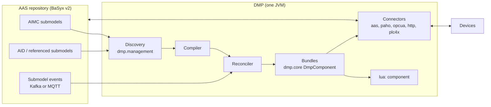

# AAS-Camel-DMP — Design Specification

> **Status (2026-10-22):** describes the implemented single-process Java DMP.
> Open and deferred work is tracked in [PLAN.md](PLAN.md). Earlier designs
> (Python management node, per-asset containers, file configuration, JSONata,
> BaSyx v1) are retired; see the git history before `8fe9c46` for their text.

## 1. Purpose and scope

The DMP (data-mapping processor) connects asset protocols to Asset
Administration Shells. It:

1. reads AIMC (Asset Interfaces Mapping Configuration 2.0) submodels from an
   AAS v3 repository and the AID (Asset Interfaces Description) and other
   submodels they reference;
2. compiles each mapping into Camel routes that acquire values from sources
   (MQTT, OPC UA, HTTP, Modbus via PLC4X, SNMP, AAS elements, TimeSeries
   segments on InfluxDB 2), transform them with a sandboxed Lua script, and
   write them to sinks;
3. serves AAS Operation invocations delegated by BaSyx and forwards them to the
   device over HTTP, OPC UA Methods or MQTT 5 request/reply, or as a property
   write;
4. keeps routes current from repository events.

Out of scope: the AAS server, model authoring and registration (`aas-model`,
`Registration_Service` in the parent workspace), simulators, and the knowledge
graph.

## 2. Terminology

| Term | Meaning |
| --- | --- |
| AID | Submodel describing a device's protocol interfaces: `EndpointMetadata` (base URI, content type, security) and `InteractionMetadata` (properties, actions, events with `forms`). |
| AIMC | Submodel (`https://admin-shell.io/idta/AssetInterfacesMappingConfiguration/2/0/Submodel`) listing `MappingConfigurations`: Sources, Sinks and a Lua `Transformation`. |
| Mapping | One `MappingConfiguration`. Identity is (AIMC id, mapping identity). |
| SourceId / SinkId | Keys of the Lua input table and the Lua result table. |
| Bundle | The set of Camel routes, endpoints and registry bindings owned by one mapping. |
| Ordinary mapping | Data mapping: sources → Lua → sinks. |
| Bridge mapping | Mapping whose single source is an AAS Operation: caller → Lua → device action → reply. |

## 3. Architecture



| Module | Responsibility |
| --- | --- |
| `dmp.management` | Repository client, AIMC/AID wire projection, mapping compiler, fingerprints, reconciliation, Kafka/MQTT event routes, value feed |
| `dmp.core` | Route model, execution-policy route creator, fan-in/fan-out, payload assembly, affordance validation, bundle lifecycle |
| `dmp.camel-lua` | `lua:` component and sandbox |
| `dmp.camel-aas` | AAS element read/write, `aas-event:` source, Operation bridge |
| `dmp.camel-paho`, `-opcua`, `-http`, `-plc4x`, `-snmp` | Connectors reachable from AID bindings, including the DMP Camel components (§9) |
| `dmp.camel-influxdb2` | `dmp-influxdb2:`, TimeSeries LinkedSegments on InfluxDB 2 (§5.5) |
| `dmp.component` | Executable, settings, `/health`, `/management/status`; the root `Dockerfile` builds it into the image |

## 4. Discovery and lifecycle

### 4.1 Startup discovery (need-to-know)

1. List AIMCs with `GET /submodels?semanticId=<AIMC>` (paged), or read the IDs
   in `DMP_MANAGED_AIMC_IDS` directly.
2. Collect every Source/Sink ModelReference. Its first key names a submodel; the
   remaining keys are the idShort path.
3. Read each referenced submodel once:
   - an AID whole (recognised by an ID ending in `AssetInterfacesDescription`,
     otherwise by the `$metadata` semanticId);
   - any other submodel as `$metadata` plus the referenced subtrees, or whole
     when referenced at more than eight paths. A missing path is confirmed
     against the whole submodel before the mapping is blocked.
4. Shells are never read. References still containing `{aas_id}` macros block
   their mapping; models are expected to be fully resolved at authoring time.

This is the only full discovery. There is no periodic repair.

### 4.2 Events

- Transport: `DMP_MANAGED_EVENT_TRANSPORT=kafka` (BaSyx `aas-events`/
  `submodel-events` topics, committed offsets) or `mqtt` (BaSyx
  submodel-repository MQTT feature, two persistent QoS 1 subscriptions:
  `sm-repository/<repo>/submodels/+` and `…/submodels/+/submodelElements/#`).
  Both carry the same events: a batch update of a submodel arrives as one
  submodel event, never as per-Property value events. The parent workspace's
  stacks use Kafka, for its committed offsets.
- Parsing is lazy: event identity first; payload and AAS4J parsing only for
  relevant events.
- Relevance filter: events on unreferenced submodels, unreferenced elements and
  value-only updates of referenced Properties are dropped. A relevant event
  re-reads only that submodel and recompiles only the dependent AIMCs. An
  unknown submodel is read once to see whether it is a new AIMC.
- A failed pass retries with backoff (`DMP_MANAGED_RETRY_INTERVAL_MS`, doubling
  up to 16×).
- An MQTT broker that drops the persistent session loses the events of that gap
  until the next restart.

### 4.3 Value feed

AAS Property sources without a `PollingInterval` are event-sourced: each
change event carries the new value. Values come from a separate feed (Kafka:
per-process consumer group at the latest offset, no commits; MQTT: clean
session), started only while such sources exist, so a backlog is never replayed
to devices. Such a source has no value until its first change event. A
submodel event carries the whole submodel; the source takes its Property's
value from it, so batch updates reach event-sourced sources too.

### 4.4 Compilation and installation

- Each mapping compiles to one plan with a fingerprint over its effective
  inputs. An unchanged fingerprint keeps the installed bundle.
- A changed mapping is staged as an inactive candidate and swapped in under a
  generation fence; in-flight requests on the old bundle drain, and calls during
  the swap receive "unavailable". Device actions are never retried or replayed.
- A mapping that cannot compile is `blocked` with a category; it does not affect
  siblings. `/management/status` reports per-mapping state (`installed`,
  `blocked`, `stale`, `failed`), generation, a per-mapping revision (installations
  since start; display only, not a fence) and fingerprints; repository IDs
  appear only as SHA-256 tokens.
- `/health` is 200 once the initial scan completed and the event transport is
  connected (Kafka: assigned on every control topic).
- There is no lease or cluster coordination: run exactly one DMP per set of
  mappings.

## 5. Data model

Accepted template versions: AIMC 2.0 and its bug-fix release 2.1 (same
semantic ID; 2.1 list members carry no idShort, so an unnamed mapping is
identified by its position), and AID 1.1 and 1.2 (1.2 adds the SNMP binding,
supported, and the CAN binding, rejected because it is not IP-based (PLAN),
and optional fields such as
`EndpointMetadata/protocolVersion`, which the DMP ignores). Other versions
block the mappings that reference them.

### 5.1 AIMC

```
AssetInterfacesMappingConfiguration
└── MappingConfigurations[]
    ├── DefaultPollingInterval   (optional, seconds; fallback for Read sources)
    ├── ExecutionSemantics
    │   └── TriggerSourceIds[]   (optional; SourceIds whose updates execute the mapping)
    ├── Transformation           (Blob, Lua)
    ├── Sources[]  : Source (Reference), SourceId, PollingInterval?
    ├── Sinks[]    : Sink (Reference), SinkId
    │   DMP extensions, bridge mappings only (§7):
    ├── ResponseSources[] : Source (Reference), SourceId
    ├── ResponseTransformation   (Blob, Lua)
    └── ResponseSinks[]   : Sink (Reference), SinkId
```

The IDTA template defines `DefaultPollingInterval`, `Transformation`,
`Sources` and `Sinks`. Every DMP extension (Response*,
`ExecutionSemantics`) carries a semantic id
`https://smartproductionlab.aau.dk/aimc/<Name>/1/0`; the DMP checks the
`ExecutionSemantics` id and matches the others by idShort.

Unknown fields, retired declarations (`writeDelegation`, JSONata semantic IDs,
`queryLanguage`, `executionPolicy`) and behaviour-bearing qualifiers are
rejected, not ignored.

### 5.2 AID bindings

The AID is read as IDTA AID 1.2 defines it, plus the extension of
aas-model `docs/aid-extension.md` for what AID leaves EXTERNAL or undefined
(action and event members, the form's `op` and `response`, `readOnly`/
`writeOnly`, `mqv_responseTopic`, the OPC UA event terms). No separate Thing
Description is consulted. Where AID is silent, the W3C WoT protocol bindings
apply.

A reference into AID `InteractionMetadata` selects one affordance with one
form. The form's `href` is resolved against the interface's
`EndpointMetadata.base` as RFC 3986 says (AID 1.2 Annex B): a base path ends
with `/` for relative hrefs to extend it, and an href starting with `/`
replaces it.

**Operations.** A form serves its `op` list (`hctl:hasOperationType`); without
`op` it serves the affordance's WoT TD defaults: a property is readable unless
`writeOnly`, writable unless `readOnly` and observable when `observable`; an
action is invoked; an event is subscribed. A mapping role needs an operation
the form serves:

| Mapping role | Needs | Interaction |
| --- | --- | --- |
| Source on a property | `observeproperty` or `readproperty` | Observe when the property is observable and the connector observes (MQTT, OPC UA monitored item, HTTP `subprotocol`, Modbus polling); else Read (with the effective polling interval; 5 s without one) |
| Source on an event | `subscribeevent` | Observe |
| Sink on a property | `writeproperty` | Write |
| Sink on an action | `invokeaction` | Invoke (bridge mappings only) |

**Data schemas.** A schema is a TD DataSchema as aas-model's AID extension
writes it (aas-model `docs/aid-extension.md` §3.6), the same at every depth.
Its `type` is one of the JSON types (`boolean`, `integer`, `number`, `string`,
`object`, `array`, `null`; a leaf written as a typed AAS Property takes its
`valueType`). `properties`, `items` (a full data schema: arrays of objects and
of arrays) and `required` (an SML of member names) nest freely, and `oneOf`
(an SML of data schemas) gives alternatives, e.g. a nullable value. Constraints
are read as AID writes them, `min_max`, `lengthRange` and `itemsRange`
(Ranges), `const` and `enum`, and as the JSON-schema terms the extension adds
(`exclusiveMinimum`, `exclusiveMaximum`, `multipleOf`, `pattern`, `format`,
`contentEncoding`, `contentMediaType`); they matter to affordance validation
(JSON Schema 2020-12). Annotations (`title`, `description`, `unit`, `default`,
`key`, `readOnly`/`writeOnly` below the affordance) are accepted and ignored.
Terms the DMP cannot honour reject the AID: `anyOf`, `allOf`, `not`,
`if`/`then`/`else`, `$ref`, `prefixItems`, `additionalProperties`,
`patternProperties`, and any other `type`. A form's `additionalResponses`
(responses other than the regular one, each with an inline schema) are
accepted; the regular reply is validated against the affordance's schema.

An `op` value outside the WoT operation types, an unrepresented form term
(e.g. subprotocol `websub`, a form `security` selection) or a
binding term of another protocol blocks the mapping.

**HTTP.** The method is `htv_methodName` (mandatory in AID), else the WoT
default: GET to read, PUT to write, POST to invoke. A read is a GET poll; a
write is PUT, POST or PATCH. Bodies are JSON. A form's static `htv_headers`
(`htv_fieldName`/`htv_fieldValue` pairs) go with every request of the form:
polls, observations, writes and invocations. Names must be HTTP tokens and
unique, values one line; headers the connector sets (`Content-Type`,
`Content-Length`, `Host`, `Connection`, `Transfer-Encoding`, …) are rejected, so
is `Accept` on an observed form and `Authorization` next to credentials in the
href. Header values may be secrets: they are bound in the Camel registry and
never appear in endpoint URIs or the exported fingerprint. HTTP requests are
not retried automatically.

A form with a `subprotocol` (AID 2.24.1, WoT HTTP binding) observes: it must
serve `observeproperty` (a property, e.g. `observable` true) or
`subscribeevent` (an event), and an HTTP event needs one. `dmp-http-observe:`
(§9) consumes it:

- `longpoll`: a GET the server answers on the next change; each answer with a
  body is one value (204 or an empty body is none), and the GET is repeated
  at once (at most every 100 ms; a request held for 5 minutes is reissued).
- `sse`: a GET with `Accept: text/event-stream`; the `data` of each event is
  one value. A closed stream is reopened after the server's `retry` (3 s by
  default) with `Last-Event-ID`.

Values are decoded as the form's `contentType` (JSON). A failed request or
broken stream is retried with backoff (1 s doubling to 30 s); values in the
gap are lost. An observed source takes no PollingInterval; `websub` (an
inbound callback) is not supported.

**MQTT.** The topic is the resolved `href`'s path without its leading `/`,
percent-decoded: AID writes a topic with a leading `/` as `.//topic` and the
`#` wildcard as `%23`. `mqv_controlPacket` describes the consumer (WoT MQTT
binding): `subscribe` to read and observe, `publish` to write and invoke; a
form whose packet contradicts the mapping role blocks it. An MQTT property is
read by subscription, so a source needs it observable or retained
(`mqv_retain`); a PollingInterval on it is rejected. `mqv_qos` and
`mqv_retain` apply to the subscription and the publication. An action with
`mqv_responseTopic` is an MQTT 5 request/reply (§7.1); an action without it
and without an `output` only invokes. Payloads are JSON.

Modbus follows AID 1.2 and the WoT Modbus binding; the compiler translates a
form into a PLC4X tag:

- The resolved `href` is `/{unitID}/{address}?quantity={n}`: AID writes the
  unit ID in the base (`modbus+tcp://host:port/{unitID}/`) and
  `{address}?quantity={n}` in the href; `/{unitID}/{address}` in the href
  against `modbus+tcp://host:port` resolves to the same. The address is the
  protocol address (PLC4X counts from 1, so protocol address 0 is PLC4X
  `coil:1`); with `modv_zeroBasedAddressing` false it counts from 1. PLC4X
  tag syntax in an AID is rejected.
- The memory area is `modv_entity` (Coil, DiscreteInput, HoldingRegister,
  InputRegister), else `modv_function` (readCoil, readHoldingRegisters,
  writeSingleCoil, …), else the binding's default: Coil (readCoil for reads,
  writeSingleCoil for writes). Discrete inputs and input registers are not
  writable.
- `modv_type` (xsd:boolean, short, int, long, their unsigned forms, integer,
  float, double) becomes the PLC4X data type; the quantity counts registers,
  so four registers of `xsd:int` are two values.
- `modv_mostSignificantByte`/`Word` (default true; on the form, or for all
  forms on the interface's `EndpointMetadata`) set the driver's payload
  byte order, `modv_timeout` its request timeout, the unit ID its unit
  identifier. `modv_pollingTime`, the device's maximum polling rate, is a
  source's polling interval when the AIMC gives none and a lower limit for
  the one it gives. Observing a Modbus property polls.
- Forms may declare `application/octet-stream`.

OPC UA follows OPC 10101 (the OPC UA binding for WoT):

- `readproperty`, `writeproperty`, `observeproperty` and `invokeaction` map to
  the UA Read, Write, Monitor and Call services. An observable variable is
  observed (a monitored item); otherwise it is read.
- A source receives the variable's value, as an MQTT or HTTP source receives
  its payload, so the AID schema describes what Lua gets and a reference into
  the schema selects a member of the value. A sample or read without a Good
  status contributes nothing; status codes and timestamps are not passed on.
- The AID must describe the device: a sampled or read value carries what the
  server declares for it (the variable's built-in type, or the structure's
  `DataTypeDefinition`, nested), and every member the AID schema describes must
  exist there with a compatible JSON type (`number` accepts `integer`; members
  the AID leaves out are still delivered). A source whose AID disagrees, or
  whose reference names a member the device lacks, contributes nothing; each
  value fails with the differences by path. Writes and Method inputs are held
  to the server's definition when they are encoded (below).
- A form names its node by the NodeId of its `href` (`/?id=<nodeId>`, `#` and
  `&` percent-encoded), else by `uav_browsePath`: an absolute path from the
  Root node (`/Root/Objects/2:Machine/2:Pressure`; qualified names
  `<namespaceIndex>:<name>`, namespace 0 without a prefix) along hierarchical
  references. AID makes `href` mandatory, so such a form carries an href
  without an id (e.g. `/`). `dmp-milo-client:` resolves the path with
  TranslateBrowsePathsToNodeIds once per client session (option
  `browsePath`).
- An observed variable is a monitored item in a subscription of its own; the
  source's `PollingInterval` sets its sampling and publishing interval (the
  IDTA AIMC text calls the interval ignored for asynchronous sources; for OPC
  UA the server samples at it). Its queue keeps short-lived values between
  two publishes.
- An action names its Method's owning Object with `uav_componentOf` on the
  action affordance (a NodeId, or a list holding one), not in the form.
- Forms may declare `application/octet-stream` (the binding's default UA
  serialization); values are decoded from the UA types either way.
- Structures are UA Binary ExtensionObjects whose encoding the server
  describes: the client reads the server's DataType nodes and their
  `DataTypeDefinition`s (OPC UA 1.04) once per session, when it first meets a
  structure (Milo's dynamic DataTypeManager), so the AID schema is not a codec.
  A structure reaches Lua as an object keyed by field name (nested; an absent
  optional field is left out), an array of structures as an array, a union as
  `{field: value}` (null when empty), an enumeration as its Int32 value.
  Namespace-0 structures (e.g. Range) are objects the same way. Writes and
  Method inputs are encoded from objects by the variable's `DataType` or the
  argument's `DataType`: every non-optional field is required, an unknown field
  is an error, an enumeration takes its value or its name. A value that does
  not fit fails the write (`OPCUA_VALUE_MISMATCH`) or the call
  (`METHOD_ARGUMENT_MISMATCH`). Not supported: custom encodings the server does
  not describe (they stay undecoded), servers that publish only the pre-1.04
  DataTypeDictionary, and structure fields with a valueRank above 1.
- Events (a DMP extension; OPC 10101 v1.00 defines no event vocabulary) are
  event affordances (WoT EventAffordance, `aas-model` `OpcuaEvent`), consumed
  like MQTT events: the form `href` (or `uav_browsePath`) names the event
  notifier (e.g. the Server object `i=2253`), the form serves `subscribeevent` (the default). Each
  property of the event's `data` schema (an object) is one selected field:
  its `uav_eventField` browse path relative to the event (`0:ToState/0:Id`,
  `/`-separated qualified names, namespace 0 without a prefix), or its own
  name as a namespace-0 BrowseName (`Message`, `Severity`, `Time`, …). The
  affordance-level `uav_eventType` (an EventType NodeId) is the where clause,
  `OfType`, so subtypes pass. Both terms carry DMP semantic ids
  (`…/aid/OpcuaEventType/1/0`, `…/aid/OpcuaEventField/1/0`). The DMP
  subscribes with an event monitored item (select clauses relative to
  BaseEventType); each event arrives as an object of its fields (UA built-in
  values as JSON: LocalizedText → text, NodeId → string, DateTime → ISO-8601)
  and a field the event lacks is `null`. `PollingInterval` sets the
  publishing interval.

SNMP follows the AID 1.2 SNMP binding (Annex E.1), v1 and v2c:

- The resolved `href` is `snmp://{address}:{port}/{oid}` (port 161 by
  default; the base `snmp://{address}:{port}/` and the OID as a relative href
  resolve to the same). The community is the URI's user information
  (`snmp://community@host`), else `public`.
- `snmpv_pduType` is `snmpv:GetRequestPDU` to read (the default of
  readproperty) and `snmpv:SetRequestPDU` to write (writeproperty); a PDU type
  that contradicts the mapping role blocks it. `snmpv_version` is
  `snmpv:SNMPv1` or `snmpv:SNMPv2c` (default).
- A source is read with GET at its polling interval (SNMP has no
  observation); a sink is a SET of the object's own SMI type, learned from a
  GET. An error status, a missing object or no answer within 1.5 s (one retry)
  fails the read or write.
- Values: INTEGER, Counter32/64, Gauge32 and TimeTicks are numbers, an OCTET
  STRING its text when printable and hex otherwise, an IpAddress and an OBJECT
  IDENTIFIER their dotted text. Actions, events and traps are not supported.

Event affordances of every binding carry the WoT EventAffordance terms
(`subscription`, `data`, `dataResponse`, `cancellation`); the DMP consumes
`data` and rejects the other three, since MQTT and OPC UA subscriptions carry
no such payloads.

### 5.3 AAS element bindings

| Reference target | Interaction |
| --- | --- |
| Operation as Source | Accept invocation (bridge mapping) |
| Property Source with `PollingInterval` | Read (`GET` of the element) |
| Property Source without one | Observe through the value feed (§4.3) |
| Collection/list Source | Read; requires an explicit interval |
| Property/collection Sink | Write (`PATCH …/$value`) |
| Operation as Sink | Rejected (no chained actions) |
| TimeSeries LinkedSegment as Sink | One InfluxDB point per evaluation (§5.5) |
| TimeSeries LinkedSegment as Source | Read of the latest row; requires an explicit interval (§5.5) |

An element below a submodel is addressed by its idShortPath: collection
members joined by `.`, list items by index (`Location.x`, `Items[0]`).

Lua receives every AAS element in one form, whether polled, read for
fan-in, delivered by the value feed or passed as an Operation variable: a
Property as its value typed by its `valueType` (integers as integers, decimals
and floats as numbers, booleans as booleans, other types as their lexical
text), a collection as an object keyed by member idShort, a list as an array.
The same types apply to the values Lua returns. Property values are never part
of the configuration.

### 5.4 Granularity (`valuePath`)

A reference may end at a whole affordance (coarse: Lua receives the whole
decoded payload) or continue into its payload schema (fine: the compiler pins a
JSON Pointer, RFC 6901, and the route extracts that member before Lua). On
sinks, a pointer places the SinkId value into the outgoing payload. Sinks that
address members of the same affordance are assembled into one payload and one
send; distinct affordances stay separate sends; AAS children are separate
writes. Per-element fan-out over arrays is not supported.

### 5.5 TimeSeries segments

A time series is an SMC shaped like the IDTA 02008 submodel (`Metadata/Record`,
`Segments/LinkedSegment`), recognised by this project's id
`https://smartproductionlab.aau.dk/variables/TimeSeries/1/0` or the IDTA
TimeSeries id as semanticId or supplemental id; its elements are recognised by
semanticId, never by idShort. A reference to a LinkedSegment
(`…/<series>/<Segments>/<segment>`) makes the DMP read the series container as
well; it counts as referenced for events and the fingerprint. TimeSeries
submodels (a segment directly below the submodel) are not supported yet.

- The Record is the row shape: one UtcTime (`xs:dateTime`; other time
  semantics block the mapping) and fields. A field's InfluxDB field is its
  idShortPath below the Record: a Property is one field, a Range two
  (`Tolerance.min`, `Tolerance.max`, of its valueType), a File one string (its
  path or URL; the file stays where it is), a MultiLanguageProperty one string
  per language its value declares (`Batch.en`; the declaration's texts are the
  field's labels, and one without languages blocks the mapping). An SMC's
  members follow by idShort (`Position.x`), an SML's by index
  (`Waypoints[0].x`; never by displayName), an Operation's input, InOut and
  output variables by idShort. Blobs, Entities, relationships, Capabilities and
  events have no InfluxDB form and block the mapping.
  Renaming a field therefore starts a new InfluxDB field; its history stays
  under the old name.
- A ReferenceElement in the Record (or in a group of it) counts exactly as if
  the element it references were declared at its place, under the
  reference's idShort: `Occupy → …/Skills/Occupy/operation` gives
  `Occupy.Uuid`, `Occupy.State`. The referenced element is read like a mapping
  endpoint and counts as referenced for events and the fingerprint; a change
  of its structure recompiles the mapping. References inside a referenced
  element do not chain and block the mapping, as does a reference whose target
  is missing. The reference lends the structure only; values come from the
  transformation.
- The segment's `InfluxDb2Target` (`…/timeseries/InfluxDb2Target/1/0`; each database has its own target, told apart by semanticId, and a segment carries exactly one) names `Bucket`,
  `Measurement` and `Tags` (each tag's idShort is its key). Its IDTA
  `Endpoint` must name the configured InfluxDB and org (`DMP_INFLUX_URL`,
  `DMP_INFLUX_ORG`); otherwise, or without a configured InfluxDB, the mapping
  is blocked. The IDTA `Query` is for people and the web UI; the DMP never
  parses it.
- Lua returns the row for the segment's SinkId as a table keyed by Record
  idShort, groups nested (`row.Position.X`). A field the row omits is not
  written; an unknown field, a value of another type than the field's
  valueType, or a row without fields fails the sink. `Time` is optional: an
  `xs:dateTime` with an offset is the point's time, otherwise the time of
  writing.
- A Source on a segment is a Read: every `PollingInterval` (its own or the
  mapping's `DefaultPollingInterval`; without one the mapping is blocked, as
  InfluxDB has no subscriptions) it queries each field's `last()` within
  `DMP_INFLUX_LOOKBACK` (default `P30D`) and hands Lua the row in the same
  shape, `Time` being the newest of the fields' times. Fields keep their
  latest values independently, so a row can combine values written at
  different times; a field unchanged for longer than the lookback is absent.
  A series without a point has no row, so the source has no value yet. A
  stored value of another type than its field fails the read.
- The segment's IDTA `StartTime`, `EndTime` and `State` are its period: times
  are `xs:dateTime` with an offset, the State is `InProgress` or `Completed`
  (absent or empty counts as not authored; anything else, an `EndTime` not
  after the `StartTime`, or an `InProgress` segment with an `EndTime` blocks
  the mapping). A Sink needs an open segment (not `Completed`, no `EndTime`)
  and rejects a row whose time lies before the `StartTime`. A Source reads
  within the period (`range(start:, stop:)`, `EndTime` included), falling back
  to `DMP_INFLUX_LOOKBACK` only where there is no `StartTime`. The DMP never
  maintains `RecordCount`, `LastUpdate` or `Duration`: that would be an AAS
  write per point, and InfluxDB answers them itself.
- InfluxDB fixes a field's type per measurement. Across all mappings, every
  Source and Sink naming the same bucket, measurement and field must declare
  the same InfluxDB type (string, integer, float, boolean; `xs:double` and
  `xs:float` are both floats); otherwise every mapping involved is held back
  (`timeseries-type-conflict`, an installed one is kept as `stale`) and the
  disagreeing declarations are logged together.
- Values are written as the field's valueType: strings (and date/time types,
  including the Gregorian `xs:gYear` … `xs:gDay`)
  as strings, integer types as InfluxDB integers, `xs:double`/`xs:float`/
  `xs:decimal` as floats, `xs:boolean` as booleans.

## 6. Ordinary mappings

```
Sources[] ──► latest-value cache ──► aimc_main(sources) ──► per-SinkId dispatch ──► Sinks[]
```

- Each source has its own consumer (Observe) or poller (Read) and contributes
  its decoded, `valuePath`-extracted value to a per-mapping latest-value cache.
- The mapping evaluates when a triggering source updates **and every source has
  delivered at least once**. Without `TriggerSourceIds` every source triggers;
  with it, only the listed ones do and the rest refresh the cache only.
- Lua runs once per evaluation against an immutable snapshot of the cache.
- Every mapping has consumers and producers of its own. Mappings may observe
  the same affordance or AAS element: each gets its own monitored item,
  subscription, listener or poll at its own authored interval, and never sees
  another mapping's samples. Connections are shared where the connector allows
  it (one OPC UA session per server configuration); an MQTT client is per
  mapping. Only an Operation is exclusive: one mapping answers it.
- Sinks are dispatched sequentially in authored order; each starts from restored
  headers and body. A SinkId missing from the Lua result is an error for that
  sink; it is not silently skipped.
- `DMP_AFFORDANCE_VALIDATION=ON` validates inbound values and outbound payloads
  against the AID schemas (invalid inbound values are dropped, invalid outbound
  payloads are not sent); `REPORT` only logs; `OFF` (default) skips validation.
- No timeout, partial evaluation or debounce exists; the only timing knob is the
  authored polling interval.

## 7. Bridge mappings (Operation delegation)

1. BaSyx delegates an Operation to the URL in its `invocationDelegation`
   qualifier. The DMP serves `POST` on that URL's path (by convention
   `/operations/{aasIdShort}/{skill}`). An Operation without exactly one
   absolute delegation URL blocks its mapping.
2. The mapping's sources are the Operation and, optionally, further AAS
   elements (fan-in, §7.1). Its sinks bind the Operation 1:1 to one affordance
   of the device's AID: the action of the same skill, or one whole property
   (§7.1). The two sides are addressed alike:

   | | Request | Response |
   |---|---|---|
   | AAS side | Sources: Operation input/InOut variables (or the Operation), fan-in elements | ResponseSinks: Operation output/InOut variables (or the Operation), further AAS elements |
   | Device side | Sinks: the action's `input` DataSchema, or members of it | ResponseSources: the action's `output` DataSchema, or members of it |

   A Sink on the action itself or on its `output`, or a ResponseSource
   outside its `output`, blocks the mapping. Operation input, output and InOut
   variables have unique idShorts and are one of:
   - a **Property** with a supported `valueType` → a typed scalar;
   - a **SubmodelElementCollection** of such variables (members uniquely
     named) → an object keyed by member idShort;
   - a **SubmodelElementList** → an array. Every member must have the list's
     `typeValueListElement` (and, for Properties, `valueTypeListElement`).
     The first authored member defines the member shape; an empty list is
     only allowed for Properties with a `valueTypeListElement`.
   Nesting is unrestricted. Other element types (Range, File, Blob, …) block
   the mapping. Lua receives inputs and InOut values typed by their declared
   `valueType`s. The reply is rebuilt from the declared variables: list
   members get no idShort (AASd-120), list metadata and semantic IDs are
   copied, members the declaration lacks are dropped, and a value whose shape
   contradicts the declaration fails with `DMP_RESPONSE_MAPPING_FAILED`.

   **Optional.** A variable, or a member of a collection variable, is
   required unless it carries the qualifier `Optional` (semantic ID
   `https://smartproductionlab.aau.dk/aas/OperationVariable/Optional/1/0`,
   `xs:boolean` value `true`, kind `ConceptQualifier`); a list is marked as a
   whole. The DMP recognises the qualifier by its semantic ID; a value other
   than an `xs:boolean`, or the qualifier on a list member, blocks the
   mapping. A required input or InOut the caller omits (absent or null) fails
   with `DMP_OPERATION_VALIDATION_FAILED` (400) before the request Lua runs;
   a required output or InOut the response mapping omits fails with
   `DMP_RESPONSE_MAPPING_FAILED`. (`SMT/Cardinality` is not used: it says how
   many elements a template instance holds, not which values a call carries.)
3. The request Lua is mandatory and turns the caller's input variables (and
   the fanned-in AAS values, keyed by their SourceIds) into the device command
   or the value to write.
4. The command leg is synchronous per protocol:
   - **HTTP**: the HTTP response is the reply;
   - **OPC UA**: Method call; arguments are matched by name to the server's
     `InputArguments`/`OutputArguments`, outputs must match the declared basic
     type and rank; structured arguments are objects (§5.2);
   - **MQTT 5**: `paho-mqtt5-inout:` publishes with ResponseTopic and
     CorrelationData; the first reply on the declared reply topic that carries
     the request's correlation data is the terminal reply, whatever its
     payload. A device publishes progress or other messages without that
     correlation data. Timeout 30 s. An action without `mqv_responseTopic`
     only invokes: the command is published one way and the call returns once
     the broker accepted it (QoS 1 or 2; QoS 0 blocks the mapping). Such an
     action has no `output`; one that declares an output needs the response
     topic.
   - **PLC4X (Modbus)**: no actions; an Operation bound to a property writes
     its tag (§7.1).
5. The reply is validated against the action's `output` and mapped by the
   response mapping: `ResponseSources` name the reply (or members of it),
   `ResponseTransformation` maps them, and its value for the `ResponseSink`
   that selects the Operation itself is the caller's reply, an object keyed
   by output and InOut idShort. Its entry point is
   `aimc_main(sources, requestSources)`: `sources` holds the ResponseSources;
   `requestSources` holds what the request Lua received, keyed by the Sources'
   SourceIds (the caller's values and the fanned-in AAS values). Nothing is
   read again, so it contextualises the reply with the request, e.g. the
   station a robot was sent to while the device only received its pose. The three are authored together; one without
   the others blocks the mapping. Nothing is matched by name: an Operation
   with required output or InOut variables needs a response mapping with that
   ResponseSink. Without a response mapping the Operation answers with no
   outputs; only an Operation whose outputs are all Optional, or that has
   none, may do so. Members the Operation does not declare are dropped.

   The call returns when the action does: an OPC UA Call, an HTTP request and
   an MQTT action with `mqv_responseTopic` wait for their terminal reply also
   when the Operation has no outputs, so the caller learns that the action
   finished (or its 502/504) and the reply is validated, then dropped. Only an
   MQTT action without a response topic returns on the broker's
   acknowledgement (e.g. Halt).
6. `ResponseSinks` that address AAS elements receive their SinkId value
   asynchronously through a bounded Wire Tap (2 workers, 128 queued jobs, abort
   on overflow). These writes are best effort and never change the caller's
   reply.
7. Failures return structured errors: `DMP_DEVICE_TIMEOUT` (504),
   `DMP_DEVICE_ERROR`/`DMP_DEVICE_TRANSPORT_ERROR` (502),
   `DMP_COMMAND_VALIDATION_FAILED`, `DMP_RESPONSE_VALIDATION_FAILED`,
   `DMP_RESPONSE_MAPPING_FAILED`, `DMP_OPERATION_VALIDATION_FAILED`,
   `DMP_CONNECTOR_CONFIGURATION_ERROR` (500), and
   `DMP_OPERATION_VALIDATION_FAILED` (400) for a request that omits a required
   input. Nothing is retried.
8. A failed call still runs the `ResponseTransformation` when the mapping has
   ResponseSinks that do not answer the caller (e.g. a `Log` series), in a
   route of its own: `sources` is empty, `requestSources` holds what the
   request Lua received (empty when the call failed before it), and
   `meta.invocation.outcome` is `Failed` with the `error` (`code`, `message`,
   and the connector's `category`). Only those ResponseSinks are written, best
   effort; SinkIds the result leaves out are skipped silently. The caller's
   error reply is built afterwards and is unchanged by anything the
   transformation does; if it fails, that is logged as a warning.

### 7.1 Scope: one affordance, one terminal answer

A bridge mapping binds the Operation 1:1 to one affordance:

- an **action**, whose terminal reply is its result: an OPC UA Method, an
  MQTT 5 request/reply, an HTTP request;
- a **property**, which the call writes. The call returns once the connector
  acknowledges the write: the PLC4X write response, the OPC UA Write status
  (`dmp-milo-client:` waits for it and converts a scalar to the variable's
  DataType), the HTTP response; MQTT only confirms that the broker accepted
  the publish (QoS 1/2). The reply is the written value: ResponseSources
  select it (or members of it). Without a response mapping the call answers
  with no outputs. A rejected write answers 502
  `DMP_DEVICE_ERROR`; nothing is fanned out.

On the AAS side the mapping fans in and out:

- **Fan-in.** Further Sources that address AAS elements are read once per
  invocation, before the request Lua, and passed to it under their SourceIds
  next to the Operation's variables. A failed read answers
  `DMP_DEVICE_TRANSPORT_ERROR`. A read hands Lua the element's value
  (§5.3).
- **Fan-out.** ResponseSinks receive the response Lua's values for their
  SinkIds (§7 item 6).

The DMP
does not model multi-step device sequences (write parameters, trigger, poll a
status, read a result, reset, e.g. Modbus coils or OPC UA Programs); the
higher-level control orchestrates them through ordinary mappings.

- **Concurrency.** Each invocation is correlated by its protocol (an OPC UA
  Call, MQTT 5 correlation data, an HTTP exchange), so invocations of the
  same action run concurrently; there is no busy guard.
- **Timeouts.** A call waits for its terminal reply up to the connector's
  timeout (30 s for MQTT, OPC UA and HTTP). BaSyx delegation is
  synchronous and has no timeout of its own, so the invoking client's HTTP
  timeout must exceed the connector's.
- **Late replies.** When the timeout expires the call fails, but the device
  may still carry out the action; a later reply is dropped. Idempotency and
  compensation are the higher-level control's concern.

**Route.** Content Enrichers make the fan-in reads; a Content Enricher sends
the command through a command route that clears the caller's headers and runs
the connector's invocation steps (`SynchronousInvocationAdapter.configureInvoke`)
or the property write; a Wire Tap makes the AAS response writes.

## 8. Lua contract

```lua
function aimc_main(sources)          -- sources keyed by SourceId
    return { sink1 = sources.a + sources.b }   -- result keyed by SinkId
end
```

- The global `meta` describes the call, a fresh copy per invocation:

  | Field | Content |
  | --- | --- |
  | `meta.sources.<SourceId>.time` | When the source's current value was acquired (ISO-8601 UTC) |
  | `meta.sinks.<SinkId>.kind` | The connector the sink writes through: its endpoint scheme (`aas`, `dmp-influxdb2`, `paho-mqtt5`, …); `operation` for a ResponseSink answering the caller |
  | `meta.invocation` | An Operation's transformations only: `id`, `started`, `caller` (`basyx` or `rest`), the Operation's `skill`, `aas`, `submodel`, `path`, `restPath`; in the response also `durationMs` and `outcome` (`Succeeded`, `Failed` with `error`, §7 step 8) |

  `meta.sources` and `meta.sinks` are always tables. Lua can use them for
  explicit logging: `Time = meta.sources.State.time`,
  `Outcome = meta.invocation.outcome`.
- Lua arrives only as AIMC Blobs and is compiled once per mapping in memory
  (`LuaCompiledSource`); identical sources share one compiled prototype.
- Each invocation gets fresh, isolated globals. Inputs are converted from
  decoded Java values (maps, lists, scalars, null markers, bytes) to native Lua
  values; results are converted back. No JSON text crosses the boundary; Lua
  may call `json.encode`/`json.decode` explicitly.
- Integral numbers stay integral (a Lua double with an exact integral value
  becomes a `Long`, up to 2^53−1).
- Sandbox: base functions, `math`, `table`, `string`, `json`, `os.clock`. No
  `io`, other `os`, `require`/`load*`/`dofile`, `debug`, `luajava`, `package`,
  `coroutine`.
- Guards: CPU budget per invocation via instruction-count hook (default 2 s), a
  maximum script size, and the contract checks (`aimc_main` exists, result is a
  table). There is no per-script memory cap; the JVM heap (`-Xmx`, default
  512 MB in the image) is shared by all mappings.

## 9. Connector capabilities

| Binding | Implemented | Not implemented |
| --- | --- | --- |
| AAS | Read, Observe (events), Write, Accept invocation | Operation sinks |
| OPC UA (Milo) | Read (Read service), Observe (monitored items), Events (event monitored items, DMP extension), Write, Invoke (Method); structures, unions and enumerations the server describes | Encodings the server does not describe, pre-1.04 DataTypeDictionaries, condition refresh and acknowledgement |
| MQTT 5 | Observe (subscribe), Write (publish), Invoke (request/reply) | Read; MQTT 3.1.1 |
| HTTP | Read (poll), Observe and events (`longpoll`, `sse`), Write, Invoke; static headers | `websub`, inbound requests other than Operations |
| PLC4X (Modbus) | Read, acknowledged Write of one tag per affordance | Invoke (Modbus has no actions) |
| InfluxDB 2 (TimeSeries, §5.5) | Acknowledged Write of one point per row, Read of the latest row (polled) | Observe (InfluxDB has no subscriptions); other databases |
| SNMP (v1, v2c) | Read (GET, polled), Write (SET) | Traps, SNMPv3, tables |
| BACnet | — (rejected: the PLC4X 0.13.1 `bacnet-ip` driver neither reads nor writes; it only listens for COV notifications) | Read, Write, Observe |

Data-plane MQTT clients are one per endpoint; their credentials are bound in
the Camel registry per bundle and referenced by name in URIs.

Where an upstream Camel component lacks a behaviour the DMP needs, the DMP
ships a component that extends it under its own scheme (registered through
`META-INF/services/org/apache/camel/component/<scheme>`); routes use it like
any component, and the upstream component stays usable unchanged:

| Scheme | Extends | Adds |
| --- | --- | --- |
| `dmp-plc4x:` | camel-plc4x | acknowledged writes and checked reads (failures raise instead of being logged or read as `{}`); the body is the tag value |
| `dmp-milo-client:` | camel-milo client | a Method producer that answers with the Call's result (camel-milo 4.22 drops it); a consumer whose monitored item has its own subscription and a sample queue (camel-milo shares one subscription per server, created with the first endpoint's publishing interval, and keeps only the latest sample); event monitored items with an EventFilter (options `eventFields`, `eventType`; camel-milo has only data-change filters); a Write producer that waits for the server, fails on a Bad status and writes scalars as the variable's DataType (camel-milo ignores the status); structures decoded and encoded with the server's DataTypes (§5.2) |
| `dmp-snmp:` | camel-snmp (SNMP4J) | checked GET (error status, missing object and timeout raise) and SET of the object's own SMI type; camel-snmp has no SET |
| `paho-mqtt5-inout:` | camel-paho-mqtt5 | MQTT 5 request/reply with correlation; owns its reply consumer and publish producer |
| `dmp-http-observe:` | — (camel-http has no consumer) | observing an HTTP resource by long polling or server-sent events (§5.2) |
| `dmp-influxdb2:` | camel-influxdb2 (influxdb-client-java) | blocking writes whose rejection or failure fails the exchange (camel-influxdb2 writes through the asynchronous batching API, whose errors never reach the exchange); typed points from a Record row; a polling consumer reading the latest row with Flux (camel-influxdb2 has no consumer); no creation of orgs or buckets (camel-influxdb2 creates them by default); one client for the configured InfluxDB, its token outside every URI |

Connector invocation steps (`SynchronousInvocationAdapter.configureInvoke`)
map arguments and replies of actions (HTTP, OPC UA, MQTT); an Operation bound
to a property is the connector's acknowledged write (`dmp-plc4x:`,
`dmp-milo-client:`, HTTP, MQTT).

## 10. Diagnostics

The DMP writes no interaction log of its own (the InfluxDB interaction log was
removed 2026-10-22). What a mapping records is authored: a `Log` series
written by an ordinary Sink or a ResponseSink (§5.5). The DMP's own state is in
`/management/status` (§4.4) and the application log, which carries one line
per mapping change (`mapping <token> of AIMC <token> is blocked (category),
generation n`; warnings for `blocked` and `failed`), with repository IDs as
the status tokens, followed by one line per diagnostic.

`GET /management/mappings?aimc=<AIMC submodel id>` explains one AIMC's
mappings: per mapping its `identity`, `listIndex`, `state`, `category`,
`cause` and `diagnostics`. Anyone who can reach the DMP and knows the AIMC's
id can read it; the status itself stays without names and messages.

- A **diagnostic** is `{path, message}`: the path relative to the mapping
  (`Sinks/value/1`, `Sources/value/0/forms/mqv_qos`, empty for the whole
  mapping) and the compiler's message: an invalid structure, an unresolved
  reference (`not found: …`), an unsupported connector capability, a
  `rest-path-conflict` (`POST /… is also served by mapping …`) or a
  `timeseries-type-conflict` (`InfluxDB field … is FLOAT (xs:double) here,
  but …`).
- A **cause** names why a compiled mapping failed to install, from a fixed
  set: `multiple-consumers-unsupported`, `unknown-host`,
  `connection-refused`, `timeout`, `authentication-failed`,
  `endpoint-invalid`, `unknown`. The exception itself, which can carry an
  endpoint URI with credentials, is only in the log.

## 11. Security

- Lua blobs are untrusted: sandbox, CPU budget, size limit.
- Secrets (repository authorization, Kafka SASL, MQTT credentials) come from
  environment variables and are never logged or exposed in status.
- Repository access is read-only (GET); the DMP never writes models.

## 12. Decisions

| ID | Decision |
| --- | --- |
| ADR-001 | Lua engine is LuaJ 3.0.1 (pure Java). |
| ADR-002 | Plain Apache Camel JVM process in Docker, not Camel K. |
| ADR-003/004 | Lua input/output are tables keyed by SourceId/SinkId of decoded values; JSON encoding belongs to connectors. |
| ADR-005 | Sandbox, CPU budget and JVM heap bound; no per-script memory cap. |
| ADR-007 | Normalize at the protocol boundary; Lua is protocol-agnostic. |
| ADR-009/026 | Camel 4.22, Java 21. |
| ADR-011 | Lua comes only from AIMC Blobs. |
| ADR-014 | Coarse/fine references via `valuePath`, symmetric on sources and sinks. |
| ADR-017 | Mapping-scoped entity identities; raw SourceId/SinkId reach Lua. |
| ADR-019 | References are anchored at the submodel they name; no fallback to another AID. |
| ADR-020 | One fixed execution rule per mapping (§6); no authorable execution policy. |
| ADR-022 | Operation delegation: the Operation is the source, one AID action or property is the sink (§7.1). |
| ADR-023 | Variables/Parameters are plain Properties; references address the element itself. |
| ADR-024 | Optional `TriggerSourceIds`; acquisition mode comes from declared capability. |
| ADR-025 | Connector capabilities are explicit per interaction (§9). |
| ADR-027 | Single Java process; Python management node, per-asset containers and file configuration removed (2026-10-15). |
| ADR-028 | Need-to-know discovery and event-only lifecycle; no periodic repair (2026-10-15). |
| ADR-029 | REST path comes from the Operation's `invocationDelegation` URL; shells and `{aas_id}` expansion are not used. |

Retired: ADR-006 (file-loaded scripts), ADR-008/012 (one DMP per asset),
ADR-010 (Kafka-only eventing), ADR-013 (Python management node), ADR-015
(JSONata), ADR-018 (timer/event fan-in split), ADR-021 (instance attribution and
local-AID pins).

## 13. Provenance and licensing

- Fork of [eclipse-basyx/basyx-databridge](https://github.com/eclipse-basyx/basyx-databridge)
  (MIT). Derived files keep their MIT headers; the project stays MIT.
- AIMC/AID semantics: IDTA submodel templates (CC BY 4.0) — attribute and
  indicate modifications.
- This is a derivative work, not an official Eclipse BaSyx component.
  Its Java packages and Maven groupId are `dk.aau.smartproductionlab` (renamed
  from the DataBridge's `org.eclipse.digitaltwin.basyx`, 2026-10-22).
