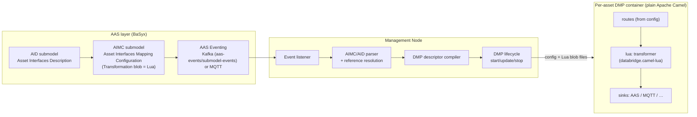
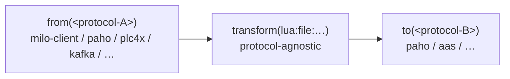
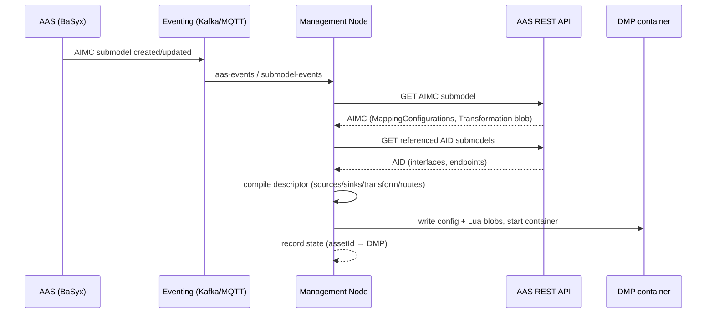

# aas-camel-dmp — Design Specification

> **Status:** Implemented — milestones M0–M9 complete; **M10 in progress** (shared `aas_model`, ADR-016)
> **Date:** 2026-08-19 · **Last updated:** 2026-08-25
> **Applies to:** this repository, checked out as **`aas-camel-dmp`** (renamed from `aas-camel-k-dmp`, M0)
> **Companion artifacts (implemented):** `databridge.camel-lua/` (Lua component + harness), `databridge.camel-jsonata/` (secondary engine, ADR-015), `databridge.core/…/EventRouteCreator.java` (fan-in + coarse/fine, ADR-014), `management-node/` (Python orchestrator), per-protocol config catalog (`mqttconsumer.json`, `mqttdatasink.json`, `aasserver.json`, `restsources.json`, …)

---

## 1. Purpose & Scope

This document is the implementation guideline for reworking the current Eclipse BaSyx DataBridge fork into the **aas-camel-dmp**: a per-asset, deployable **DMP** (DataBridge MQTT Platform) container that

1. consumes data from industrial protocols (OPC UA, PLC, MQTT, Kafka, HTTP, …),
2. transforms incoming data with **Lua** in compliance with the **AIMC** transformation contract (a JSONata expression is available as a fast/simple secondary engine, declared via the blob's semantic id, §7.6), and
3. writes transformed data to sinks (AAS submodel elements, MQTT topics, other protocols).

The DMP instances are **instantiated by a management node** that is triggered by **AAS eventing (Kafka or MQTT)** and parses the asset's **AID** and **AIMC** submodels to derive the DMP configuration, including the Lua transformation blobs.

Out of scope: the AAS server itself, the AAS registration service, ontology generation, and the knowledge graph — except where the management node interacts with them.

---

## 2. Terminology

| Term | Meaning |
|---|---|
| **AAS** | Asset Administration Shell (IEC 63278 / IDTA). |
| **AID** | **Asset Interfaces Description** submodel — describes each protocol interface of an asset (MQTT endpoints, OPC UA nodes, …) with `EndpointMetadata` and `InteractionMetadata`. |
| **AIMC** | **Asset Interfaces Mapping Configuration** submodel (IDTA `.../AssetInterfacesMappingConfiguration/2/0`) — describes how data is mapped asset→AAS or AAS→AAS: sources, sinks, and the Lua transformation. A `Source`/`Sink` reference may resolve at coarse (whole data point) or fine (one nested property) granularity — see §6.5. |
| **Coarse source** | A source resolved to the **whole AID data point** (one MQTT topic / OPC UA node). The full JSON payload is delivered under the `SourceId`; any nested structure is navigated inside the Lua blob (`sources.X.Y`). Default and currently implemented. |
| **Fine source** | A source resolved to **one nested property** of an AID data point. The management node's `Resolver` pins a JSON Pointer (e.g. `$.State`) that auto-extracts that field into `sources[SourceId]` at the DMP boundary. §6.5. |
| **Transformation Blob** | The Lua script stored in an AIMC `MappingConfiguration.Transformation`. Must expose `function aimc_main(sources)`. |
| **Delivery style** | How a *source* hands data to the DMP, classified **per data point from the AID** and **protocol-agnostic** (§6.1): **async** = push/event (MQTT, Kafka, observable/monitored OPC UA, `InteractionMetadata.events`), **sync** = request/response / polled (HTTP, Modbus/PLC, OPC UA reads, AAS-element). The DMP route trigger and fan-in strategy key on this, not on the protocol string. |
| **DMP** | DataBridge MQTT Platform — the per-asset integration container (this project). |
| **Management node** | Orchestrator that reacts to AAS events, parses AID/AIMC, and instantiates/updates/removes DMPs. |

---

## 3. Background & Current State

- This repository is a fork of the **Eclipse BaSyx DataBridge**, running as a
  **plain Apache Camel 4.x JVM application** (`DataBridgeExecutable` →
  `DefaultCamelContext` → `DataBridgeRouteBuilder`), **not** on Camel K (M5,
  ADR-002). Renamed `aas-camel-k-dmp` → **`aas-camel-dmp`** (M0); baseline
  upgraded to **Camel 4.22.x / Java 17** (M0.5, ADR-009).
- Routes are built at startup from JSON configs (`routes.json` + per-category
  config files, e.g. `luatransformers.json`, `mqttconsumer.json`).
- The default/compliance transformation is **Lua** with an `aimc_main(sources)`
  entry point (`databridge.camel-lua` → `lua:file:<path>`, §7) — sandboxed
  (§7.2/§7.3), harness-verified (§8.4). **JSONata**
  (`databridge.camel-jsonata` → `jsonata:file:<path>`) remains as a fast/simple
  secondary engine, selected by the transformation blob's semantic id (M9,
  ADR-015, §7.6).
- This resolves the two problems that motivated the Lua work: **Problem 1 —
  expressiveness** (JSONata lacked the required mathematical operators) and
  **Problem 2 — compliance** (the AIMC specification requires Lua + `aimc_main`).
- **Reference granularity (M8, ADR-014)** implements coarse/fine on source AND
  sink: a `valuePath` (JSON Pointer) disassembles the payload pre-transform and
  assembles the outgoing payload post-transform (§6.5). **Fan-in
  aggregation is native (§6.4)** — a route may aggregate several sources into
  one `sources{}` map before the transform.
- **Use-case 2 (AAS→AAS) is supported (R1–R4).** A non-interface source (any
  submodel element) becomes an **AAS polling consumer**
  (`aaspollingconsumer.json`) driven by a timer whose period is the AIMC
  `DefaultPollingInterval`/`PollingInterval`; AAS sinks may target **any**
  submodel (not just the asset's Variables); a mapping with **no
  Transformation** emits a passthrough identity Lua blob (SourceId↔SinkId
  linking per the AIMC template); OPC UA, Modbus/PLC and synchronous HTTP
  interfaces emit `opcuaconsumer.json` / `plc4xconsumer.json` /
  `httpconsumer.json` (+ `timerconsumer.json`) respectively.
- The repo ships a Kafka-based AAS eventing backbone (BaSyx
  `BASYX_FEATURE_KAFKA_ENABLED`, topics `aas-events` / `submodel-events`) that
  the **management node** (`management-node/`, Python, M3) consumes (ADR-010):
  it parses AID + AIMC, pins `valuePath` per fine source/sink, selects the
  engine from the blob semantic id, and compiles the DMP descriptor (routes,
  `mqttconsumer.json`, `mqttdatasink.json`, `aasserver.json`, `restsources.json`,
  Lua/JSONata transformer blobs).

---

## 4. Goals / Non-Goals

### Goals
- G1. The default/compliance transformation is a **Lua** script conforming to the AIMC contract (`aimc_main`); a JSONata expression is supported as a fast/simple secondary engine, selected by the blob's semantic id (G9 / ADR-015).
- G2. One deployable DMP container per asset, configured from AID + AIMC submodels.
- G3. A management node that reacts to AAS events and instantiates/updates/removes DMPs.
- G4. Runtime-loaded Lua scripts (blobs arrive at runtime via the AIMC submodel, not at build time).
- G5. Protocol bridging ("interface transforms") so a resource with only OPC UA can be decorated with an MQTT interface (and vice versa / any protocol pair).
- G6. A hardened Lua sandbox: module whitelist, CPU timeout, bounded memory.
- G7. A local harness + contract tests so blobs are verifiable before deployment.
- G8. Reference granularity (**coarse** vs **fine**), symmetric on **source and sink**: let an author point at an AID data point and resolve nested structure in the transform (**coarse**), or point at a specific nested property and have that resolution performed **automatically** (**fine**, via a JSON Pointer `valuePath`) — disassembly pre-transform, assembly post-transform (§6.5) — while the DMP stays a declarative, minimally-configured router (ADR-014).
- G9. Transformation engine selection by the blob's semantic id: **Lua** (`aimc_main`) for complex/mathematical transforms (AIMC-compliant), **JSONata** for fast/simple transforms — both as "the transformation blob" from the AAS side (ADR-015, §7.6).

### Non-goals
- NG1. Running the DMP on Camel K / Kubernetes (see ADR-002; **resolved at M5**: plain Apache Camel in Docker containers — no cluster fleet in scope).
- NG2. Replacing the AAS server or registration service.
- NG3. Guaranteeing hard per-script memory isolation inside the JVM (see §14.4).

---

## 5. High-Level Architecture



**Data flow:** A resource's AAS is described by an AID submodel (interfaces) and an AIMC submodel (mappings + Lua blob). An AAS event (new/updated AIMC) triggers the management node, which parses both submodels, compiles a DMP descriptor, and deploys a per-asset DMP container. The DMP consumes protocol data, transforms it with the Lua blob, and writes to sinks.

---

## 6. Driving Data Model: AID + AIMC

### 6.1 AID — Asset Interfaces Description

Defined by `aas_pydantic/submodel_templates/asset_interfaces_description.py`; instantiated in `AASDescriptions/Resource/configs/*.json` (e.g. `syntegonStoppering.json`).

Per interface (e.g. `interface_mqtt`):

- **`EndpointMetadata`**
  - `base` — protocol endpoint, e.g. `mqtt://192.168.0.104:1883/NN/Nybrovej/InnoLab/Stoppering`
  - `contentType` — e.g. `application/json`
  - `securityDefinitions`
- **`InteractionMetadata`** — describes data/actions on the interface:
  - `actions.<name>` with
    - `key`
    - `synchronous` (bool)
    - `forms[]` with `href`, `op`, and protocol-specific fields, e.g. MQTT: `mqv_retain`, `mqv_control_packet` (`subscribe`/`publish`), `mqv_qos`.
  - `properties.<name>` with `observable`, `forms[]` (`href`, `op`, `subprotocol`, protocol-specific fields)
  - `events.<name>` (WoT EventAffordance) — transient **push** sources, always async.

**Delivery style (async vs sync) — protocol-agnostic classification.** How a
source delivers is declared **per data point/affordance in the AID**, not by the
protocol string (this replaces any `SYNC_PROTOCOLS`-style protocol lookup; §6.4):

| Indicator (in AID) | Meaning |
|---|---|
| `InteractionMetadata.events` entry | **async** by definition (push) |
| `forms[].op` ∈ {`observeproperty`, `subscribeevent`, …observe/subscribe…} | **async** (subscription) |
| `forms[].subprotocol` ∈ {`sse`, `websub`, `longpoll`, monitored-item, …} | **async** mechanism |
| `property_name.observable = true` | observation **capability** (e.g. OPC UA monitorable) — treated as async when `op` is unset |
| `forms[].op` ∈ {`readproperty`, `writeproperty`, `invokeaction`} or absent | **sync** (request/response) |
| protocol default | MQTT/Kafka → async; HTTP/Modbus/PLC/AAS → sync |

The resolver (`resolver.py::ResolvedSource.delivery`) derives a single
`delivery ∈ {async, sync}` per source; the descriptor (`descriptor.py`) picks the
route trigger (`event` vs `timer`) and the fan-in strategy from it, independent
of protocol.

**Interpretation rule for the DMP:** every `InteractionMetadata` form that is addressable as a data point becomes a candidate **source** or **sink** endpoint. Protocol and addressing are fully derived from the AID; the DMP maps `href`/`base` + `mqv_*`/OPC-UA node identifiers onto Camel endpoint URIs (see §10).

**Reference granularity (coarse vs fine):** a `Source`/`Sink` reference may point at either an entire AID data point (`properties`/`actions` entry → its topic/node) **or** at a specific nested property within it. *Coarse* resolution delivers the whole data-point payload under the `SourceId` and leaves nested structure to the Lua blob (`sources.X.Y`); *fine* resolution additionally pins a JSON Pointer (`valuePath`, e.g. `$.State`) that auto-extracts the nested property into `sources[SourceId]` at the DMP boundary. Both modes share the same AID endpoint/topic resolution (interface → base → form `href`); they differ only in how much of the payload is delivered and who does the drill-down (see §6.5, ADR-014).

### 6.2 AIMC — Asset Interfaces Mapping Configuration (v2.0)

Defined by `aas_pydantic/submodel_templates/asset_interfaces_mapping_configuration.py`.
Submodel semantic id: `https://admin-shell.io/idta/AssetInterfacesMappingConfiguration/2/0/Submodel`.

Structure:

```
AssetInterfacesMappingConfiguration
└── MappingConfigurations[] : MappingConfiguration
    ├── DefaultPollingInterval  (optional, xs:double, seconds; for synchronous sources)
    ├── Transformation          (Blob, content_type text/plain)  ← THE LUA SCRIPT
    ├── Sources[] : Source
    │   ├── Source              (Reference → SubmodelElement, incl. AID InteractionMetadata)
    │   ├── SourceId            (xs:string; key used inside the Lua `sources` table)
    │   └── PollingInterval     (optional; overrides DefaultPollingInterval)
    └── Sinks[] : Sink
        ├── Sink                (Reference → SubmodelElement, e.g. AAS submodel element)
        └── SinkId              (xs:string; key used in the Lua return table)
```

**Semantics (from the IDTA template):**

- *"The transformation allows for transforming incoming data before writing it to the sinks. The transformation must contain an `aimc_main(sources)` entrypoint function in Lua."*
- `SourceId` — *"unique and non-empty identifier that facilitates data access in the Lua transformation … unique with respect to the Sources-list."* → **`sources[SourceId]`**
- `SinkId` — *"unique and non-empty identifier that facilitates data writing in the Lua transformation"* → **return table keyed by `SinkId`**
- Sources/Sinks reference SubmodelElements, *"including those defined in the InteractionMetadata of AID Submodels for fetching live-data from assets."*
- *"The AIMC 2.0 is used to describe how data is mapped from asset to AAS or from AAS to AAS."*
- **Versioning (Q3):** always track the **latest AIMC** (currently **2.0**); refactor when a new version is released.

**This resolves the `sources` shape question:** `sources` is a **map keyed by `SourceId`**, and the return value is a **map keyed by `SinkId`** (JSON object both ways).

### 6.3 AIMC → DMP descriptor compilation

The management node compiles each `MappingConfiguration` into DMP config:

| AIMC element | DMP artifact |
|---|---|
| `MappingConfiguration` (one per logical mapping) | one entry in `routes.json` (or one route) |
| `Sources[].Source` + AID resolution | `datasource` endpoint (MQTT topic / OPC UA node / polling source) |
| `Sources[].Source` **nested target** (fine mode, §6.5) | a `valuePath` (JSON Pointer, e.g. `$.State`) on the datasource that auto-extracts the nested property into `sources[SourceId]` at the DMP boundary |
| `Sources[].SourceId` | the key under which the payload is placed in `sources` |
| `Transformation` (blob content — **only source**, Q2) | extracted by the management node from the AIMC submodel → written as a `.lua` file in the DMP's `queries/` (or mounted path) |
| `Sinks[].Sink` + AID resolution | `datasink` endpoint (AAS element write / MQTT publish / …) |
| `Sinks[].Sink` **nested target** (fine mode, §6.5) | a `valuePath` (JSON Pointer) on the datasink that places/reads the `SinkId` value at the target field of the outgoing payload (assembly) |
| `Sinks[].SinkId` | key in the returned object mapped to the sink |
| `DefaultPollingInterval` / `Source.PollingInterval` | polling/timer config for synchronous sources |
| source `delivery` (async/sync, from AID §6.1) | route trigger: async → event, sync → timer |

**Per-asset, per-protocol config selection.** The descriptor emits **exactly
the datasource/datasink config files for the protocols an asset's interfaces
declare**, each from the fixed catalog:

| Protocol/kind | Config file |
|---|---|
| MQTT source | `mqttconsumer.json` |
| OPC UA source | `opcuaconsumer.json` |
| PLC / timer / SQL / HTTP / Kafka | `plc4x.json` / `timerconsumer.json` / `sqlconsumer.json` / `httpproducer.json` / `kafkaconsumer.json` |
| AAS sink | `aasserver.json` |
| MQTT datasink | `mqttdatasink.json` |
| REST datasource (operations) | `restsources.json` |

So an asset with only an MQTT interface ships only `mqttconsumer.json`; an
asset with an OPC UA interface ships an `opcuaconsumer.json`; an asset involved
in a PLC4X→MQTT remap ships both `plc4x.json` and `mqttdatasink.json`. The DMP
reads whatever datasource/sink config files are present and builds the
corresponding Camel endpoints — the presence/absence of a per-protocol file is
the *only* protocol signal the DMP needs. "Protocol-agnostic" refers to the
transform and route model (canonical JSON, §10), **not** to the endpoint
configs, which are inherently per-protocol.

### 6.4 Symmetric route model: fan-in → transform → fan-out

The AIMC 2.0 model defines `Sources[]` and `Sinks[]` as **lists**, and the Lua
contract is already fan-in-shaped (`aimc_main(sources)` where `sources` is keyed
by `SourceId`) and fan-out-shaped (return table keyed by `SinkId`). The DMP route
model must therefore be **symmetric**: many sources may feed one transform, and
one transform may feed many sinks.

```
Sources[] ──► (aggregate by SourceId) ──► aimc_main(sources) ──► (multicast by SinkId) ──► Sinks[]
```

**Current state (implemented, M8 + delivery):** fan-out is native and fan-in is
**implemented** — a route has a `List<String> datasinks` and `EventRouteCreator`
uses Camel `.multicast()` (or `.pipeline()` per `datasinkMappingConfiguration`),
and `RouteConfiguration.datasources` is a single `List<String>`; the legacy
singular `"datasource"` JSON key is still accepted by
`RouteConfigurationDeserializer` for backward compatibility. Each async source
gets its own `from()` route and is disassembled per-source (fine `valuePath`,
§6.5) before a shared aggregator fires the transform; a single synchronous
source drives a timer route (R1/R4). See the extension below and §8.4 #9.

**Trigger and fan-in key on delivery, not protocol.** Every source is classified
`async` (push) or `sync` (polled) from the AID (§6.1). A mapping is compiled as
an **event** route when all its sources are async (fan-in aggregator), and as a
**timer** route when it has a single sync source. Async sinks/sources combine by
"latest value"; sync sources are read each cycle.

**Extension (this section):**

1. **`RouteConfiguration.datasources` is a single `List<String>`.** The
   redundant singular `datasource` field is removed. A route may declare
   multiple sources. For backward compatibility, the Gson deserializer
   (`RouteConfigurationDeserializer`) accepts both the legacy singular
   `"datasource"` (string) and the plural `"datasources"` (array) JSON keys,
   mapping either onto the list — so existing `routes.json` files keep working.
2. **Fan-in aggregation (synchronized):** when a route has multiple sources,
   each source gets its own `from()` route that tags the exchange with its
   `SourceId` and forwards it to a shared in-memory aggregator (`seda:`). The
   aggregator fires the transform only when **every** source has delivered at
   least once, using each source's **latest** value (completion predicate on
   map size, with a timeout safety net). Single-source routes keep the existing
   `from(source)` behavior.
3. **Symmetric AIMC selectors:** the base config classes carry the AIMC key
   each side maps to/from, mirroring each other:

   | Side | Selector | Meaning |
   |---|---|---|
   | Source | `DataSourceConfiguration.sourceId` | key under which this source's payload lands in `sources` |
   | Sink | `DataSinkConfiguration.sinkId` | key (`SinkId`) whose value this sink writes out of the return object (concrete sinks, e.g. AAS, expose it as `valuePath`) |

4. **No Lua changes required:** `aimc_main(sources)` already consumes a
   `SourceId`-keyed map and returns a `SinkId`-keyed map. The extension is
   confined to the route assembly layer (config model + route creator +
   aggregation strategy).

**Example — combine two sources in one math transform:**

```json
{
  "routeId": "combine",
  "datasources": ["station_state", "station_mode"],
  "transformers": ["combine_lua"],
  "datasinks": ["packml_state", "packml_mode"]
}
```

```lua
function aimc_main(sources)
    local state = sources["station_state"]
    local mode  = sources["station_mode"]
    return {
        ["packml_state"] = state,
        ["packml_mode"]  = mode
    }
end
```

**Aggregation semantics (implemented):** each source's latest payload is
retained per `SourceId`; the transform fires only when **every** source has
delivered at least once (completion predicate on delivered-source count, guarded
by a timeout safety net); single-source routes keep the direct `from(source)`
behavior. This matches the AIMC intent that a mapping may read from any
SubmodelElement in any Asset, combine the values, and write the result to any
sink.

**Unified fan-in across protocols (next increment).** The fan-in aggregator is
currently wired only for **async** sources (MQTT; an async OPC UA source
compiles its `opcuaconsumer.json` and joins the same event route). Synchronous
sources are supported **one per mapping** (timer route); **multiple**
synchronous sources, or a **sync+async mix** in one mapping, are skipped with a
warning until the unified barrier aggregator lands: a single coalescing loop that
*reads* all sync sources on every cycle (timer-driven, or triggered by an async
event when the mapping interval is 0) and *combines* them with the **latest**
values of the async sources, then waits for all sync responses (barrier), with a
bounded timeout — see §12 and the delivery design in §6.1. This is the target
route model (same logic for all protocols, no MQTT-specific path).

---

### 6.5 Source / Sink reference resolution: coarse vs fine

A `MappingConfiguration` `Source`/`Sink` is an AAS `ModelReference` — a key
path into an AID interface. Its resolution is therefore **two independent
steps that may target different granularities**:

1. **Endpoint resolution (always coarse):** the reference names an AID
   interface (`interface_*`) and a data point (a `properties`/`actions`
   entry) → the interface's `base` plus that data point's form `href` yield
   the **protocol endpoint** (MQTT topic / OPC UA node / polling source).
2. **Payload granularity (coarse *or* fine):** how much of that data point's
   incoming payload is delivered under the `SourceId`, and **who does the
   drill-down** into the nested structure.

> **The user goal.** The DMP author wants *either* mode to work with no extra
> mental model: point at the interface/data point and resolve the nesting
> inside the Lua blob (coarse), **or** point at one specific property within
> the AID interface and have that resolution done **automatically** (fine) —
> without hand-writing the traversal and without hard-coding topics in the
> DMP.

| Mode | AIMC reference | Payload delivered under `SourceId` | Drill-down done by | Blob sees |
|---|---|---|---|---|
| **Coarse** (default, current) | interface + data point + *optional* nested path ignored | whole JSON payload of that data point/topic | the Lua blob (`sources.X.Y`) | the full object |
| **Fine** | … + **nested property** (extends the reference to a JSON Pointer like `$.State`) | **only** the extracted nested property | the management node (pins `valuePath`) | the leaf value |

Both modes share the same endpoint/topic resolution; they differ only in what
is placed under the `SourceId` and who navigates the nesting. `SourceId`,
`sources` shape and the `aimc_main(sources)` / return-table contract are
identical in both modes (§7.1).

#### 6.5.1 JSON Pointer as the fine-resolution unit (source & sink)

A fine reference extends the AIMC `Source`/`Sink` reference with a
**JSON Pointer** (RFC 6901), e.g. `$.State` or `$.ProcessQueue.mode`:

```
Source  -> [ AID submodel, interface_mqtt, InteractionMetadata,
             properties, StationState ]        # coarse: topic/endpoint + whole payload
           + valuePath = "$.State"             # fine: auto-extract sources.StationState = payload.State

Sink    -> [ AID submodel, interface_rest, InteractionMetadata, ... ]
           + valuePath = "$.SetPoint"          # fine: place the SinkId value under $.SetPoint of the
                                               # constructed outgoing JSON (or extract it outright)
```

- **Public representation:** `valuePath` on the datasource entry **and** on the
  datasink entry of the DMP descriptor, realized at the DMP boundary by the
  transformer/adapter `valuePath` URI option (§8.3). This **mirrors the
  existing AAS sink `valuePath`** already used for AAS variable writes
  (§6.3/§16.7; `AASEndpoint` extracts `node.get(valuePath)`).
- **Symmetric on both sides:** a source `valuePath` performs **disassembly**
  (select the leaf out of the incoming payload *before* the transform); a sink
  `valuePath` performs **assembly** (place/write the `SinkId` value at the
  path in the outgoing payload *after* the transform). Together they form the
  JSON dis/assembly pipeline of §6.5.4.
- **Syntax (JSON Pointer, RFC 6901):** object keys (`$.State`) and **0-based
  array indices** (`$.WorkOrders[0].id`) are supported. **Non-goal:** "apply
  the transform to *every* element of an array" (per-element fan-out) is **not**
  expressed by `valuePath` and is deferred until the AID template your
  registration service emits models array payloads as a first-class type.
- **Handling convention (three sub-cases):**
  - *No `valuePath`* ⇒ coarse. Deliver the whole payload keyed by `SourceId`
    (source) / write the whole `SinkId` value (sink) — the blob drills down /
    the sink writes as-is. Current implementation.
  - *Fine source but **no** data-point anchor* ⇒ the payload is treated as
    **self-describing** (this is the OPC UA canonical form, §10.6: the whole
    body already is `{ value, status, timestamp, nodeId }`). The DMP delivers
    the payload unchanged as `sources[SourceId]` and the blob reads
    `sources.X.value` — no artificial pointer needed.
  - *Fine sink but **no** target anchor* ⇒ the sink payload is treated as
    **self-describing** — the `SinkId` value *is* the outgoing payload, so the
    sink publishes/writes it unchanged (extract-only).

#### 6.5.2 Where each part lives: management node vs DMP

The **management node** owns all AID/AIMC intelligence; the **DMP** stays a
*dumb, declaratively-configured router* (this split keeps the per-asset DMP
config minimal — the management node's whole job is to compile a simple,
self-contained config from the rich AID/AIMC submodels).

| Concern | Owner | Responsibility |
|---|---|---|
| Parse AID + AIMC | **Management node** | AID/AIMC parsers + resolver (existing). |
| Resolve reference → interface / data point / endpoint | **Management node** | Protocol, `base`, form `href` → MQTT topic / OPC UA node (existing `resolver.py`). |
| Fine-resolution **detection** (source & sink) | **Management node** | Decide coarse vs fine from the reference shape (nested key vs data-point key) and/or the AID datatype. |
| Fine-resolution **unit** (JSON Pointer) | **Management node** | Pin `valuePath` per fine source and per fine sink. **The DMP never computes this.** |
| **Disassemble** incoming payload (source `valuePath`) | **DMP** (transformer/adapter) | If the datasource has `valuePath`, apply the pointer to the canonical payload and place the **leaf** under `SourceId`; else place the whole payload. No routing decisions. |
| **Assemble** outgoing payload (sink `valuePath`) | **DMP** (datasink/adapter) | Place/write the `SinkId` value at the sink's `valuePath` when set (AAS does this via `AASEndpoint.node.get(valuePath)`), else write it as-is. No routing decisions. |
| Navigate nested structure (coarse) | **DMP transformation blob** | `sources.X.Y` — the blob's existing responsibility. |

**Why this split is correct:**
- The DMP is spawned with a **simple config that explains all the routing** —
  `routes.json`, datasource(s) with optional `valuePath`, transformer refs,
  datasinks. All resolution intelligence (which AID property → which topic,
  and at what granularity) happened in the management node *before* the DMP
  started; the DMP only routes and applies pointers it was given.
- Fine resolution stays **single-flight per source** in the DMP (one type
  converter / one pointer application), stays inside the existing per-message
  sandbox path, and needs **no Lua changes**.
- The AID is a *runtime-data* description; the management node is the only
  component with both AID + AIMC + the RDF/JSON datatype context needed to
  interpret nested structure. Putting it there keeps that knowledge in one
  place (ADR-013 separation of concerns).

#### 6.5.3 Generation & sequencing

The management node compiles fine sources in the same pass that resolves
endpoints (no extra round-trips): for each `Source`, resolve the interface
and data point as today (§6.3), then — where the reference (or the AID
property datatype) indicates a nested property — emit `valuePath` on the
datasource entry. The DMP applies the pointer (or delivers whole payload) at
runtime. Because the DMP config is derived state, changing a reference's
granularity only regenerates the asset's config dir + restart of that DMP
(idempotent reconcile, §11.2.8).

**Out of scope (non-goals):** fine resolution does **not** imply per-nested-
property `SourceId`s or per-property split of a single MQTT message into
multiple sources — a `Source` remains **one endpoint / one `SourceId`**.
Multiple *routing* fan-ins remain the province of §6.4. If a single incoming
message must feed several *independent* `SourceId`s, that is a fan-in/routing
config decision, not a reference-granularity one.

#### 6.5.4 The JSON dis/assembly pipeline (source → transform → sink)

Fine (and coarse) resolution together form an explicit **disassembly →
transform → assembly** pipeline around `aimc_main`/the transform:

```
SourceFromAllInterfaces → SelectionOfDatapoints (disassemble, source valuePath)
  → PassToTransform → Transform → PassOutputToJsonConstruction
  → ConstructIndividualJsons (assemble, sink valuePath) → SendToSinks
```

**Disassembly (pre-transform, source `valuePath`):** each source's whole
payload is reduced to exactly the field the mapping needs (`sources[SourceId]`
= that leaf; coarse = the whole payload). This is what the DMP's
transformer/adapter does with the pinned pointer.

**Transform:** the blob receives the disassembled `sources{}` map and returns
a `{ SinkId: value }` map. The blob is **agnostic to protocol and to
disassembly/assembly** — it only ever sees/returns JSON under
`SourceId`/`SinkId` keys.

**Assembly (post-transform, sink `valuePath`):** each `SinkId` value is then
**placed into / extracted from** the outgoing payload of its sink — the DMP
writes the value at the sink's `valuePath` (e.g. a MQTT or REST sink expects
`{ "SetPoint": <v> }`, so the value lands under `$.SetPoint`; the AAS sink
already does this via `AASEndpoint.node.get(valuePath)`).

**Why this is worth it:** it keeps the **AIMC submodel in control** of *which*
fields of *which* interface payloads flow into and out of the transform,
without the blob or the DMP hard-coding payload shapes. The author selects
data points, the management node pins the pointers, and the DMP does the
mechanical placement both sides of the transformation.

**A `valuePath` is expected on every sink (and every fine source).** For each
output the mapping writes, the management node pins the sink `valuePath` that
selects the field to write (or to construct the outgoing JSON around). Coarse
sinks (write the whole `SinkId` value as the outgoing payload) omit it.

---

## 7. Transformation Blob Contract

### 7.1 Entry point

```lua
-- The ONLY required entry point:
function aimc_main(sources)
    local value_1 = sources["source1"]     -- keyed by SourceId
    local value_2 = sources["source2"]
    return {
        ["sink1"] = value_1 + value_2,      -- keyed by SinkId
        ["sink2"] = math.sqrt(value_1*value_1 + value_2*value_2)
    }
end
```

- **Input:** `sources` is a table (map) keyed by `SourceId`; values are the JSON-decoded payloads (post **disassembly**, §6.5.4).
- **Output:** the return value is a table (map) keyed by `SinkId`; the host JSON-encodes it, then **assembly** places each `SinkId` value at its sink's `valuePath` (§6.5.4).
- The host (not the blob) performs JSON ↔ table conversion and the dis/assembly; the blob never touches JSON or payload shape.
- **Engine selection (ADR-015):** the transformation is **either** a Lua script (this chapter, `aimc_main`, AIMC-compliant) **or** a JSONata expression — selected by the `Transformation` blob's **semantic id** (§7.6). Both are "one transformation contract, two engines."
- **What each `sources[SourceId]` value contains is a resolution-granularity decision (coarse vs fine, §6.5):**
  - **Coarse (default):** the whole JSON payload of the referenced data point/topic under that `SourceId`. Any nested structure (e.g. `sources.StationState.State`) is navigated by the blob — this is the current behaviour.
  - **Fine:** only the nested property pinned by a JSON Pointer (`valuePath`, e.g. `$.State`) is present under that `SourceId`, so `sources.StationState` *is already* the extracted field. The blob should treat the value as the leaf, not re-descend.
  - Both modes are invisible to the blob *contract* (still `SourceId`-keyed JSON); the modes change only the **shape of the value** delivered. The DMP never rewrites the blob — it honours whatever shape the management node resolved.

### 7.2 Available environment (sandbox whitelist)

The blob runs with a **whitelisted global environment**:

| Available | Notes |
|---|---|
| `assert`, `error`, `ipairs`, `next`, `pairs`, `pcall`, `select`, `tonumber`, `tostring`, `type` | base functions |
| `math` | full math library (satisfies the math-operator requirement) |
| `table`, `string` | (keep `string` — the upstream Python example omits it, likely an oversight) |
| `json` (custom) | optional `json.decode` / `json.encode` for advanced use |
| `os.clock` (only) | minimal clock for the timeout hook |

**Explicitly excluded:** `os` (except `clock`), `io`, `require`/`dofile`/`loadfile`/`load`, `debug` (not exposed to blobs), **`luajava`** (JVM escape hatch — must never be loadable), `package`, coroutine (unless explicitly needed).

### 7.3 Hard guards

| Guard | Policy | Mechanism |
|---|---|---|
| **CPU timeout** | default 2 s of CPU per invocation, configurable | `debug.sethook` instruction-count hook + elapsed-CPU check → raise Lua error → route failure (never a hang). LuaJ is not interruptible mid-evaluation, so the hook is the primary mechanism; verify in the harness. |
| **Memory** | no per-script cap in LuaJ | bound the JVM heap (`-Xmx`) and rely on **per-asset process isolation**: a misbehaving blob can only OOM its own DMP. Document this tradeoff vs. lupa's `max_memory`. |
| **Script size** | enforce a max blob size (e.g. 1 MB) at load | fail fast at load time |
| **Contract validation** | `aimc_main` must exist; return must be a table | validated at load; clear log message otherwise |

### 7.4 Runtime loading & reload

- Scripts are read from a **file path at runtime** (`lua:file:/etc/dmp/transform.lua`).
- **Blob origin (Q2):** the Lua content comes **only** from the AIMC `MappingConfiguration.Transformation` Blob; the management node materializes it into the DMP file. No external/reference-based blobs.
- Default `contentCache=true` with **mtime/sha-based reload** — a dropped-in replacement (e.g. updated AIMC blob mounted via config map / volume) is picked up without restart.
- Load the script once, cache the compiled chunk, evaluate per message.

### 7.5 Thread safety

- LuaJ `Globals` are **not thread-safe**.
- Use **one `Globals` per exchange** (simplest) or a small pooled set of precompiled chunks.
- The CPU timeout prevents one slow blob from starving concurrent messages.

### 7.6 Transformation engine selection: Lua vs JSONata (ADR-015)

The AIMC `MappingConfiguration.Transformation` is a Blob whose **semantic id
selects the transformation engine** — from the AAS side both are just "the
transformation blob", differing only in that semantic id:

| Engine | Blob semantic id (Transformation) | Blob content | Good for |
|---|---|---|---|
| **Lua** (`aimc_main`) | the AIMC/Lua one (`…/Lua` or the AIMC 2.0 default) | Lua script exposing `aimc_main(sources)` | complex / mathematical transforms — full `math`/`table`/`string` in the sandbox (§7.2) |
| **JSONata** | a JSONata semantic id | a JSONata expression string | very simple transforms — fast and safe, no sandbox parsing needed |

- **Dispatch:** the management node reads the blob's semantic id and emits the
  matching transformer config → the DMP instantiates `lua:` or `jsonata:`
  accordingly. The DMP routes on the declared semantic id; it does not guess.
- **Compliance:** the **Lua** path is the AIMC-compliant one (G1). **JSONata
  is an explicitly-marked non-AIMC option**, retained as a fast/simple
  escape hatch for elementary maps and **not** emitted as the primary path by
  the management node (it is available only where the AAS declares a JSONata
  transformation). Both share the same coarse/fine `valuePath` dis/assembly
  pipeline (§6.5.4) and the same `SourceId`/`SinkId` keyed contract.
- This keeps the §8 `databridge.camel-lua` module the compliance engine while
  acknowledging that not every transform warrants a full Lua sandbox.

---

## 8. `databridge.camel-lua` Module (Component Spec)

New Maven module mirroring `databridge.camel-jsonata`.

### 8.1 Artifacts

- **Engine:** `org.luaj:luaj-jse:3.0.1` (pure Java, architecture-independent — works on `linux/amd64`, `arm64`, `arm/v7`; no JNI, no native image requirement for the interpreter path).
- **Note:** there is **no** `org.apache.camel:camel-lua` (never published to Maven Central) — this module **is** the Lua integration.

### 8.2 Classes

| Class | Responsibility |
|---|---|
| `LuaTransformerConfiguration` | mirrors `JsonataTransformerConfiguration`; `getConnectionURI()` → `lua:file:<path>?inputType=JsonString&outputType=JsonString` (+ options) |
| `LuaDefaultConfigurationFactory` | mirrors `JsonataDefaultConfigurationFactory`; default file `luatransformers.json` |
| `LuaComponent` / `LuaEndpoint` | Camel `lua:` scheme; parses URI options |
| `LuaProducer` (or `Processor`) | loads script (with reload), builds sandboxed globals, runs `aimc_main(sources)`, encodes return; **applies the source `valuePath` JSON Pointer** (when set) when disassembling `sources[SourceId]` — the DMP boundary that realizes fine resolution (§6.5). Sink-side assembly is applied by the datasink/adapter (e.g. AAS `valuePath`), not here. |
| `LuaSandbox` | whitelisted globals factory (§7.2) |
| `LuaTimeoutHook` | instruction-count + CPU-time hook (§7.3) |
| `LuaHarness` | CLI/unit runner: load blob → call `aimc_main` with sample `sources` → print result |

### 8.3 URI options

| Option | Default | Meaning |
|---|---|---|
| `inputType` | `JsonString` | `JsonString` (decode) or `JsonValue` (already parsed) |
| `outputType` | `JsonString` | `JsonString` (encode) or `JsonValue` |
| `timeoutSeconds` | `2` | CPU budget per invocation |
| `contentCache` | `true` | cache script; reload on mtime/sha change |
| `maxScriptBytes` | `1048576` | max blob size |
| `sourceKeys` | `body` | how to assemble `sources`: `body` → `{ ["body"]=payload }`, or comma list → `{ [key]=payload }` |
| `valuePath` | *(absent → coarse)* | **Source-side fine resolution / disassembly (ADR-014 / §6.5):** a JSON Pointer (RFC 6901, e.g. `$.State`) applied to the incoming canonical payload *before* it is placed under a `SourceId`. When set, only the extracted leaf is delivered under `SourceId` (fine); when absent, the whole payload is delivered (coarse). Applies alongside a single `sourceKeys` entry; the management node pins it per fine source. The DMP never computes the pointer — it only applies what it was given. (Sink-side `valuePath` for **assembly** lives on the datasink/adapter, e.g. the AAS sink's `valuePath`, not on the transformer.) |

### 8.4 Contract test matrix (harness)

1. Load blob → assert `aimc_main` exists.
2. Call `aimc_main(sources)` with a sample map → assert returned map (this is the local harness; same blob file that runs in the DMP).
3. Infinite-loop blob → must time out (CPU hook).
4. Blob calling `os.execute` / `io` / `require` / `luajava` → must fail at load.
5. Blob returning a non-table → route failure with clear error.
6. Reload: modify blob file → next evaluation uses new code.
7. **Coarse source:** no `valuePath` → `sources[SourceId]` = whole decoded payload; nested access (e.g. `sources.StationState.State`) works in-blob.
8. **Fine source:** `valuePath=$.State` → `sources[SourceId]` *is* the extracted leaf (`payload.State`); no in-blob traversal needed. Pointer on a missing path → clear route error.
9. **Both modes together** (one coarse + one fine source, §6.4 fan-in) → `sources` mixes whole-payload and leaf values correctly.
10. **Sink assembly (fine sink):** the datasink `valuePath` places the `SinkId` value at the target field of the outgoing payload (AAS: `node.get(valuePath)`; MQTT/REST: into the constructed JSON), verifying the post-transform construction of §6.5.4.
11. **Engine dispatch (ADR-015):** a JSONata `Transformation` semantic id → JSONata expression evaluated in the same dis/assembly pipeline; the DMP instantiates `jsonata:` instead of `lua:`.

### 8.5 Config file

```json
// databridge/luatransformers.json
[
  {
    "uniqueId": "<asset>_<mapping>_transformer",
    "queryLanguage": "LUA",
    "queryPath": "queries/<asset>_<mapping>.lua",
    "inputType": "JsonString",
    "outputType": "JsonString",
    "sourceKeys": "<SourceId>",
    "valuePath": "$.<property>"      // optional; fine resolution (ADR-014 / §6.5)
  }
]
```

`routes.json` format stays unchanged; only the transformer references point at `LUA` transformers. The `sourceKeys` + optional `valuePath` pair is what the management node emits per fine source (coarse sources omit `valuePath`).

---

## 9. DMP Runtime & Deployment

### 9.1 Runtime: plain Apache Camel container (ADR-002)

- **Camel version:** **4.x** (Java 17) — baseline upgraded in M0.5 (ADR-009).
- **Decision (confirmed at M5):** deploy the DMP as a **plain Apache Camel JVM container** (as today via `databridge.component` → `eclipsebasyx/databridge`-style image), **not** Camel K.
- Rationale (see decision record §15):
  - Same engine, same protocol catalog, same per-message speed as Camel K.
  - Camel K's headline benefit (native image) is **blocked by LuaJ** (reflection) → JVM mode anyway.
  - Per-asset DMPs may run on edge/compose without a cluster; Camel K adds operator + cluster infra with no protocol/speed gain.
  - Camel K compiles routes at build time; our Lua blobs arrive **at runtime** — plain Camel reads all config/scripts at startup, strictly more flexible.
- **Portability:** `databridge.camel-lua` is a standard Camel component. The M5 gate (now resolved) confirmed plain containers, so no Camel K work is planned; if a cluster fleet ever materializes, the component would be reused unchanged (write YAML routes, ship jar as `-d mvn:` dependency).

### 9.2 One DMP per asset

- Each asset = one DMP container, isolated (process-level fault isolation).
- **Granularity (Q4 / ADR-012): 1 DMP container per asset hosting N `MappingConfigurations`** (multiple mappings per asset, one process).
- Config is provided at runtime via the existing mechanism: a config directory (`/usr/share/config` default) and/or environment variables (mirroring the current `JSONATA_ENV_VAR_NAME` pattern with a `LUA` equivalent).
- The config directory holds **exactly the per-protocol datasource/sink files the asset's interfaces declare** (§6.3: `mqttconsumer.json`, `opcuaconsumer.json`, `plc4x.json`, `mqttdatasink.json`, `aasserver.json`, …) plus `routes.json` and the transformer/lua configs.
- Lua blob files (and, where the AAS declares a JSONata transformation, the JSONata files) are placed/mounted into the DMP at runtime (from the management node or a mounted volume/config map).

### 9.3 JVM sizing

- Set `-Xmx` (e.g. 512 MB) per DMP; this is the effective per-blob memory bound (§7.3).
- No `--native` in this iteration.

---

## 10. Interface Transforms (Protocol Bridging)

### 10.1 Principle

**Normalize at the protocol boundary.** Every Camel protocol component adapts its native payload to/from **canonical JSON**; the Lua blob is a protocol-agnostic JSON→JSON function. `aimc_main(sources)` never changes; only the `from`/`to` endpoints change per interface.



### 10.2 Example: decorate an OPC UA-only resource with an MQTT interface

- **OPC UA → MQTT (state):**
  `from("opcua-client:tcp://<asset>:4840?node=<ns>…&monitor=true") → transform(lua:file:/etc/dmp/opc2mqtt.lua) → to("paho:aas/<asset>/<State>?brokerUrl=tcp://…")`
- **MQTT → OPC UA (commands):**
  `from("paho:aas/<asset>/cmd?brokerUrl=tcp://…") → transform(lua:file:/etc/dmp/mqtt2opc.lua) → to("opcua-client:tcp://<asset>:4840?node=<ns>…")`

Bidirectional = two routes, two blobs (one per direction) — maps cleanly to the single-`aimc_main` contract.

### 10.3 Protocol coverage

Any protocol with a Camel component is supported. The modules already present define the baseline: **OPC UA** (`milo-client`), **MQTT** (`paho`), **PLC** (`plc4x`: S7/Modbus/…), **Kafka**, **ActiveMQ/Hono (AMQP/JMS)**, **HTTP polling**, **SQL**, **timer**. Pattern is uniform: `from(A) → lua → to(B)`.

### 10.4 Two layers (keep distinct)

1. **Runtime data bridge** — the routes above (per message).
2. **AAS description/registration** — the resource's AAS must *advertise* the new interface (AID submodel updated, registration refreshed). This is a one-time modeling step driven by config, **not** per-message; the management node can trigger it alongside DMP instantiation.

### 10.5 Caveats

- Event (MQTT/Kafka) vs request/response (OPC UA/HTTP) semantics: expose reads via polling/timer, writes via reverse routes.
- Non-JSON/binary payloads (PLC4X structs, byte strings) canonicalize in the protocol binding (§10.6); Lua stays JSON-only.
- MQTT publish/retain semantics are **taken verbatim from the AID interface spec** (`mqv_retain`, `mqv_qos`, `mqv_control_packet`), not hardcoded (Q7).
- One OPC UA session + one MQTT client per DMP; fan-in many assets via a central broker (HiveMQ in the repo).

### 10.6 Canonical payload forms (per protocol)

The existing `databridge.camel-plc4x` / `databridge.camel-opcua` plugins define the **endpoint configuration schema** and endpoint URIs (PLC4X: driver/tags/options; OPC UA: node ids, publishing interval, security) — but **not** the runtime message body shape. That canonical JSON form handed to Lua is pinned here (ADR-007 — normalize at the boundary; Q5):

| Protocol | Camel component body | Canonical JSON value for `sources[SourceId]` |
|---|---|---|
| MQTT (paho) | `byte[]` / String | payload parsed as JSON; string if not JSON |
| OPC UA (milo-client) | `org.eclipse.milo.opcua.stack.core.types.builtin.DataValue` | `{ "nodeId": <id>, "value": <typed>, "status": <code>, "timestamp": <time> }` |
| PLC4X | `PlcReadResponse` | `{ "<tagName>": <value>, ... }` (tag name → value map) |
| HTTP / SQL | component-specific | documented per binding; Lua stays JSON-only |

These bindings live in the protocol adapters; blobs never see protocol types.

> **M4 note (camel-milo 4.22):** the milo-client consumer puts a raw Milo
> `DataValue` on the body (the `UaMonitoredItemValue` wrapper of older
> camel-milo versions no longer exists). `databridge.camel-opcua` therefore
> ships `OpcUaCanonicalConverter` — registered Camel type converters
> (`DataValue → String/Map`) that produce the canonical JSON form above and are
> auto-invoked when the Lua component reads the body — plus
> `OpcUaNormalizer` for the write direction (canonical `{ "value": … }` →
> Milo `Variant`, which the milo-client producer writes). Monitored items are
> enabled with `monitorFilterType=dataChangeFilter`. See
> `deploy/interface-transforms/` for the full bidirectional example.

---

## 11. Management / Orchestration Node

### 11.1 Trigger — AAS eventing (Kafka only, ADR-010)

- **Transport: Kafka only.** Reuse the existing BaSyx Kafka eventing backbone (`BASYX_FEATURE_KAFKA_ENABLED=true`, `SPRING_KAFKA_BOOTSTRAP_SERVERS`, topics matching `(aas-events|submodel-events)`).
- **Follow `kg-bridge` Kafka conventions** (`kg-bridge/main.py`): env vars `KAFKA_BOOTSTRAP`, `KAFKA_TOPIC_PATTERN` (default `(aas-events|submodel-events)`), `KAFKA_CONSUMER_GROUP`, `KAFKA_AUTO_OFFSET_RESET` (default `earliest`).
- The node subscribes with a consumer group, filters for **AIMC submodel create/update/delete** events (discriminator: submodel semantic id `…/AssetInterfacesMappingConfiguration/2/0/Submodel`) scoped to a resource AAS.
- **Note:** `kg-bridge` (Kafka → SPARQL ingestion) may be replaced by a route inside the DMP/management node; keep these Kafka conventions shared so either implementation can consume the same events.

### 11.2 Responsibilities

1. **Listen** for AAS events (Kafka only, ADR-010).
2. **Resolve** the affected AAS/submodel (registry/endpoint config).
3. **Fetch & parse** the AIMC submodel and referenced **AID** submodels (AAS REST API).
4. **Resolve references:** `Source`/`Sink` references → SubmodelElements, including AID `InteractionMetadata` forms → concrete protocol endpoints (MQTT topics, OPC UA nodes, polling config) **and the source granularity** (coarse vs fine, §6.5): for a fine source the node pins a `valuePath` (JSON Pointer) on the datasource.
5. **Compile the DMP descriptor** (§6.3): datasources (incl. optional `valuePath`), lua transformers (blob content → files), datasinks, routes, polling.
6. **Materialize** the descriptor into the asset's DMP config directory, write the Lua blob files.
7. **Instantiate / update / decommission** the per-asset DMP container (docker/compose in iteration 1).
8. **Reconcile:** repeat events for the same asset are idempotent (keyed by asset id; single-flight per asset).
9. **Health/failure handling:** track DMP state, log, and on failure retry with backoff.

### 11.3 Event flow (sequence)



### 11.4 Data storage

- DMP config + Lua blobs: asset config volume/dir (source of truth = AAS submodels; config is derived state).
- Management-node registry: mapping `assetId → DMP instance state` — **in-memory** (Q6; acceptable at lab scale; externalize later if needed). Extend entries with `targetHost`, connection method, and container state for remote deployment (§11.5).

### 11.5 Remote / edge deployment (DMP on other machines)

Feasible: the DMP is a plain container and can run anywhere, including on the asset's edge device (preferred — DMP colocated with the OPC-UA/PLC source gives lower latency and independence from the central network). Mechanisms, in order of fit with ADR-002:

1. **Docker Engine API over SSH/TLS (recommended, lab scale).** Management node controls each edge's Docker daemon remotely (Java: `docker-java` over SSH or TLS), delivering image + config + Lua blobs, then create/start/stop/remove the DMP container. Requires edge reachability from the management node.
2. **Compose-over-SSH.** Ship a compose file + config dir to the edge and run `docker compose up -d` over SSH. Simplest; reuses existing compose artifacts; more brittle orchestration.
3. **Pull-based edge agent (for NAT'd / edge-unreachable devices).** A tiny agent per edge subscribes to **Kafka** deploy commands (reuses ADR-010 Kafka-only eventing) and applies the DMP locally (Docker, or systemd for the plain JVM jar). Use when the management node cannot initiate connections to the edge.
4. **K3s / KubeEdge (fleet scale, out of scope).** Scheduling/rolling updates across many edges are not current requirements — the **M5 gate resolved against it** (plain Docker containers confirmed). If a fleet ever materializes, revisit; Camel K would still run JVM mode due to LuaJ.

Considerations (all mechanisms):
- Runtime config + Lua blobs are delivered to the edge before container start; blobs remain runtime data (Q2).
- **Security:** a remotely exposed Docker daemon is effectively root — use TLS client certs or SSH keys per edge; store edge credentials in the management node config/secret.
- Registry access from the edge: private registry pull, or ship the image via `docker save` / `load`.
- Extend the in-memory registry (§11.4) with `targetHost` + connection method.

---

## 12. Performance Notes

- Per-message cost is dominated by **MQTT/OPC UA I/O + the LuaJ transform + JSON conversion + the HTTP round-trip to the AAS server** (milliseconds on LAN). The transform itself is tens-to-hundreds of µs for typical blobs.
- **LuaJ vs JSONata:** JSONata4Java compiles to Java bytecode and caches it; LuaJ is an interpreter. On CPU-heavy scripts, compiled JSONata can be faster (2–5× on tight loops). At per-asset event rates (1–100 Hz) this is irrelevant end-to-end. This switch is for **compliance + math expressiveness**, not speed.
- Optional speedups if ever needed: LuaJC bytecode compilation (validate blobs), avoid double JSON round-trip, JIT Lua via GraalVM Truffle (heavy, native-incompatible — last resort).
- **Explored (2026-08-21) — sandbox sharing is NOT viable; the per-message sandbox stays.** The per-message sandbox (`LuaSandbox.createGlobals()`) is ~90 % of the transform cost (~14–27 µs/msg measured). Three sharing designs were POC-validated, and all but one are rejected:
  - *Fresh `_ENV` (LuaTable + `__index` → template):* fast (~1 µs) and isolated, but **breaks the CPU timeout completely** — `LuaClosure` only consults the debug hook when the executing env *is* a `Globals` with `debuglib` attached; a plain table sets `globals = null`, so a runaway blob runs forever (42 s observed). **Rejected.**
  - *Fresh `Globals` + `__index` → template + shared `debuglib`:* the hook fires, but `DebugLib.onInstruction` reads `globals.running.state` from the globals the DebugLib was loaded into (the template), so the state is stale and shared across threads → wrong exception (`ArrayIndexOutOfBoundsException`) and not thread-safe. **Rejected.**
  - *Fresh `Globals` + shared pre-built lib tables + per-message `DebugLib` (ThreadLocal deadline):* correct (clean `LuaError` timeout at 2001 ms, 8×20 000 msgs → 0 errors, isolated), but only **~2× faster** (7.3 vs 14.5 µs/msg) and it reintroduces subtle risks (shared `LibFunction` instances stay bound to the template globals; a blob mutating a shared lib table such as `math.foo = 1` leaks across messages). Not worth the complexity at 1–100 Hz rates — **deferred**.
  - **Conclusion:** LuaJ's debug-hook state is bound to the executing `Globals`, so a correct CPU timeout *requires* a per-message `Globals`. The per-message sandbox is therefore kept as-is.
- **Future expansion — shared MQTT subscriber per DMP (Option A).** Today each MQTT-sourced route creates its own paho client (one broker connection per route); with hundreds of routes this floods the broker with connections. Planned consolidation: ONE Eclipse Paho client per broker subscribes to the exact union of route topics (`MqttClient.subscribe(String[], int[])`) and fans each message out **asynchronously** to per-route `direct:` endpoints (per-route async dispatch so a slow route — e.g. a blocking AAS write — cannot stall the others). Routes would consume `direct:<sourceId>` instead of `paho:<topic>`; `routes.json`/`mqttconsumer.json` stay unchanged (the DMP resolves MQTT datasources internally). A cheaper variant (Option B) uses one camel-paho consumer with a `<asset-prefix>/DATA/#` wildcard + topic-based routing, at the cost of subscribing to more than needed. Not implemented — deferred (2026-08-21).
- **Benchmark requirement:** before accepting a blob or a throughput claim, measure with the harness (msg/s, p50/p95) against a mock sink; do not guess.

---

## 13. Security Model

- **Trust boundary:** Lua blobs are third-party/per-asset code extracted from AAS submodels → treated as untrusted.
- Sandbox whitelist (§7.2), CPU timeout (§7.3), script size cap, JVM heap bound + per-asset process isolation.
- No `luajava`; no `os`/`io`/`require`/`dofile`/`loadfile`.
- Blob content is validated at load time (contract) and every evaluation is guarded (timeout).
- If blobs are ever authored by parties outside the lab, consider signing/AIMC provenance checks (future).

---

## 14. Key Learnings from the Upstream Python Prototype

The primitive reference implementation (Python/lupa) is effectively a spec + harness prototype. Adopted lessons:

1. `sources` / return are **maps** — confirmed by the AIMC 2.0 template (`SourceId` / `SinkId`).
2. JSON lives in the **host**, not the blob.
3. **Whitelist** globals; strip `os`/`io`/`require` (in Java also `luajava`).
4. **CPU timeout** via `debug.sethook`-style instruction counting (lupa's `os.clock` hook ↔ LuaJ `DebugLib` count hook).
5. **Memory cap:** lupa has `max_memory`; LuaJ does not → JVM heap + process isolation (documented tradeoff).
6. Keep `string` in the whitelist (their example omits it).
7. Load once, call many times; harness = contract tests.

---

## 15. Design Decision Record

| ID | Decision | Rationale |
|---|---|---|
| ADR-001 | Lua engine = **LuaJ** (`org.luaj:luaj-jse:3.0.1`) | Pure Java, arch-independent, on Maven Central; **no** `camel-lua` exists anywhere (never published). |
| ADR-002 | DMP deployment = **plain Apache Camel container** (Docker); Camel K rejected | Same engine/protocols/speed; native blocked by LuaJ; no cluster needed for per-asset/compose; scripts arrive at runtime (Camel K compiles at build time). **Resolved at M5 (2026-08): no cluster fleet — plain containers only.** |
| ADR-003 | `sources` = map keyed by `SourceId`; return = map keyed by `SinkId` (JSON object both ways) | Mandated by AIMC 2.0 template semantics. |
| ADR-004 | JSON handled by host; blobs are table-in/table-out | Keeps blobs simple; matches reference prototype. |
| ADR-005 | Sandbox + CPU timeout + JVM-level memory bound | Blobs are untrusted, per-asset code. |
| ADR-006 | Scripts loaded at runtime from files, cached with reload | AIMC blobs arrive at runtime; per-asset iteration without rebuild. |
| ADR-007 | Normalize at protocol boundary; Lua is protocol-agnostic | Enables interface transforms for any protocol pair with one transform contract. |
| ADR-008 | One DMP per asset (process isolation) | A bad blob/connection can only take down its own asset; aligns with event-driven instantiation. |
| ADR-009 | Camel baseline upgrade: **3.21 → latest 4.x** (4.22.x), Java 11 → **17** | 3.x is EOL; every Camel component used by this repo exists in 4.x (verified: paho, jms, activemq, http, jsonata, jackson, kafka, milo, plc4x, sql, support); Hono module uses Eclipse Hono client libs directly (unaffected); aligns with Camel 4.x (the M5 gate later confirmed plain containers, not Camel K); build `databridge.camel-lua` against the final version, not 3.x. |
| ADR-010 | Management-node eventing = **Kafka only**, following `kg-bridge` conventions (`KAFKA_BOOTSTRAP`, `KAFKA_TOPIC_PATTERN`, `KAFKA_CONSUMER_GROUP`, `KAFKA_AUTO_OFFSET_RESET`) | Q1; reuse existing BaSyx Kafka backbone; `kg-bridge` may be replaced by a DMP route later — keep conventions shared. |
| ADR-011 | Transformation blob is pulled **only** from the AIMC `MappingConfiguration.Transformation` Blob | Q2; single source of truth per the IDTA template; no external blob references. |
| ADR-012 | **1 DMP container per asset, N `MappingConfigurations` inside** | Q4; asset-level isolation with multiple mappings per asset in one process. |
| ADR-013 | Management node implemented in **Python** (not Java/Camel) | The management node is orchestrator glue, not a data plane — no Camel routing needed. Python is the easiest choice: the AID/AIMC pydantic models already exist in Python (`aas_pydantic` + `Registration_Service` templates); `kg-bridge` (the Kafka-convention reference, ADR-010) is Python; `docker` SDK covers container lifecycle. Boundary stays clean: Python orchestrator compiles `routes.json`/`luatransformers.json`/`.lua` blobs → starts the Java DMP container. Java is reserved for the DMP data plane. |
| ADR-014 | Reference granularity = **coarse or fine**, symmetric on **source and sink**, chosen at the **management node**; fine resolution pins a `valuePath` (JSON Pointer) on the datasource **and** the datasink; the **DMP applies it** (or delivers the whole payload / writes as-is) at the boundary — **disassembly pre-transform, assembly post-transform** (§6.5.4) | Lets the author resolve nested AID properties **automatically** (fine) or navigate them in the transform (coarse), without hard-coding topics/payload shapes in the DMP; keeps the per-asset DMP config declarative and minimal; no transform contract change (both modes are `SourceId`/`SinkId`-keyed JSON, §6.5). Fine detection + pointer derivation is AID/AIMC/datatype knowledge → management node (ADR-013 separation); the DMP stays a dumb router that only applies what it was given. Sink `valuePath` reuses the existing AAS sink mechanism. See §6.5. |
| ADR-015 | Transformation engine selected by the **blob's semantic id**: **Lua** (`aimc_main`) = AIMC-compliant path for complex/math transforms; **JSONata** = fast/safe path for simple transforms. Same dis/assembly pipeline, same `SourceId`/`SinkId` contract | From the AAS side both are just "the transformation blob", differing only in a semantic id → single AIMC concept, two engines. Keeps Lua as the compliance engine (§8) while acknowledging JSONata's fit for elementary maps; the DMP dispatches on the declared semantic id. See §7.6. |
| ADR-016 | **Shared AAS data-model package (`aas-model`).** The management node parses AID+AIMC **through the same pydantic model classes** the registration service authors them with. `aas_model` is the **entire data model package** (own git submodule): it bundles vendored `aas_pydantic` (base framework + generated IDTA templates), the project submodel templates, the resource/instantiation templates and build/schema helpers (`builder`, `id_injector`, `json_schema_aid`, `schema_parser`), `MQTTSchemas`, and the AAS-JSON↔model `_serde` bridge. Shared by `Registration_Service` (instantiation) and `aas-camel-dmp/management-node` (parsing) | Forces the generator and parser into lockstep: a model change shows up on both sides and is enforced by shared round-trip/schema tests, eliminating drift between the registration-service templates and the management node's handwritten `parsers/`. The resolver/descriptor remain the **derived-state** layer (delivery, valuePath, ref_path) reading from the shared models; the DMP stays a dumb router. See §18. |

---

## 16. Resolved Decisions (formerly Open Questions)

1. **Eventing transport — Kafka only (ADR-010).** No MQTT eventing. Follow `kg-bridge` Kafka conventions (§11.1). Note: `kg-bridge` may be replaced by a route in the DMP.
2. **Transformation blob — only source, pulled from the AIMC submodel** per the IDTA template (`MappingConfiguration.Transformation` Blob). No external references.
3. **AIMC version — always latest** (currently **2.0**); refactor on new releases.
4. **Granularity — 1 DMP, N mappings (ADR-012).** One DMP container per asset hosts N `MappingConfigurations`.
5. **Canonical payload forms — partially predefined.** The existing `databridge.camel-plc4x` / `camel-opcua` plugins define endpoint **configuration** schemas and URIs only; runtime canonical JSON forms are pinned in §10.6.
6. **DMP state registry — in-memory** at the management node (lab scale; externalize later if needed).
7. **MQTT publish/retain semantics — strictly follow the AID interface spec** (`mqv_retain`, `mqv_qos`, `mqv_control_packet`, `synchronous` as declared in the AID `InteractionMetadata`).
8. **Management-node language — Python (ADR-013).** Orchestrator glue only; Java/Camel stays with the DMP data plane. Reuses the existing Python AID/AIMC pydantic models and `kg-bridge` Kafka conventions.
9. **Deployment — plain Apache Camel in Docker containers (ADR-002; M5 gate resolved 2026-08).** No Camel K / Kubernetes: per-asset DMPs run as plain JVM containers via Docker/compose (the management node drives `docker run`, §11.5 mechanism 1/2); `databridge.camel-lua` stays a standard Camel component, reusable unchanged if a cluster fleet ever appears.
10. **Reference granularity — coarse or fine, symmetric on source and sink, chosen at the management node (ADR-014).** A `Source`/`Sink` points at an AID data point and, optionally, at a **nested property** within it (fine). The management node detects fine targets and pins `valuePath` (JSON Pointer) on the datasource **and** datasink; the DMP applies it (or delivers the whole payload / writes as-is) at the boundary — **disassembly pre-transform, assembly post-transform** (§6.5.4). Coarse (default) leaves nesting to the transform; fine auto-extracts/sets the nested property, so the author can either navigate in the transform or have the resolution done **automatically**. The DMP stays a declarative router; no transform contract change. Sink-side `valuePath` is the existing AAS sink mechanism generalized to all sinks. See §6.5.
11. **Transformation engine selected by the blob semantic id — Lua or JSONata (ADR-015).** Lua (`aimc_main`) is the AIMC-compliant path for complex/mathematical transforms; JSONata is retained as a fast/safe option for very simple transforms. Both are "the transformation blob" with a different semantic id; the DMP dispatches accordingly, sharing the same dis/assembly pipeline and `SourceId`/`SinkId` contract (§7.6).
12. **AID/AIMC models are a shared package (ADR-016).** Extracted into `aas_model` (own git submodule) consumed by both the registration service (authoring) and the management node (parsing). The management node's `resolver`/`descriptor` stay the derived-state layer; its parsers become thin reverse-parses of the shared models. See §18.

---

## 17. Implementation Milestones

| Milestone | Deliverable | Exit criteria |
|---|---|---|
| **M0** | Rename repo `aas-camel-k-dmp` → `aas-camel-dmp` | README/module refs updated; spec carried over |
| **M0.5** | Camel **4.x** baseline upgrade | Parent `camel.version` → latest 4.x (4.22.x); Java 17 everywhere (incl. modules still pinned to 1.8); fix `databridge.core` repackaged imports (`DefaultCamelContext`, health classes); verify every `databridge.camel-*` module + IT suite on 4.x; update Docker JRE base image. Exit: full build + regression tests green on 4.x/Java 17 |
| **M1** | `databridge.camel-lua` + harness + contract tests | Test matrix §8.4 green; blob runs in the Camel 4.x app (AIMC-compliant immediately) |
| **M2** | DMP container integration | `luatransformers.json`, env-var config (LUA equivalent of `JSONATA_ENV_VAR`), runtime mount of blobs, `-Xmx`, reload verified |
| **M3** | Management node | Subscribes to AAS events; parses AID+AIMC; compiles descriptor; instantiates/updates/stops per-asset DMPs; idempotent reconcile |
| **M4** | Interface transforms | OPC UA-only resource decorated with MQTT interface (both directions); pattern reusable for other protocol pairs |
| **M5** | Decision gate: plain containers vs Camel K | **Resolved (2026-08): plain Apache Camel in Docker containers only** — no cluster fleet in scope; Camel K rejected; Lua component reused unchanged |
| **M6** | End-to-end live-data integration run | Simulated stopper station → MQTT → DMP → Lua → AAS Variables submodel verified live (PackMLState tracks IDLE/EXECUTE); broker override (`DMP_MQTT_BROKER`), BaSyx base64url addressing, per-sink `valuePath` |
| **M7** | REST operation-delegation endpoints | Extended AIMC = **two plain directional MappingConfigurations** per skill (request: REST→MQTT; response: MQTT→REST). DMP exposes `/health` + `/operations/**` on ONE camel-rest (jetty) surface; `OperationRouteCreator` builds operation routes (REST datasource, MQTT command sink, request/response Lua transformers); `MqttRequestReplyBridge` does Uuid-correlated MQTT request/reply (timeout→504, error→500). Verified live: `POST /operations/.../Halt` → `/CMD/Halt` → station reply on `/DATA/Halt` → correlated 200 in ~0.4 s |
| **M8** | Reference granularity: coarse vs fine, source **and** sink (ADR-014) | Management node detects coarse/fine and pins `valuePath` (JSON Pointer) per fine source **and** per fine sink; DMP applies it at the boundary (disassembly pre-transform, assembly post-transform, §6.5.4). Exit: a fine source at `$.State` yields `sources.StationState == payload.State`; a fine sink at `$.SetPoint` places the `SinkId` value into the outgoing JSON (`AASEndpoint.node.get(valuePath)` for AAS); coarse sources/sinks behave as today; DMP config stays declarative; contract/harness tests cover both shapes + sink assembly. **Implemented (2026-08-24):** `JsonPointer` util (RFC 6901); Lua `valuePath` URI option (§8.3); datasource-level, per-source disassembly in `EventRouteCreator` (single + fan-in); generic per-sink assembly + AAS `extractValuePath` generalized to JSON Pointer; management node detection/pinning (`resolver.py`/`descriptor.py`); tests §8.4 #7–#10 + `test_fine_resolution.py` |
| **M9** | Transformation engine selection via semantic id (ADR-015) | Management node reads the `Transformation` blob's semantic id and emits the matching transformer config; DMP dispatches Lua vs JSONata. Exit: a Lua-blob mapping and a JSONata-expression mapping (both declared via semantic id) run in the same dis/assembly pipeline with correct `SourceId`/`SinkId` semantics; contract tests cover both engines. **Implemented (2026-08-24):** `aimc.py` captures the blob semantic ids and `transformation_engine()` selects LUA/JSONATA; `descriptor.py` emits `jsonatatransformer.json` + `.jsonata` blobs or the Lua path; `JsonataEngineContractTest` covers §8.4 #11 |
| **M10** | Shared `aas_model` data-model package (ADR-016) | `aas_model` is the **entire data model package** (git submodule in the `AP2030-UNS` monorepo): vendored `aas_pydantic` + IDTA templates + project submodel templates + resource/instantiation templates + build/schema helpers + `MQTTSchemas` + the `_serde` AAS-JSON parse bridge. `Registration_Service` authors via it (its own `src/templates`, `schema_parser`, `third_party/aas_pydantic`, `MQTTSchemas` removed); the management node parses via it (`_serde` + shared-model validation gate), keeping the resolver/descriptor as derived-state. Exit: management-node `pytest` green via shared models; registration-service AAS JSON unchanged; generator change breaks parser CI. **Implemented (2026-08-25)** — see `plans/aas-model-PLAN.md` |

---

## 18. References

- `README.md` (this repo) — BaSyx DataBridge origins
- `databridge/routes.json`, `databridge/jsonatatransformer.json`, `databridge/queries/*.jsonata` — current config format
- `databridge.camel-jsonata/` — module to mirror for `databridge.camel-lua`
- `databridge.component/…/DataBridgeExecutable.java`, `RoutesConfigurationLoader.java` — runtime entry points
- `databridge.core/…/EventRouteCreator.java`, `DataBridgeComponent.java` — route construction
- `Registration_Service/third_party/aas_pydantic/aas_pydantic/submodel_templates/asset_interfaces_mapping_configuration.py` — AIMC 2.0 template (verbatim contract)
- `Registration_Service/third_party/aas_pydantic/aas_pydantic/submodel_templates/asset_interfaces_description.py` — AID template
- `AASDescriptions/Resource/configs/*.json` — AID/AIMC instantiations (e.g. `syntegonStoppering.json`)
- `plans/aas-model-PLAN.md` — extraction of the shared `aas_model` package (ADR-016, M10)
- `@Registration_Service/third_party/aas_pydantic` — generated IDTA templates + reverse converter (`convert_submodel_to_model_instance`); the runtime mechanism the management node's shared-model parse uses
- `@Registration_Service/src/templates/submodel_templates/` → (**moved**, ADR-016/M10) to the shared `aas_model` package
- `compose/docker-compose.basyx.yml`, `compose/docker-compose.kg.yml` — Kafka eventing backbone
- Upstream reference: Python/lupa AIMC transformation prototype (source of the sandbox/timeout/memory lessons)

---

## 19. Licensing, Attribution & Publication

Verified licenses of upstream material used in this project:

| Upstream | License | Obligation |
|---|---|---|
| Eclipse BaSyx DataBridge (fork origin, `eclipse-basyx/basyx-databridge`) | **MIT** (per-file headers `SPDX-License-Identifier: MIT` + "Copyright (C) … the Eclipse BaSyx Authors"; parent pom declares MIT) | retain copyright notices + MIT permission text in derived files; keep `LICENSE` |
| `aas_pydantic` (`SebBehrendt/aas_pydantic`, submodel template models) | **MIT** (© 2024 Sebastian Behrendt) | retain notice |
| IDTA submodel templates (`admin-shell-io/submodel-templates`, basis of AIMC/AID semantics) | **CC BY 4.0** (`LICENSE.txt`) | attribute creator, **indicate modifications**, link to CC BY 4.0; no-endorsement clause |

Required actions:
- Do **not** strip the MIT headers ("Copyright (C) … the Eclipse BaSyx Authors", SPDX MIT) from derived files.
- Keep `LICENSE` (MIT); keep the fork **MIT overall** (derived portions must remain MIT; simplest is one MIT license for the whole repo).
- Add provenance to `README`/`NOTICE`: fork origin URL + date/commit + list of modifications; template attributions (IDTA CC BY 4.0, aas_pydantic MIT).
- Publishing artifacts (jars/images): license text must travel (`LICENSE`/`NOTICE` in the image).

For the scientific paper:
- Cite upstreams, not just the fork: Eclipse BaSyx / BaSyx DataBridge; IDTA AIMC 2.0 + AID templates (cite semantic IDs and versions); aas_pydantic; key dependencies (Apache Camel, LuaJ, Milo, PLC4X, JSONata4Java).
- State the delta explicitly: "built on a fork of X, with modifications A/B/C"; be honest about contribution vs. upstream capability.
- Companion artifacts carry headers + NOTICE and state the license of new code.
- Follow institution/funder publication & code-release policies.

Ethics beyond legal:
- Trademark care: label as a derivative, not an official Eclipse/BaSyx component (no implied endorsement).
- Consider contributing generic parts upstream (e.g. `databridge.camel-lua`) — good community citizenship and strengthens the paper.
- This is general guidance, not legal advice; confirm with institutional/legal review before publication.
