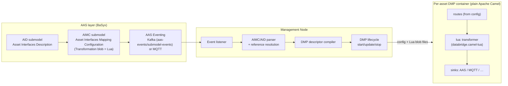
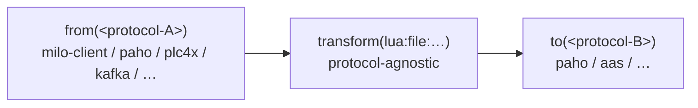
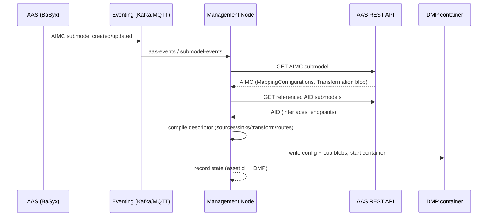

# aas-camel-dmp — Design Specification

> **Status:** Draft for implementation guidance
> **Date:** 2026-08-19
> **Applies to:** this repository, currently checked out as `aas-camel-k-dmp`, to be renamed **`aas-camel-dmp`**
> **Companion artifacts:** `databridge/routes.json`, `databridge/luatransformers.json` (planned), `databridge.camel-lua/` (planned), `management-node/` (planned)

---

## 1. Purpose & Scope

This document is the implementation guideline for reworking the current Eclipse BaSyx DataBridge fork into the **aas-camel-dmp**: a per-asset, deployable **DMP** (DataBridge MQTT Platform) container that

1. consumes data from industrial protocols (OPC UA, PLC, MQTT, Kafka, HTTP, …),
2. transforms incoming data **exclusively with Lua** in compliance with the **AIMC** transformation contract, and
3. writes transformed data to sinks (AAS submodel elements, MQTT topics, other protocols).

The DMP instances are **instantiated by a management node** that is triggered by **AAS eventing (Kafka or MQTT)** and parses the asset's **AID** and **AIMC** submodels to derive the DMP configuration, including the Lua transformation blobs.

Out of scope: the AAS server itself, the AAS registration service, ontology generation, and the knowledge graph — except where the management node interacts with them.

---

## 2. Terminology

| Term | Meaning |
|---|---|
| **AAS** | Asset Administration Shell (IEC 63278 / IDTA). |
| **AID** | **Asset Interfaces Description** submodel — describes each protocol interface of an asset (MQTT endpoints, OPC UA nodes, …) with `EndpointMetadata` and `InteractionMetadata`. |
| **AIMC** | **Asset Interfaces Mapping Configuration** submodel (IDTA `.../AssetInterfacesMappingConfiguration/2/0`) — describes how data is mapped asset→AAS or AAS→AAS: sources, sinks, and the Lua transformation. |
| **Transformation Blob** | The Lua script stored in an AIMC `MappingConfiguration.Transformation`. Must expose `function aimc_main(sources)`. |
| **DMP** | DataBridge MQTT Platform — the per-asset integration container (this project). |
| **Management node** | Orchestrator that reacts to AAS events, parses AID/AIMC, and instantiates/updates/removes DMPs. |

---

## 3. Background & Current State

- The current `aas-camel-k-dmp` is the **Eclipse BaSyx DataBridge** as a **plain Apache Camel 3.21.0 JVM application** (`DataBridgeExecutable` → `DefaultCamelContext` → `DataBridgeRouteBuilder`), **not** running on Camel K.
- **Planned baseline upgrade:** Camel **4.x** (latest, currently 4.22.x) with Java **17**, executed as milestone **M0.5** (see ADR-009) before the Lua module work.
- Routes are built at startup from JSON configs (`routes.json` + per-category config files, e.g. `jsonatatransformer.json`, `mqttconsumer.json`).
- Transformations today use **JSONata** (`databridge.camel-jsonata` → `jsonata:file:<path>`).
- **Problem 1 — expressiveness:** JSONata lacks sufficient mathematical operators for the required mappings.
- **Problem 2 — compliance:** the AIMC specification requires that **all transformations are Lua scripts** with an `aimc_main(sources)` entry point.
- The repo already ships a Kafka-based AAS eventing backbone (BaSyx `BASYX_FEATURE_KAFKA_ENABLED`, topics `aas-events` / `submodel-events`, consumed e.g. by `kg-bridge`) — the management node reuses this.

---

## 4. Goals / Non-Goals

### Goals
- G1. All transformations are Lua scripts conforming to the AIMC contract.
- G2. One deployable DMP container per asset, configured from AID + AIMC submodels.
- G3. A management node that reacts to AAS events and instantiates/updates/removes DMPs.
- G4. Runtime-loaded Lua scripts (blobs arrive at runtime via the AIMC submodel, not at build time).
- G5. Protocol bridging ("interface transforms") so a resource with only OPC UA can be decorated with an MQTT interface (and vice versa / any protocol pair).
- G6. A hardened Lua sandbox: module whitelist, CPU timeout, bounded memory.
- G7. A local harness + contract tests so blobs are verifiable before deployment.

### Non-goals
- NG1. Running the DMP on Camel K / Kubernetes (see ADR-002; **resolved at M5**: plain Apache Camel in Docker containers — no cluster fleet in scope).
- NG2. Replacing the AAS server or registration service.
- NG3. Guaranteeing hard per-script memory isolation inside the JVM (see §14.4).

---

## 5. High-Level Architecture



**Data flow:** A resource's AAS is described by an AID submodel (interfaces) and an AIMC submodel (mappings + Lua blob). An AAS event (new/updated AIMC) triggers the management node, which parses both submodels, compiles a DMP descriptor, and deploys a per-asset DMP container. The DMP consumes protocol data, transforms it with the Lua blob, and writes to sinks.

---

## 6. Driving Data Model: AID + AIMC

### 6.1 AID — Asset Interfaces Description

Defined by `aas_pydantic/submodel_templates/asset_interfaces_description.py`; instantiated in `AASDescriptions/Resource/configs/*.json` (e.g. `syntegonStoppering.json`).

Per interface (e.g. `interface_mqtt`):

- **`EndpointMetadata`**
  - `base` — protocol endpoint, e.g. `mqtt://192.168.0.104:1883/NN/Nybrovej/InnoLab/Stoppering`
  - `contentType` — e.g. `application/json`
  - `securityDefinitions`
- **`InteractionMetadata`** — describes data/actions on the interface:
  - `actions.<name>` with
    - `key`
    - `synchronous` (bool)
    - `forms[]` with `href`, `op`, and protocol-specific fields, e.g. MQTT: `mqv_retain`, `mqv_control_packet` (`subscribe`/`publish`), `mqv_qos`.

**Interpretation rule for the DMP:** every `InteractionMetadata` form that is addressable as a data point becomes a candidate **source** or **sink** endpoint. Protocol and addressing are fully derived from the AID; the DMP maps `href`/`base` + `mqv_*`/OPC-UA node identifiers onto Camel endpoint URIs (see §10).

### 6.2 AIMC — Asset Interfaces Mapping Configuration (v2.0)

Defined by `aas_pydantic/submodel_templates/asset_interfaces_mapping_configuration.py`.
Submodel semantic id: `https://admin-shell.io/idta/AssetInterfacesMappingConfiguration/2/0/Submodel`.

Structure:

```
AssetInterfacesMappingConfiguration
└── MappingConfigurations[] : MappingConfiguration
    ├── DefaultPollingInterval  (optional, xs:double, seconds; for synchronous sources)
    ├── Transformation          (Blob, content_type text/plain)  ← THE LUA SCRIPT
    ├── Sources[] : Source
    │   ├── Source              (Reference → SubmodelElement, incl. AID InteractionMetadata)
    │   ├── SourceId            (xs:string; key used inside the Lua `sources` table)
    │   └── PollingInterval     (optional; overrides DefaultPollingInterval)
    └── Sinks[] : Sink
        ├── Sink                (Reference → SubmodelElement, e.g. AAS submodel element)
        └── SinkId              (xs:string; key used in the Lua return table)
```

**Semantics (from the IDTA template):**

- *"The transformation allows for transforming incoming data before writing it to the sinks. The transformation must contain an `aimc_main(sources)` entrypoint function in Lua."*
- `SourceId` — *"unique and non-empty identifier that facilitates data access in the Lua transformation … unique with respect to the Sources-list."* → **`sources[SourceId]`**
- `SinkId` — *"unique and non-empty identifier that facilitates data writing in the Lua transformation"* → **return table keyed by `SinkId`**
- Sources/Sinks reference SubmodelElements, *"including those defined in the InteractionMetadata of AID Submodels for fetching live-data from assets."*
- *"The AIMC 2.0 is used to describe how data is mapped from asset to AAS or from AAS to AAS."*
- **Versioning (Q3):** always track the **latest AIMC** (currently **2.0**); refactor when a new version is released.

**This resolves the `sources` shape question:** `sources` is a **map keyed by `SourceId`**, and the return value is a **map keyed by `SinkId`** (JSON object both ways).

### 6.3 AIMC → DMP descriptor compilation

The management node compiles each `MappingConfiguration` into DMP config:

| AIMC element | DMP artifact |
|---|---|
| `MappingConfiguration` (one per logical mapping) | one entry in `routes.json` (or one route) |
| `Sources[].Source` + AID resolution | `datasource` endpoint (MQTT topic / OPC UA node / polling source) |
| `Sources[].SourceId` | the key under which the payload is placed in `sources` |
| `Transformation` (blob content — **only source**, Q2) | extracted by the management node from the AIMC submodel → written as a `.lua` file in the DMP's `queries/` (or mounted path) |
| `Sinks[].Sink` + AID resolution | `datasink` endpoint (AAS element write / MQTT publish / …) |
| `Sinks[].SinkId` | key in the returned object mapped to the sink |
| `DefaultPollingInterval` / `Source.PollingInterval` | polling/timer config for synchronous sources |
| `synchronous = false` (from AID) | event-driven route (MQTT/Kafka) |

---

## 7. Lua Transformation Blob Contract

### 7.1 Entry point

```lua
-- The ONLY required entry point:
function aimc_main(sources)
    local value_1 = sources["source1"]     -- keyed by SourceId
    local value_2 = sources["source2"]
    return {
        ["sink1"] = value_1 + value_2,      -- keyed by SinkId
        ["sink2"] = math.sqrt(value_1*value_1 + value_2*value_2)
    }
end
```

- **Input:** `sources` is a Lua table (map) keyed by `SourceId`; values are the JSON-decoded payloads.
- **Output:** the return value is a Lua table (map) keyed by `SinkId`; the host JSON-encodes it for the sinks.
- The host (not the blob) performs JSON ↔ table conversion; the blob never touches JSON.

### 7.2 Available environment (sandbox whitelist)

The blob runs with a **whitelisted global environment**:

| Available | Notes |
|---|---|
| `assert`, `error`, `ipairs`, `next`, `pairs`, `pcall`, `select`, `tonumber`, `tostring`, `type` | base functions |
| `math` | full math library (satisfies the math-operator requirement) |
| `table`, `string` | (keep `string` — the upstream Python example omits it, likely an oversight) |
| `json` (custom) | optional `json.decode` / `json.encode` for advanced use |
| `os.clock` (only) | minimal clock for the timeout hook |

**Explicitly excluded:** `os` (except `clock`), `io`, `require`/`dofile`/`loadfile`/`load`, `debug` (not exposed to blobs), **`luajava`** (JVM escape hatch — must never be loadable), `package`, coroutine (unless explicitly needed).

### 7.3 Hard guards

| Guard | Policy | Mechanism |
|---|---|---|
| **CPU timeout** | default 2 s of CPU per invocation, configurable | `debug.sethook` instruction-count hook + elapsed-CPU check → raise Lua error → route failure (never a hang). LuaJ is not interruptible mid-evaluation, so the hook is the primary mechanism; verify in the harness. |
| **Memory** | no per-script cap in LuaJ | bound the JVM heap (`-Xmx`) and rely on **per-asset process isolation**: a misbehaving blob can only OOM its own DMP. Document this tradeoff vs. lupa's `max_memory`. |
| **Script size** | enforce a max blob size (e.g. 1 MB) at load | fail fast at load time |
| **Contract validation** | `aimc_main` must exist; return must be a table | validated at load; clear log message otherwise |

### 7.4 Runtime loading & reload

- Scripts are read from a **file path at runtime** (`lua:file:/etc/dmp/transform.lua`).
- **Blob origin (Q2):** the Lua content comes **only** from the AIMC `MappingConfiguration.Transformation` Blob; the management node materializes it into the DMP file. No external/reference-based blobs.
- Default `contentCache=true` with **mtime/sha-based reload** — a dropped-in replacement (e.g. updated AIMC blob mounted via config map / volume) is picked up without restart.
- Load the script once, cache the compiled chunk, evaluate per message.

### 7.5 Thread safety

- LuaJ `Globals` are **not thread-safe**.
- Use **one `Globals` per exchange** (simplest) or a small pooled set of precompiled chunks.
- The CPU timeout prevents one slow blob from starving concurrent messages.

---

## 8. `databridge.camel-lua` Module (Component Spec)

New Maven module mirroring `databridge.camel-jsonata`.

### 8.1 Artifacts

- **Engine:** `org.luaj:luaj-jse:3.0.1` (pure Java, architecture-independent — works on `linux/amd64`, `arm64`, `arm/v7`; no JNI, no native image requirement for the interpreter path).
- **Note:** there is **no** `org.apache.camel:camel-lua` (never published to Maven Central) — this module **is** the Lua integration.

### 8.2 Classes

| Class | Responsibility |
|---|---|
| `LuaTransformerConfiguration` | mirrors `JsonataTransformerConfiguration`; `getConnectionURI()` → `lua:file:<path>?inputType=JsonString&outputType=JsonString` (+ options) |
| `LuaDefaultConfigurationFactory` | mirrors `JsonataDefaultConfigurationFactory`; default file `luatransformers.json` |
| `LuaComponent` / `LuaEndpoint` | Camel `lua:` scheme; parses URI options |
| `LuaProducer` (or `Processor`) | loads script (with reload), builds sandboxed globals, runs `aimc_main(sources)`, encodes return |
| `LuaSandbox` | whitelisted globals factory (§7.2) |
| `LuaTimeoutHook` | instruction-count + CPU-time hook (§7.3) |
| `LuaHarness` | CLI/unit runner: load blob → call `aimc_main` with sample `sources` → print result |

### 8.3 URI options

| Option | Default | Meaning |
|---|---|---|
| `inputType` | `JsonString` | `JsonString` (decode) or `JsonValue` (already parsed) |
| `outputType` | `JsonString` | `JsonString` (encode) or `JsonValue` |
| `timeoutSeconds` | `2` | CPU budget per invocation |
| `contentCache` | `true` | cache script; reload on mtime/sha change |
| `maxScriptBytes` | `1048576` | max blob size |
| `sourceKeys` | `body` | how to assemble `sources`: `body` → `{ ["body"]=payload }`, or comma list → `{ [key]=payload }` |

### 8.4 Contract test matrix (harness)

1. Load blob → assert `aimc_main` exists.
2. Call `aimc_main(sources)` with a sample map → assert returned map (this is the local harness; same blob file that runs in the DMP).
3. Infinite-loop blob → must time out (CPU hook).
4. Blob calling `os.execute` / `io` / `require` / `luajava` → must fail at load.
5. Blob returning a non-table → route failure with clear error.
6. Reload: modify blob file → next evaluation uses new code.

### 8.5 Config file

```json
// databridge/luatransformers.json
[
  {
    "uniqueId": "<asset>_<mapping>_transformer",
    "queryLanguage": "LUA",
    "queryPath": "queries/<asset>_<mapping>.lua",
    "inputType": "JsonString",
    "outputType": "JsonString"
  }
]
```

`routes.json` format stays unchanged; only the transformer references point at `LUA` transformers.

---

## 9. DMP Runtime & Deployment

### 9.1 Runtime: plain Apache Camel container (ADR-002)

- **Camel version:** **4.x** (Java 17) — baseline upgraded in M0.5 (ADR-009).
- **Decision (confirmed at M5):** deploy the DMP as a **plain Apache Camel JVM container** (as today via `databridge.component` → `eclipsebasyx/databridge`-style image), **not** Camel K.
- Rationale (see decision record §15):
  - Same engine, same protocol catalog, same per-message speed as Camel K.
  - Camel K's headline benefit (native image) is **blocked by LuaJ** (reflection) → JVM mode anyway.
  - Per-asset DMPs may run on edge/compose without a cluster; Camel K adds operator + cluster infra with no protocol/speed gain.
  - Camel K compiles routes at build time; our Lua blobs arrive **at runtime** — plain Camel reads all config/scripts at startup, strictly more flexible.
- **Portability:** `databridge.camel-lua` is a standard Camel component. The M5 gate (now resolved) confirmed plain containers, so no Camel K work is planned; if a cluster fleet ever materializes, the component would be reused unchanged (write YAML routes, ship jar as `-d mvn:` dependency).

### 9.2 One DMP per asset

- Each asset = one DMP container, isolated (process-level fault isolation).
- **Granularity (Q4 / ADR-012): 1 DMP container per asset hosting N `MappingConfigurations`** (multiple mappings per asset, one process).
- Config is provided at runtime via the existing mechanism: a config directory (`/usr/share/config` default) and/or environment variables (mirroring the current `JSONATA_ENV_VAR_NAME` pattern with a `LUA` equivalent).
- Lua blob files are placed/mounted into the DMP at runtime (from the management node or a mounted volume/config map).

### 9.3 JVM sizing

- Set `-Xmx` (e.g. 512 MB) per DMP; this is the effective per-blob memory bound (§7.3).
- No `--native` in this iteration.

---

## 10. Interface Transforms (Protocol Bridging)

### 10.1 Principle

**Normalize at the protocol boundary.** Every Camel protocol component adapts its native payload to/from **canonical JSON**; the Lua blob is a protocol-agnostic JSON→JSON function. `aimc_main(sources)` never changes; only the `from`/`to` endpoints change per interface.



### 10.2 Example: decorate an OPC UA-only resource with an MQTT interface

- **OPC UA → MQTT (state):**
  `from("opcua-client:tcp://<asset>:4840?node=<ns>…&monitor=true") → transform(lua:file:/etc/dmp/opc2mqtt.lua) → to("paho:aas/<asset>/<State>?brokerUrl=tcp://…")`
- **MQTT → OPC UA (commands):**
  `from("paho:aas/<asset>/cmd?brokerUrl=tcp://…") → transform(lua:file:/etc/dmp/mqtt2opc.lua) → to("opcua-client:tcp://<asset>:4840?node=<ns>…")`

Bidirectional = two routes, two blobs (one per direction) — maps cleanly to the single-`aimc_main` contract.

### 10.3 Protocol coverage

Any protocol with a Camel component is supported. The modules already present define the baseline: **OPC UA** (`milo-client`), **MQTT** (`paho`), **PLC** (`plc4x`: S7/Modbus/…), **Kafka**, **ActiveMQ/Hono (AMQP/JMS)**, **HTTP polling**, **SQL**, **timer**. Pattern is uniform: `from(A) → lua → to(B)`.

### 10.4 Two layers (keep distinct)

1. **Runtime data bridge** — the routes above (per message).
2. **AAS description/registration** — the resource's AAS must *advertise* the new interface (AID submodel updated, registration refreshed). This is a one-time modeling step driven by config, **not** per-message; the management node can trigger it alongside DMP instantiation.

### 10.5 Caveats

- Event (MQTT/Kafka) vs request/response (OPC UA/HTTP) semantics: expose reads via polling/timer, writes via reverse routes.
- Non-JSON/binary payloads (PLC4X structs, byte strings) canonicalize in the protocol binding (§10.6); Lua stays JSON-only.
- MQTT publish/retain semantics are **taken verbatim from the AID interface spec** (`mqv_retain`, `mqv_qos`, `mqv_control_packet`), not hardcoded (Q7).
- One OPC UA session + one MQTT client per DMP; fan-in many assets via a central broker (HiveMQ in the repo).

### 10.6 Canonical payload forms (per protocol)

The existing `databridge.camel-plc4x` / `databridge.camel-opcua` plugins define the **endpoint configuration schema** and endpoint URIs (PLC4X: driver/tags/options; OPC UA: node ids, publishing interval, security) — but **not** the runtime message body shape. That canonical JSON form handed to Lua is pinned here (ADR-007 — normalize at the boundary; Q5):

| Protocol | Camel component body | Canonical JSON value for `sources[SourceId]` |
|---|---|---|
| MQTT (paho) | `byte[]` / String | payload parsed as JSON; string if not JSON |
| OPC UA (milo-client) | `org.eclipse.milo.opcua.stack.core.types.builtin.DataValue` | `{ "nodeId": <id>, "value": <typed>, "status": <code>, "timestamp": <time> }` |
| PLC4X | `PlcReadResponse` | `{ "<tagName>": <value>, ... }` (tag name → value map) |
| HTTP / SQL | component-specific | documented per binding; Lua stays JSON-only |

These bindings live in the protocol adapters; blobs never see protocol types.

> **M4 note (camel-milo 4.22):** the milo-client consumer puts a raw Milo
> `DataValue` on the body (the `UaMonitoredItemValue` wrapper of older
> camel-milo versions no longer exists). `databridge.camel-opcua` therefore
> ships `OpcUaCanonicalConverter` — registered Camel type converters
> (`DataValue → String/Map`) that produce the canonical JSON form above and are
> auto-invoked when the Lua component reads the body — plus
> `OpcUaNormalizer` for the write direction (canonical `{ "value": … }` →
> Milo `Variant`, which the milo-client producer writes). Monitored items are
> enabled with `monitorFilterType=dataChangeFilter`. See
> `deploy/interface-transforms/` for the full bidirectional example.

---

## 11. Management / Orchestration Node

### 11.1 Trigger — AAS eventing (Kafka only, ADR-010)

- **Transport: Kafka only.** Reuse the existing BaSyx Kafka eventing backbone (`BASYX_FEATURE_KAFKA_ENABLED=true`, `SPRING_KAFKA_BOOTSTRAP_SERVERS`, topics matching `(aas-events|submodel-events)`).
- **Follow `kg-bridge` Kafka conventions** (`kg-bridge/main.py`): env vars `KAFKA_BOOTSTRAP`, `KAFKA_TOPIC_PATTERN` (default `(aas-events|submodel-events)`), `KAFKA_CONSUMER_GROUP`, `KAFKA_AUTO_OFFSET_RESET` (default `earliest`).
- The node subscribes with a consumer group, filters for **AIMC submodel create/update/delete** events (discriminator: submodel semantic id `…/AssetInterfacesMappingConfiguration/2/0/Submodel`) scoped to a resource AAS.
- **Note:** `kg-bridge` (Kafka → SPARQL ingestion) may be replaced by a route inside the DMP/management node; keep these Kafka conventions shared so either implementation can consume the same events.

### 11.2 Responsibilities

1. **Listen** for AAS events (Kafka/MQTT).
2. **Resolve** the affected AAS/submodel (registry/endpoint config).
3. **Fetch & parse** the AIMC submodel and referenced **AID** submodels (AAS REST API).
4. **Resolve references:** `Source`/`Sink` references → SubmodelElements, including AID `InteractionMetadata` forms → concrete protocol endpoints (MQTT topics, OPC UA nodes, polling config).
5. **Compile the DMP descriptor** (§6.3): datasources, lua transformers (blob content → files), datasinks, routes, polling.
6. **Materialize** the descriptor into the asset's DMP config directory, write the Lua blob files.
7. **Instantiate / update / decommission** the per-asset DMP container (docker/compose in iteration 1).
8. **Reconcile:** repeat events for the same asset are idempotent (keyed by asset id; single-flight per asset).
9. **Health/failure handling:** track DMP state, log, and on failure retry with backoff.

### 11.3 Event flow (sequence)



### 11.4 Data storage

- DMP config + Lua blobs: asset config volume/dir (source of truth = AAS submodels; config is derived state).
- Management-node registry: mapping `assetId → DMP instance state` — **in-memory** (Q6; acceptable at lab scale; externalize later if needed). Extend entries with `targetHost`, connection method, and container state for remote deployment (§11.5).

### 11.5 Remote / edge deployment (DMP on other machines)

Feasible: the DMP is a plain container and can run anywhere, including on the asset's edge device (preferred — DMP colocated with the OPC-UA/PLC source gives lower latency and independence from the central network). Mechanisms, in order of fit with ADR-002:

1. **Docker Engine API over SSH/TLS (recommended, lab scale).** Management node controls each edge's Docker daemon remotely (Java: `docker-java` over SSH or TLS), delivering image + config + Lua blobs, then create/start/stop/remove the DMP container. Requires edge reachability from the management node.
2. **Compose-over-SSH.** Ship a compose file + config dir to the edge and run `docker compose up -d` over SSH. Simplest; reuses existing compose artifacts; more brittle orchestration.
3. **Pull-based edge agent (for NAT'd / edge-unreachable devices).** A tiny agent per edge subscribes to **Kafka** deploy commands (reuses ADR-010 Kafka-only eventing) and applies the DMP locally (Docker, or systemd for the plain JVM jar). Use when the management node cannot initiate connections to the edge.
4. **K3s / KubeEdge (fleet scale, out of scope).** Scheduling/rolling updates across many edges are not current requirements — the **M5 gate resolved against it** (plain Docker containers confirmed). If a fleet ever materializes, revisit; Camel K would still run JVM mode due to LuaJ.

Considerations (all mechanisms):
- Runtime config + Lua blobs are delivered to the edge before container start; blobs remain runtime data (Q2).
- **Security:** a remotely exposed Docker daemon is effectively root — use TLS client certs or SSH keys per edge; store edge credentials in the management node config/secret.
- Registry access from the edge: private registry pull, or ship the image via `docker save` / `load`.
- Extend the in-memory registry (§11.4) with `targetHost` + connection method.

---

## 12. Performance Notes

- Per-message cost is dominated by **MQTT/OPC UA I/O + the LuaJ transform + JSON conversion + the HTTP round-trip to the AAS server** (milliseconds on LAN). The transform itself is tens-to-hundreds of µs for typical blobs.
- **LuaJ vs JSONata:** JSONata4Java compiles to Java bytecode and caches it; LuaJ is an interpreter. On CPU-heavy scripts, compiled JSONata can be faster (2–5× on tight loops). At per-asset event rates (1–100 Hz) this is irrelevant end-to-end. This switch is for **compliance + math expressiveness**, not speed.
- Optional speedups if ever needed: LuaJC bytecode compilation (validate blobs), avoid double JSON round-trip, pool globals, JIT Lua via GraalVM Truffle (heavy, native-incompatible — last resort).
- **Benchmark requirement:** before accepting a blob or a throughput claim, measure with the harness (msg/s, p50/p95) against a mock sink; do not guess.

---

## 13. Security Model

- **Trust boundary:** Lua blobs are third-party/per-asset code extracted from AAS submodels → treated as untrusted.
- Sandbox whitelist (§7.2), CPU timeout (§7.3), script size cap, JVM heap bound + per-asset process isolation.
- No `luajava`; no `os`/`io`/`require`/`dofile`/`loadfile`.
- Blob content is validated at load time (contract) and every evaluation is guarded (timeout).
- If blobs are ever authored by parties outside the lab, consider signing/AIMC provenance checks (future).

---

## 14. Key Learnings from the Upstream Python Prototype

The primitive reference implementation (Python/lupa) is effectively a spec + harness prototype. Adopted lessons:

1. `sources` / return are **maps** — confirmed by the AIMC 2.0 template (`SourceId` / `SinkId`).
2. JSON lives in the **host**, not the blob.
3. **Whitelist** globals; strip `os`/`io`/`require` (in Java also `luajava`).
4. **CPU timeout** via `debug.sethook`-style instruction counting (lupa's `os.clock` hook ↔ LuaJ `DebugLib` count hook).
5. **Memory cap:** lupa has `max_memory`; LuaJ does not → JVM heap + process isolation (documented tradeoff).
6. Keep `string` in the whitelist (their example omits it).
7. Load once, call many times; harness = contract tests.

---

## 15. Design Decision Record

| ID | Decision | Rationale |
|---|---|---|
| ADR-001 | Lua engine = **LuaJ** (`org.luaj:luaj-jse:3.0.1`) | Pure Java, arch-independent, on Maven Central; **no** `camel-lua` exists anywhere (never published). |
| ADR-002 | DMP deployment = **plain Apache Camel container** (Docker); Camel K rejected | Same engine/protocols/speed; native blocked by LuaJ; no cluster needed for per-asset/compose; scripts arrive at runtime (Camel K compiles at build time). **Resolved at M5 (2026-08): no cluster fleet — plain containers only.** |
| ADR-003 | `sources` = map keyed by `SourceId`; return = map keyed by `SinkId` (JSON object both ways) | Mandated by AIMC 2.0 template semantics. |
| ADR-004 | JSON handled by host; blobs are table-in/table-out | Keeps blobs simple; matches reference prototype. |
| ADR-005 | Sandbox + CPU timeout + JVM-level memory bound | Blobs are untrusted, per-asset code. |
| ADR-006 | Scripts loaded at runtime from files, cached with reload | AIMC blobs arrive at runtime; per-asset iteration without rebuild. |
| ADR-007 | Normalize at protocol boundary; Lua is protocol-agnostic | Enables interface transforms for any protocol pair with one transform contract. |
| ADR-008 | One DMP per asset (process isolation) | A bad blob/connection can only take down its own asset; aligns with event-driven instantiation. |
| ADR-009 | Camel baseline upgrade: **3.21 → latest 4.x** (4.22.x), Java 11 → **17** | 3.x is EOL; every Camel component used by this repo exists in 4.x (verified: paho, jms, activemq, http, jsonata, jackson, kafka, milo, plc4x, sql, support); Hono module uses Eclipse Hono client libs directly (unaffected); aligns with Camel 4.x (the M5 gate later confirmed plain containers, not Camel K); build `databridge.camel-lua` against the final version, not 3.x. |
| ADR-010 | Management-node eventing = **Kafka only**, following `kg-bridge` conventions (`KAFKA_BOOTSTRAP`, `KAFKA_TOPIC_PATTERN`, `KAFKA_CONSUMER_GROUP`, `KAFKA_AUTO_OFFSET_RESET`) | Q1; reuse existing BaSyx Kafka backbone; `kg-bridge` may be replaced by a DMP route later — keep conventions shared. |
| ADR-011 | Transformation blob is pulled **only** from the AIMC `MappingConfiguration.Transformation` Blob | Q2; single source of truth per the IDTA template; no external blob references. |
| ADR-012 | **1 DMP container per asset, N `MappingConfigurations` inside** | Q4; asset-level isolation with multiple mappings per asset in one process. |
| ADR-013 | Management node implemented in **Python** (not Java/Camel) | The management node is orchestrator glue, not a data plane — no Camel routing needed. Python is the easiest choice: the AID/AIMC pydantic models already exist in Python (`aas_pydantic` + `Registration_Service` templates); `kg-bridge` (the Kafka-convention reference, ADR-010) is Python; `docker` SDK covers container lifecycle. Boundary stays clean: Python orchestrator compiles `routes.json`/`luatransformers.json`/`.lua` blobs → starts the Java DMP container. Java is reserved for the DMP data plane. |

---

## 16. Resolved Decisions (formerly Open Questions)

1. **Eventing transport — Kafka only (ADR-010).** No MQTT eventing. Follow `kg-bridge` Kafka conventions (§11.1). Note: `kg-bridge` may be replaced by a route in the DMP.
2. **Transformation blob — only source, pulled from the AIMC submodel** per the IDTA template (`MappingConfiguration.Transformation` Blob). No external references.
3. **AIMC version — always latest** (currently **2.0**); refactor on new releases.
4. **Granularity — 1 DMP, N mappings (ADR-012).** One DMP container per asset hosts N `MappingConfigurations`.
5. **Canonical payload forms — partially predefined.** The existing `databridge.camel-plc4x` / `camel-opcua` plugins define endpoint **configuration** schemas and URIs only; runtime canonical JSON forms are pinned in §10.6.
6. **DMP state registry — in-memory** at the management node (lab scale; externalize later if needed).
7. **MQTT publish/retain semantics — strictly follow the AID interface spec** (`mqv_retain`, `mqv_qos`, `mqv_control_packet`, `synchronous` as declared in the AID `InteractionMetadata`).
8. **Management-node language — Python (ADR-013).** Orchestrator glue only; Java/Camel stays with the DMP data plane. Reuses the existing Python AID/AIMC pydantic models and `kg-bridge` Kafka conventions.
9. **Deployment — plain Apache Camel in Docker containers (ADR-002; M5 gate resolved 2026-08).** No Camel K / Kubernetes: per-asset DMPs run as plain JVM containers via Docker/compose (the management node drives `docker run`, §11.5 mechanism 1/2); `databridge.camel-lua` stays a standard Camel component, reusable unchanged if a cluster fleet ever appears.

---

## 17. Implementation Milestones

| Milestone | Deliverable | Exit criteria |
|---|---|---|
| **M0** | Rename repo `aas-camel-k-dmp` → `aas-camel-dmp` | README/module refs updated; spec carried over |
| **M0.5** | Camel **4.x** baseline upgrade | Parent `camel.version` → latest 4.x (4.22.x); Java 17 everywhere (incl. modules still pinned to 1.8); fix `databridge.core` repackaged imports (`DefaultCamelContext`, health classes); verify every `databridge.camel-*` module + IT suite on 4.x; update Docker JRE base image. Exit: full build + regression tests green on 4.x/Java 17 |
| **M1** | `databridge.camel-lua` + harness + contract tests | Test matrix §8.4 green; blob runs in the Camel 4.x app (AIMC-compliant immediately) |
| **M2** | DMP container integration | `luatransformers.json`, env-var config (LUA equivalent of `JSONATA_ENV_VAR`), runtime mount of blobs, `-Xmx`, reload verified |
| **M3** | Management node | Subscribes to AAS events; parses AID+AIMC; compiles descriptor; instantiates/updates/stops per-asset DMPs; idempotent reconcile |
| **M4** | Interface transforms | OPC UA-only resource decorated with MQTT interface (both directions); pattern reusable for other protocol pairs |
| **M5** | Decision gate: plain containers vs Camel K | **Resolved (2026-08): plain Apache Camel in Docker containers only** — no cluster fleet in scope; Camel K rejected; Lua component reused unchanged |
| **M6** | End-to-end live-data integration run | Simulated stopper station → MQTT → DMP → Lua → AAS Variables submodel verified live (PackMLState tracks IDLE/EXECUTE); broker override (`DMP_MQTT_BROKER`), BaSyx base64url addressing, per-sink `valuePath` |
| **M7** | REST operation-delegation endpoints | Extended AIMC = **two plain directional MappingConfigurations** per skill (request: REST→MQTT; response: MQTT→REST). DMP exposes `/health` + `/operations/**` on ONE camel-rest (jetty) surface; `OperationRouteCreator` builds operation routes (REST datasource, MQTT command sink, request/response Lua transformers); `MqttRequestReplyBridge` does Uuid-correlated MQTT request/reply (timeout→504, error→500). Verified live: `POST /operations/.../Halt` → `/CMD/Halt` → station reply on `/DATA/Halt` → correlated 200 in ~0.4 s |

---

## 18. References

- `README.md` (this repo) — BaSyx DataBridge origins
- `databridge/routes.json`, `databridge/jsonatatransformer.json`, `databridge/queries/*.jsonata` — current config format
- `databridge.camel-jsonata/` — module to mirror for `databridge.camel-lua`
- `databridge.component/…/DataBridgeExecutable.java`, `RoutesConfigurationLoader.java` — runtime entry points
- `databridge.core/…/EventRouteCreator.java`, `DataBridgeComponent.java` — route construction
- `Registration_Service/third_party/aas_pydantic/aas_pydantic/submodel_templates/asset_interfaces_mapping_configuration.py` — AIMC 2.0 template (verbatim contract)
- `Registration_Service/third_party/aas_pydantic/aas_pydantic/submodel_templates/asset_interfaces_description.py` — AID template
- `AASDescriptions/Resource/configs/*.json` — AID/AIMC instantiations (e.g. `syntegonStoppering.json`)
- `compose/docker-compose.basyx.yml`, `compose/docker-compose.kg.yml` — Kafka eventing backbone
- Upstream reference: Python/lupa AIMC transformation prototype (source of the sandbox/timeout/memory lessons)

---

## 19. Licensing, Attribution & Publication

Verified licenses of upstream material used in this project:

| Upstream | License | Obligation |
|---|---|---|
| Eclipse BaSyx DataBridge (fork origin, `eclipse-basyx/basyx-databridge`) | **MIT** (per-file headers `SPDX-License-Identifier: MIT` + "Copyright (C) … the Eclipse BaSyx Authors"; parent pom declares MIT) | retain copyright notices + MIT permission text in derived files; keep `LICENSE` |
| `aas_pydantic` (`SebBehrendt/aas_pydantic`, submodel template models) | **MIT** (© 2024 Sebastian Behrendt) | retain notice |
| IDTA submodel templates (`admin-shell-io/submodel-templates`, basis of AIMC/AID semantics) | **CC BY 4.0** (`LICENSE.txt`) | attribute creator, **indicate modifications**, link to CC BY 4.0; no-endorsement clause |

Required actions:
- Do **not** strip the MIT headers ("Copyright (C) … the Eclipse BaSyx Authors", SPDX MIT) from derived files.
- Keep `LICENSE` (MIT); keep the fork **MIT overall** (derived portions must remain MIT; simplest is one MIT license for the whole repo).
- Add provenance to `README`/`NOTICE`: fork origin URL + date/commit + list of modifications; template attributions (IDTA CC BY 4.0, aas_pydantic MIT).
- Publishing artifacts (jars/images): license text must travel (`LICENSE`/`NOTICE` in the image).

For the scientific paper:
- Cite upstreams, not just the fork: Eclipse BaSyx / BaSyx DataBridge; IDTA AIMC 2.0 + AID templates (cite semantic IDs and versions); aas_pydantic; key dependencies (Apache Camel, LuaJ, Milo, PLC4X, JSONata4Java).
- State the delta explicitly: "built on a fork of X, with modifications A/B/C"; be honest about contribution vs. upstream capability.
- Companion artifacts carry headers + NOTICE and state the license of new code.
- Follow institution/funder publication & code-release policies.

Ethics beyond legal:
- Trademark care: label as a derivative, not an official Eclipse/BaSyx component (no implied endorsement).
- Consider contributing generic parts upstream (e.g. `databridge.camel-lua`) — good community citizenship and strengthens the paper.
- This is general guidance, not legal advice; confirm with institutional/legal review before publication.
