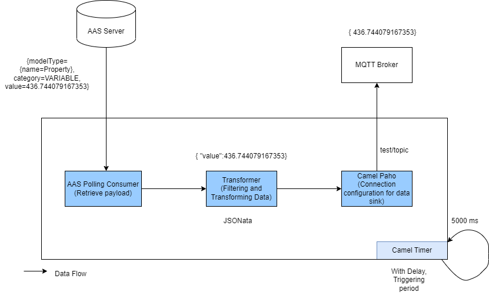
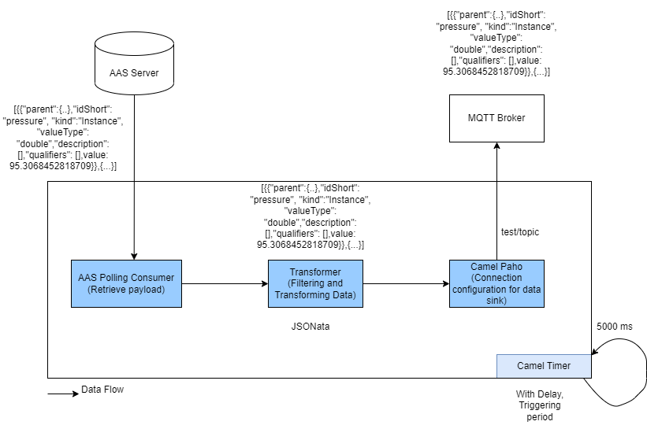

## AAS Polling Consumer to MQTT with Lua

- **AAS Polling Consumer** consumes data from AAS and sends typed values to an MQTT broker through Lua transformations.

- There are two types use case based on `aaspollingdatasource.json` configuration
  - With properties (Such as `pressure`, `rotation`)
  - Without properties
 

- With idShortPath's basic workflow

- Blank idShortPath's basic workflow

